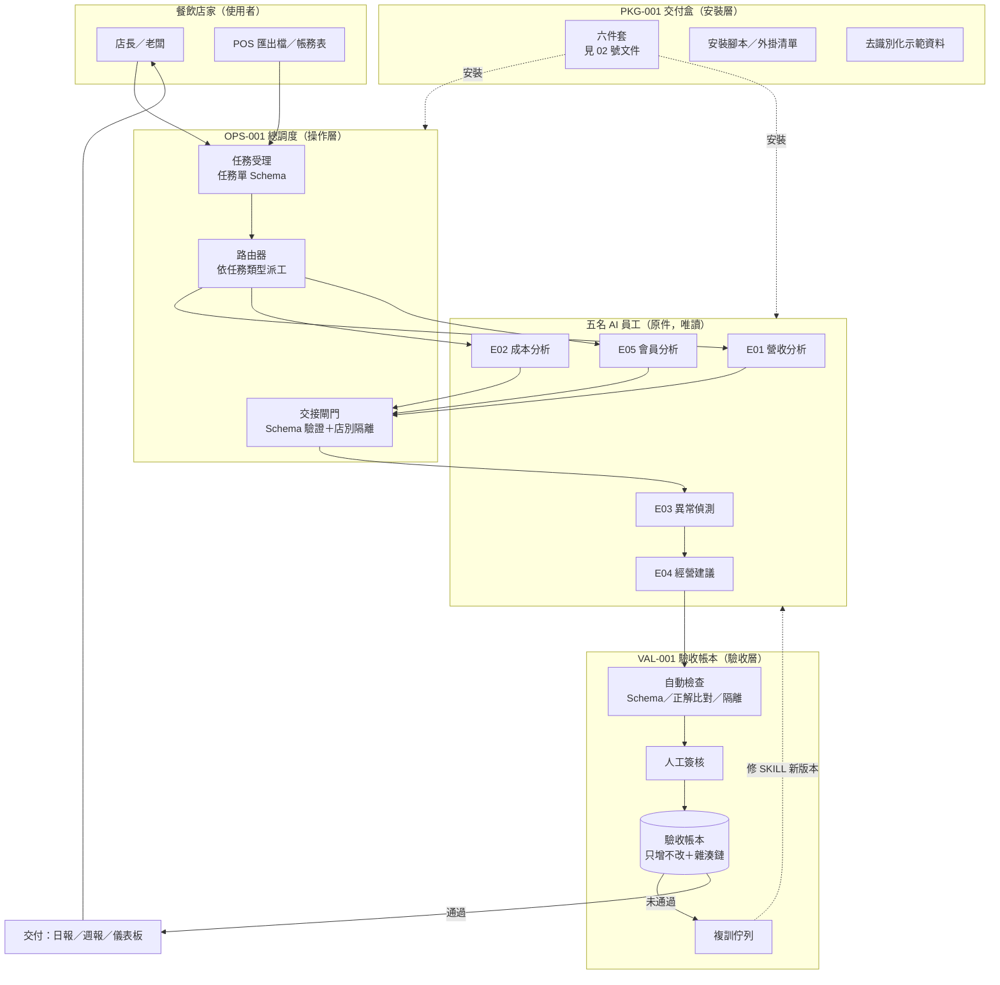

# 01｜商品整體架構圖（G1 草案）

> **狀態：草案。** E01–E05 為 AI-CORE-013 的暫定代號，正式名稱、輸入、輸出待 SKILL.md 原件（缺件 A2）。
> 本圖只畫結構，不代表任何員工已通過商品化驗收。

## 1. 一句話定位

把既有五名餐飲 AI 員工，加上「交付盒（PKG）＋總調度（OPS）＋驗收帳本（VAL）」三層外殼，變成一套**可安裝、可操作、可驗收、可複製、可複訓**的商品。不新增員工，不改員工本體。

## 2. 架構圖

## 3. 三層職責

| 層 | 來源規劃 | 負責 | 不負責 |
|---|---|---|---|
| 安裝層 | PKG-001 | 讓新店家在 30 分鐘內裝好、跑出第一份示範報告 | 不改員工邏輯 |
| 操作層 | OPS-001 | 一張任務單進來，決定誰做、誰先、誰接手；交接時檢查格式與店別 | 不做分析本身 |
| 驗收層 | VAL-001 | 每份成果都留一筆可追溯紀錄，判定通過或退回 | 不改已封存證據 |

## 4. 兩個交付版本共用同一套核心

| 元件 | A｜Claude 外掛版 | B｜雲端版 |
|---|---|---|
| 五名員工 | 原 SKILL.md 直接打包進外掛 | 同一份 SKILL.md，以 API 系統提示載入 |
| 總調度 | 外掛內的指令＋子代理 | 後端工作佇列 |
| 驗收帳本 | 店家本機 CSV／JSONL | 雲端資料庫 |
| 執行模型費用 | 計入店家自己的 Claude 方案 | 由我方 API 帳號支付，轉嫁到月費 |

**原則：** 兩版只差「外殼」，員工本體同一份、同一個雜湊值，避免分叉成兩套產品。
