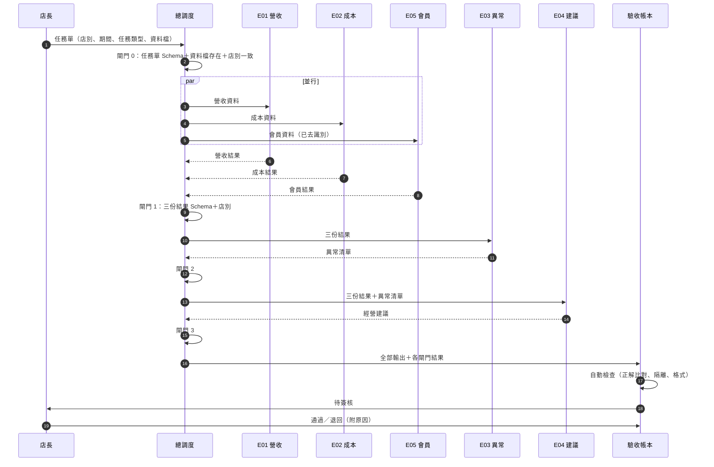

# 03｜五名 AI 員工總調度流程（G1 草案）

> **狀態：草案。** OPS-001 原文未取得（缺件 P2）。員工輸入、輸出欄位待 SKILL.md 與 Schema 原件（缺件 A2、A3）。
> 下列「依賴關係」是依暫定職能推導的設計假設，需以原件驗證。

## 1. 調度原則

1. **一張任務單一個店別。** 任務單必帶 `store_id`（去識別代號），任何員工不得讀取其他店別資料。
2. **先資料、後判斷、再建議。** 營收／成本／會員分析可並行；異常偵測要吃前三者結果；經營建議最後產出。
3. **每次交接都過閘門。** 上游輸出必須通過 Schema 驗證與店別比對，才能交給下游。
4. **調度不分析。** 總調度只派工、檢查、記錄，不改寫任何員工輸出。
5. **人工簽核是最後一關。** AI 驗收通過後仍需店長或我方驗收員簽核，才算交付。

## 2. 流程圖

## 3. 任務類型與派工表

| 任務類型 | 觸發 | 派工 | 預期產出 |
|---|---|---|---|
| T1 日報 | 每日關帳後 | E01 → E03 → E04 | 當日營收、異常、一句建議 |
| T2 週報 | 每週一 | E01＋E02＋E05 → E03 → E04 | 週營收、成本率、會員回流、異常、三項建議 |
| T3 單項查詢 | 店長臨時問 | 只派對應員工 | 單一員工輸出 |
| T4 異常追查 | E03 發出高風險異常 | E03 → 相關分析員工重跑 → E04 | 追查報告 |

## 4. 閘門規則

| 閘門 | 檢查 | 失敗處理 |
|---|---|---|
| 0 受理 | 任務單 Schema；資料檔存在；檔內店別＝任務單店別 | 退回店長，不派工 |
| 1–3 交接 | 輸出通過該員工 Schema；輸出內店別＝任務店別；沒有出現其他店別代號 | 同一員工自動重試 1 次；仍失敗則停在此閘門，記錄 `GATE_FAIL`，不往下游傳 |
| 驗收 | 見 04 號帳本 | 退回並進複訓佇列 |

## 5. 例外處理

| 狀況 | 處理 |
|---|---|
| 資料缺某一類（例如沒有會員資料） | 跳過對應員工，E03／E04 收到「缺資料」標記，報告中明示 |
| 員工逾時 | 記錄 `TIMEOUT`，不以猜測值補上 |
| 下游發現上游數字矛盾 | 停止並回報，不自行修正上游數字 |
| 任一閘門發現跨店資料 | 立即中止整張任務單，記錄 `ISOLATION_BREACH`，人工處理 |

## 6. A／B 版實作對照

| 元件 | A 外掛版 | B 雲端版 |
|---|---|---|
| 任務受理 | 斜線指令（例如 `/日報`） | 網頁表單或排程 |
| 並行派工 | 子代理 | 工作佇列 worker |
| 閘門 | 外掛 hook 呼叫 Schema 驗證腳本 | 後端驗證函式 |
| 帳本寫入 | 本機 JSONL | 資料庫 |
