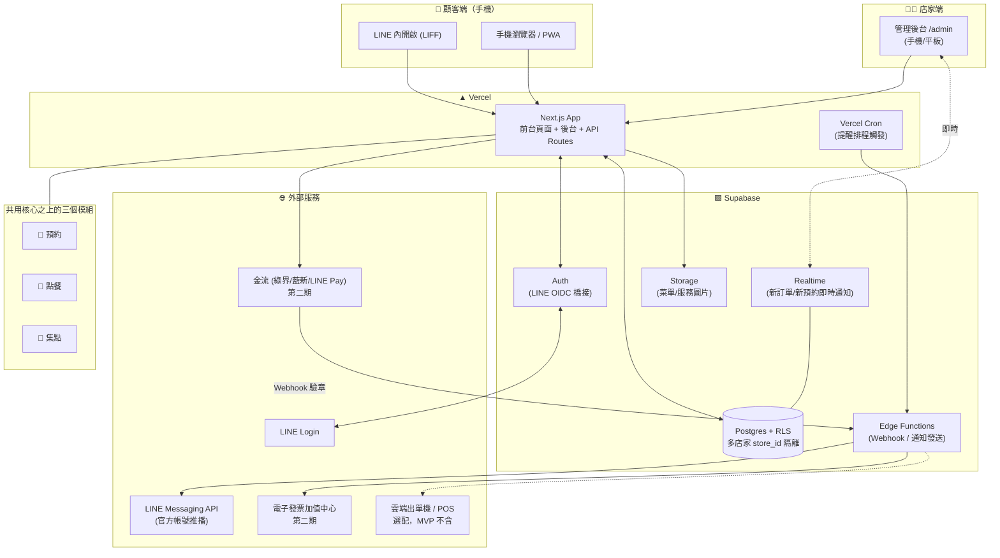

# AI-CORE-014｜小店 AI 系統技術驗證報告（A 爐・第一階段：只研究，不部署）

- 主責：Claude Code（CC）
- 報告日期：2026-11-15
- 狀態：**待 GPT 五角大廈審查 → 總指揮核准**
- 執行聲明：本階段**未**購買任何服務、**未**建立付費資源、**未**部署網站、**未**使用任何真實客戶個資、**未**啟動產品開發。

> ⚠️ 價格說明：文中第三方價格為依公開資訊整理的**估計區間**（匯率以 1 USD ≈ 32 TWD 計），各平台方案會調整，**正式採購前必須逐項向官網／業務確認**。標示「🔍待驗」者列入 7 天驗證計畫。

---

## 0. 結論摘要（給總指揮的 30 秒版）

1. **技術可行**：Next.js + Supabase + Vercel 足以支撐三套手機版小店系統，Claude Code 可大幅壓縮開發工時（估計可省 40–60% 純編碼時間），但**金流、LINE 推播、資安與維運**無法靠 AI 省略，需人工把關。
2. **三套可共用**：會員、店家（多租戶）、資料庫、LINE 登入、管理後台外框、通知模組均可共用，建議先做「共用核心」再掛三個模組。
3. **難度排序**：會員集點（易）＜ 預約系統（中）＜ 線上點餐（難，涉及金流、電子發票、出單、POS）。
4. **第一個最值得開發：📅 預約系統（含 LINE 提醒）**。理由：不碰金流即可上線、痛點明確（爽約／電話接不完）、與 LINE 生態契合、可自然延伸到集點。詳見第 9 節。
5. **成本**：Demo 階段平台費可為 **NT$0**；正式商用平台費約 **NT$1,800–4,500／月／單一部署**（不含人力維護）。

---

## 1. 技術組合評估：React／Next.js、Supabase、Vercel

| 元件 | 角色 | 優點 | 限制／風險 | 評分 |
|---|---|---|---|---|
| **Next.js（App Router, React）** | 前台手機網頁 + 管理後台 + API（Route Handlers / Server Actions） | 一套程式涵蓋前後端；SSR 利於 SEO（店家頁）；生態最大，Claude Code 熟悉度最高；可做 PWA（加到主畫面） | 版本更新快（大版本常有破壞性變更）；Server/Client Component 邊界需紀律 | ★★★★★ |
| **Supabase** | Postgres 資料庫、Auth、Row Level Security、Storage、Realtime、Edge Functions、排程（pg_cron） | 標準 Postgres，資料可攜、不被綁死；RLS 天然適合多店家隔離；Realtime 可做廚房即時單 | Free 方案**閒置 7 天會暫停、無自動備份**，只適合 Demo；**無內建 LINE Login provider**（需自建 OIDC 橋接，🔍待驗）；RLS 寫錯 = 資料外洩 | ★★★★☆ |
| **Vercel** | 部署、CDN、Preview 環境、Cron | Git push 即部署；每個分支自動預覽網址，適合給審查方看 Demo | **Hobby 免費方案條款禁止商業用途**，正式商用必須 Pro（US$20/人/月）；Serverless 函式有執行時間上限，長任務需丟給 Supabase/排程 | ★★★★☆ |

**判定**：組合可行，且為目前「小團隊 + AI 輔助開發」CP 值最高的組合之一。
**替代方案備註**：若未來想壓低平台費，Next.js 可改部署 Cloudflare Pages／自架 VPS；Supabase 可自架（但維運成本轉嫁到人力），**不建議在 MVP 階段自架**。

---

## 2. 三套系統開發難度與預估工時

工時假設：1 名具基本工程判斷的操作者 + Claude Code 輔助；含測試與修正，不含設計稿、文案、店家訪談。

| 項目 | 共用核心 | 📅 預約系統 | 🍱 線上點餐 | 🎁 會員集點 |
|---|---|---|---|---|
| 核心難點 | 多租戶 RLS、LINE 登入橋接、權限角色 | 時段計算、防重複預約（併發鎖）、服務人員排班、提醒排程 | 購物車、品項選項（加料/甜度）、**金流 + Webhook 驗證**、**電子發票**、即時接單/出單 | 防作弊（QR 重放）、點數規則、兌換核銷 |
| 技術難度 | 中 | 中 | **高** | 低～中 |
| 外部依賴 | LINE Login | LINE Messaging API | 金流商、電子發票、（選配）出單機、POS | LINE（選配） |
| MVP 工時（AI 輔助） | 30–40 h | 40–60 h | 80–120 h | 25–40 h |
| 傳統純手寫參考 | 60–80 h | 90–130 h | 180–260 h | 60–90 h |
| Demo（假資料、無金流） | 含在各模組 | **3–4 天** | 5–7 天（金流用 Sandbox） | **2–3 天** |
| 上線前額外工作 | — | 店家設定精靈、取消/改期規則 | 金流商審核（1–3 週）、發票字軌申請、退款流程 | 規則設定介面 |

**共用核心 + 三模組合計 MVP**：約 175–260 小時（AI 輔助），分期交付。

---

## 3. 共用會員、資料庫、管理後台可行性

**結論：可以，且強烈建議共用。** 採「一個平台、多店家（tenant）、多模組開關」架構。

| 共用層 | 共用方式 | 備註 |
|---|---|---|
| 會員（顧客） | 一張 `customers` 表，以 LINE userId 為主識別；`store_customers` 記錄「某顧客在某店」的關係與同意紀錄 | 同一顧客跨店不互通個資（店家只看得到自己店的關係資料） |
| 店家／員工 | `stores`、`staff_members`（角色：owner / manager / staff） | 權限以 RLS + 角色檢查雙重控管 |
| 資料庫 | 同一個 Supabase 專案；所有業務表帶 `store_id`，RLS 一律以 `store_id` 過濾 | 正式版可依客戶規模改「一店一專案」 |
| 管理後台 | 同一個 Next.js `/admin`，左側選單依店家開通的模組顯示 | 一次登入管理預約、訂單、點數 |
| 通知 | 共用 `notifications` 佇列 + 發送器（LINE / Email / SMS） | 預約提醒、取餐通知、點數到帳共用 |
| 跨模組加值 | 預約完成 → 自動集點；點餐滿額 → 自動集點 | 這是「自建」相對於拼裝多套 SaaS 的最大優勢 |

**核心資料模型（草案）**

```
stores ─┬─ staff_members
        ├─ store_customers ── customers (line_user_id, phone?, consent_at)
        ├─ [預約] services / resources / business_hours / bookings
        ├─ [點餐] menu_categories / menu_items / item_options / orders / order_items / payments
        ├─ [集點] loyalty_rules / point_ledger（只增不改的流水帳）/ rewards / redemptions
        └─ notifications / audit_logs
```

---

## 4. LINE 登入、通知、金流、POS 串接技術限制

### 4.1 LINE 登入（LINE Login / LIFF）
| 項目 | 說明 |
|---|---|
| 可行性 | ✅ 可行。LINE Login 為 OIDC 標準，LIFF 可讓網頁在 LINE 內開啟並取得使用者身分 |
| 限制 1 | Supabase Auth **無內建 LINE provider**。做法：LIFF 取 ID Token → 後端向 LINE 驗證 → 以 Supabase Admin API 建立/對應使用者並簽發 session。🔍待驗（第 2 天） |
| 限制 2 | 若要「登入後可推播」，LINE Login channel 與 Messaging API channel 必須在**同一個 Provider** 下，userId 才一致；並需引導用戶加入官方帳號好友（Add friend option） |
| 限制 3 | LIFF 在 LINE 外部瀏覽器行為不同；iOS/Android 內嵌瀏覽器需實機測試 |
| 限制 4 | 拿不到手機號碼（LINE 不提供）；若店家需要電話，需另行請顧客填寫並取得同意 |

### 4.2 通知
| 管道 | 狀態與限制 |
|---|---|
| **LINE Notify** | ❌ **已於 2025-03-31 終止服務，不可採用**（常見舊教學仍在用，需避開） |
| LINE Messaging API（官方帳號） | ✅ 主力。**Reply 訊息免費；Push 訊息計入方案則數**。台灣方案大致為：輕用量免費（約 200 則/月）、中用量約 NT$800（約 3,000 則）、高用量約 NT$1,200（約 6,000 則，可加購）🔍待驗。預約提醒每筆約 1–2 則，需估算店家量 |
| Email（Resend / SES） | 免費額度足夠 Demo；台灣小店顧客開信率低，作為備援 |
| SMS（三竹、Every8D 等） | 約 NT$0.7–1.2／則，適合 OTP 或爽約高風險提醒；需企業帳號 |
| Web Push（PWA） | iOS 需加到主畫面才可收，對小店顧客門檻高，不作主力 |

### 4.3 金流
| 項目 | 說明 |
|---|---|
| 候選 | 綠界 ECPay、藍新 NewebPay、TapPay、LINE Pay、街口支付 |
| 手續費 | 信用卡約 2.4–3.0%／筆；LINE Pay、街口約 2.5–3.5%（依合約）🔍待驗 |
| 限制 1 | **正式收款需商家審核**（多數需公司/行號登記；部分接受個人賣家但額度受限），審核 1–3 週 |
| 限制 2 | 付款結果靠**伺服器端 Webhook**（如 ECPay 的 ReturnURL + CheckMacValue 驗章），必須有公開 HTTPS 網址；Sandbox 測試可用，但仍需一個可被呼叫的網址（驗證時用 Vercel Preview，需總指揮同意） |
| 限制 3 | **電子發票**：台灣 B2C 開立義務由店家負擔，需串接加值中心（綠界、藍新等有提供），另有作廢/折讓流程 |
| 限制 4 | 平台若「代收代付」多家店款項，涉及第三方支付法規；**建議每家店用自己的金流帳號**，平台不碰錢 |
| 建議 | 點餐 MVP 先做「到店付款／取餐付款」，金流列為第二期 |

### 4.4 POS 串接
| 項目 | 說明 |
|---|---|
| 現況 | 台灣主流餐飲 POS（iCHEF、肚肚 Dudoo、Waca 等）**多數未提供公開 API**，需走合作夥伴申請，時程與費用不可控 🔍待驗 |
| 可行替代 | ① 不串 POS，訂單在自建後台 + 平板接單；② 雲端出單機（Epson ePOS / Star CloudPRNT）直接列印廚房單；③ 只做每日 CSV 匯出給店家對帳 |
| 建議 | **MVP 不承諾 POS 串接**，在提案中明確排除，避免成為無底洞 |

---

## 5. 資料安全、權限、備份、維護風險

| # | 風險 | 等級 | 情境 | 對策 |
|---|---|---|---|---|
| S1 | RLS 規則錯誤導致跨店資料外洩 | 🔴 高 | A 店看到 B 店顧客名單 | 所有表強制開 RLS；以自動化測試逐表驗證「別店身分查不到」；CI 擋未開 RLS 的表 |
| S2 | Service Role Key 外洩 | 🔴 高 | 金鑰被打包進前端 | 金鑰只放伺服器環境變數；前端只用 anon key；啟用 secret scanning |
| S3 | 個資法（台灣個人資料保護法）合規 | 🔴 高 | 未告知蒐集目的、未取得同意 | 最小蒐集（不存不必要欄位）、隱私權聲明、同意時間戳、提供刪除/匯出；店家為資料控制者、平台為受託者，需簽約界定 |
| S4 | 金流 Webhook 偽造 | 🔴 高 | 偽造「已付款」通知 | 必驗簽章（CheckMacValue 等）、比對金額、以金流商查詢 API 二次確認、冪等處理 |
| S5 | 集點作弊 | 🟠 中 | 截圖 QR 重複集點 | QR 由店員端掃顧客、或顧客掃「店家動態碼（60 秒有效、簽章、單次使用）」；點數用只增流水帳 |
| S6 | 後台帳號被盜 | 🟠 中 | 員工密碼外洩 | 店長帳號強制 2FA；角色最小權限；`audit_logs` 記錄敏感操作 |
| S7 | 預約重複／超賣 | 🟠 中 | 兩人同時搶同一時段 | 資料庫唯一約束或排他約束（exclusion constraint）而非只靠前端檢查 |
| B1 | 無備份 | 🔴 高 | Free 方案無自動備份 | 正式版用 Supabase Pro（每日備份、保留 7 天）；另每週 `pg_dump` 加密存到另一雲端；**每月演練還原一次** |
| B2 | Free 專案閒置暫停 | 🟡 低 | Demo 一週沒人用就停 | 僅 Demo 使用；正式版不用 Free |
| M1 | 第三方 API 變更 | 🟠 中 | 如 LINE Notify 停用 | 通知層抽象化，可替換管道；訂閱官方公告 |
| M2 | 框架升級債 | 🟡 低～中 | Next.js 大版本升級 | 每季一次依賴更新窗口；Dependabot；鎖版本 |
| M3 | 關鍵人風險 | 🟠 中 | 只有一人懂系統 | 文件化、Infrastructure as Code、Claude Code 可讀的 CLAUDE.md 與 runbook |
| M4 | 客服與事故責任 | 🟠 中 | 尖峰時段系統掛掉，店家要求賠償 | 合約寫明 SLA 與責任上限；Status 監控（Sentry / Uptime 監測） |

---

## 6. 成本估算

### 6.1 Demo 階段（本令核准後的下一階段）

| 項目 | 方案 | 月費 |
|---|---|---|
| Vercel | Hobby（**僅限非商業 Demo**） | NT$0 |
| Supabase | Free（2 個專案、500MB DB） | NT$0 |
| LINE Developers / 官方帳號 | 免費方案（輕用量） | NT$0 |
| 金流 | 綠界／藍新 Sandbox 測試帳號 | NT$0 |
| 網域 | 不買，使用 `*.vercel.app` | NT$0 |
| Claude Code | 既有訂閱（不新增） | 既有 |
| **建置成本** | AI 輔助人力：預約 Demo 約 25–35 h | 人力成本 |
| **合計平台費** | | **NT$0／月** |

### 6.2 正式商用（單一部署、服務 1–20 家小店）

| 項目 | 方案 | 月費估算（TWD） |
|---|---|---|
| Vercel Pro | US$20／席 × 1 | ~640 |
| Supabase Pro | US$25 起（含少量運算額度）；PITR 另加約 US$100（可選） | ~800（不含 PITR） |
| LINE 官方帳號 | **由各店家自付**自己的方案（NT$0–1,200） | 平台 0／店家自付 |
| 網域 + Email 寄送 | 網域年費攤提 + Resend 等 | ~100–700 |
| 錯誤監控 / 上線監測 | Sentry、Uptime 監測（免費～入門方案） | 0–900 |
| 外部備份儲存 | 物件儲存（小量） | ~50–150 |
| SMS（選配） | 依量 | 0–1,000 |
| **平台費小計** | | **約 NT$1,800–4,500／月** |
| 金流手續費 | 交易額 2.4–3.0%（店家負擔） | 變動 |
| **維護人力**（隱形大宗） | 每月 8–20 h（更新、客服、小改） | 依人力單價，建議另計 |

### 6.3 正式商用一次性建置成本（AI 輔助）

| 範圍 | 工時 | 備註 |
|---|---|---|
| 共用核心 + 預約系統 | 70–100 h | 第一期建議範圍 |
| + 會員集點 | +25–40 h | 第二期 |
| + 線上點餐（含金流、發票） | +80–120 h | 第三期 |
| 資安檢查、壓力測試、文件 | +15–25 h | 每期上線前 |

---

## 7. 自行開發 vs 現成 SaaS

### 7.1 市場現成方案參考（價格為估計區間 🔍待驗）

| 類別 | 代表方案 | 月費參考 | 備註 |
|---|---|---|---|
| 預約 | inline（餐廳訂位）、SimplyBook.me、Google 日曆預約頁、各美業預約 App | 免費～NT$3,000+ | 美業多用 LINE 手動回覆，系統化程度低 |
| 點餐 | iCHEF、肚肚 Dudoo、你訂、快一點 | NT$1,000–3,000+（多綁 POS／硬體） | 市場成熟、競爭激烈 |
| 集點 | **LINE 官方帳號內建集點卡（免費）**、Ocard 等 CRM | 免費～NT$3,000+ | LINE 內建功能已滿足基本需求，自建差異化空間小 |

### 7.2 優缺點比較

| 面向 | 自行開發（Next.js + Supabase） | 採用現成 SaaS |
|---|---|---|
| 初期成本 | 高（人力 70–260 h） | 低（申請即用） |
| 每月成本 | 平台費固定，**店家越多攤越薄** | 每店每月付費，店多時總額高 |
| 上線速度 | 數週 | 數天 |
| 客製化 | ✅ 完全可控（品牌、流程、跨模組集點） | ❌ 受限於產品功能 |
| 資料所有權 | ✅ 自有 Postgres，可匯出 | ⚠️ 視廠商，搬家困難 |
| 金流/發票/POS 成熟度 | ❌ 需自己串、自己扛風險 | ✅ 已整合、已過審 |
| 維運責任 | ❌ 自負（資安、備份、客服） | ✅ 廠商負責 |
| 商業模式 | 可變成「我們的 SaaS」賣給多家小店 → 可累積資產 | 只能當代理/導入顧問 |

**判斷**：
- 若目標是「幫一家店解決問題」→ **用 SaaS 更划算**。
- 若目標是「建立可複製、可收月費的小店產品線」→ **自建有意義**，但應從**金流風險最低、SaaS 最不飽和**的預約切入，點餐這種紅海與重整合領域放最後，甚至考慮與現有 POS 合作而非正面競爭。

---

## 8. 技術架構圖



> 純文字備援：顧客（LINE/瀏覽器）與店家後台 → Vercel 上的 Next.js → Supabase（Auth / Postgres+RLS / Realtime / Storage / Edge Functions）→ 外部 LINE Login、LINE 推播、（二期）金流與電子發票、（選配）出單機。

---

## 9. 三套系統 MVP 功能清單

### 9.0 共用核心（三套皆需）
- [ ] LINE 登入（LIFF）＋ 首次登入同意個資條款
- [ ] 店家建立、基本資料、營業時間、Logo
- [ ] 員工帳號與角色（店長／員工）
- [ ] 顧客清單（僅限本店關係）
- [ ] 通知發送器（LINE Push 為主、Email 備援）
- [ ] 操作稽核紀錄、資料匯出（CSV）

### 9.1 📅 預約系統 MVP
**顧客端**
- [ ] 選服務 → 選人員（可選「不指定」）→ 選日期時段 → 確認
- [ ] 我的預約：查看、取消、改期（依店家規則，如 24 小時前）
- [ ] LINE 通知：預約成功、前一天提醒、取消確認

**店家端**
- [ ] 服務項目設定（名稱、時長、價格、緩衝時間）
- [ ] 人員排班與休假
- [ ] 日／週行事曆檢視、手動新增（電話客）
- [ ] 標記到店／爽約，爽約次數統計
- [ ] 新預約即時通知

**MVP 不含**：線上訂金、候補名單、多分店、Google 日曆同步（列第二期）

### 9.2 🍱 線上點餐 MVP
**顧客端**
- [ ] 掃桌碼或店家連結進入菜單（內用／外帶）
- [ ] 分類菜單、品項選項（加料、甜度冰塊）、備註
- [ ] 購物車、預約取餐時間
- [ ] 付款方式：**MVP 先做到店付款**；金流 Sandbox 驗證、正式金流列二期
- [ ] 訂單狀態（已接單／製作中／可取餐）+ LINE 通知

**店家端**
- [ ] 菜單管理、售完開關
- [ ] 即時接單看板（平板，Realtime）
- [ ] 營業日報（單量、營收、熱銷）

**MVP 不含**：正式金流、電子發票、POS 串接、外送平台整合

### 9.3 🎁 會員集點 MVP
**顧客端**
- [ ] LINE 會員卡（點數、等級、可兌換獎品）
- [ ] 集點：掃店家動態 QR（60 秒有效、單次使用）或出示會員碼給店員掃
- [ ] 點數紀錄與兌換紀錄

**店家端**
- [ ] 集點規則（每消費 NT$X 得 1 點／每次到店 1 點）
- [ ] 獎品設定與兌換核銷
- [ ] 會員清單、近 30/60/90 天未回訪名單
- [ ] 手動補點／扣點（需填原因、留稽核紀錄）

**MVP 不含**：生日禮自動發送、分眾推播行銷、跨店聯盟點數

---

## 10. 7 天驗證計畫（Demo 前的技術驗證）

### 10.1 前提條件（需總指揮核准後才執行）
1. ✅ 核准建立**免費**帳號：Supabase Free、Vercel Hobby、LINE Developers（測試用 Provider/Channel、測試用官方帳號免費方案）。
2. ✅ 核准使用金流商**公開 Sandbox 測試帳號**（不申請正式商店）。
3. ✅ 核准 Vercel **Preview 網址**僅供內部審查（非正式網站、不公開宣傳、不綁網域）。
4. ✅ 全程僅用**假資料**（如「測試咖啡館」「王小明 0900-000-000」），不得匯入真實顧客。
5. ✅ 指定 1 位人類負責人可用自己的 LINE 帳號做測試登入。
6. ❌ 不購買網域、不升級任何付費方案、不簽任何合約。

### 10.2 每日計畫

| 天 | 目標 | 驗證項目 | 通過標準（Go） |
|---|---|---|---|
| D1 | 地基 | 建 Next.js 專案骨架、Supabase Free 專案、多租戶 schema 與 RLS | 以兩個測試店家身分互查，**查不到對方資料**（自動化測試通過） |
| D2 | LINE 登入 | LIFF 取 ID Token → 後端驗證 → 建立 Supabase session | 手機 LINE 內完成登入並寫入 `customers`；iOS + Android 各測一次 |
| D3 | LINE 通知 | Messaging API Push、加好友引導、userId 一致性 | 預約建立後 10 秒內收到 LINE 訊息；記錄每次預約實際耗用則數 |
| D4 | 預約核心 | 時段計算、併發防重複（排他約束）、取消/改期 | 模擬 20 個並發請求搶同時段，只有 1 筆成功 |
| D5 | 集點 + 即時 | 動態 QR 簽章與防重放；Realtime 後台看板 | 同一 QR 第二次掃描被拒；後台 2 秒內出現新預約 |
| D6 | 金流 Sandbox | 綠界或藍新 Sandbox：建立交易 → Webhook 驗章 → 更新訂單 | 竄改金額或簽章的 Webhook 被拒；正常付款流程狀態正確 |
| D7 | 收斂 | 安全檢查清單、Lighthouse 手機效能、成本實測、撰寫驗證報告 | 產出 Go/No-Go 報告送審，含每項實測數據與修正後成本表 |

### 10.3 No-Go 觸發條件
- LINE 登入無法穩定橋接 Supabase Auth → 改評估 NextAuth/Auth.js + Supabase 純資料庫模式。
- RLS 測試有任一外洩案例未能修復 → 暫停，不進 Demo。
- LINE 推播則數成本超出店家可接受範圍 → 改「Reply 優先 + Email/SMS 備援」設計。

---

## 11. 成本與風險總表

| 類別 | 項目 | Demo | 正式商用 | 主要風險 | 緩解 |
|---|---|---|---|---|---|
| 平台 | Vercel | 0 | ~NT$640/月 | Hobby 不可商用 | 上線即升 Pro |
| 平台 | Supabase | 0 | ~NT$800/月起 | Free 無備份、會暫停 | Pro + 外部備份 + 還原演練 |
| 通知 | LINE 官方帳號 | 0 | 店家自付 0–1,200/月 | Push 則數計費、政策變動 | 優先 Reply、通知層可替換 |
| 金流 | 綠界/藍新/LINE Pay | Sandbox 0 | 交易 2.4–3.0% | 審核時程、Webhook 偽造、法規 | 每店自有帳號、平台不碰錢、驗章 |
| 稅務 | 電子發票 | 不做 | 依加值中心方案 | 開立/作廢流程錯誤 | 第二期、用金流商整合方案 |
| 整合 | POS | 不做 | 不承諾 | API 封閉、合作不可控 | 改雲端出單機或 CSV |
| 資安 | RLS / 金鑰 / 帳號 | 測試 | 持續 | 跨店外洩 | 自動化 RLS 測試、2FA、稽核 |
| 法遵 | 個資法 | 假資料 | 必要 | 未取得同意、未界定責任 | 隱私聲明、同意紀錄、委託契約 |
| 維運 | 人力 | — | 8–20 h/月 | 關鍵人風險 | 文件化、runbook、監控 |
| **合計** | | **NT$0/月** | **約 NT$1,800–4,500/月 + 維護人力** | | |

---

## 12. 第一個最值得開發的產品建議

### 🏆 建議：📅 LINE 預約系統（共用核心 + 預約模組）

| 評估面向 | 預約 | 點餐 | 集點 |
|---|---|---|---|
| 技術風險 | 中 | 高 | 低 |
| 需要金流才有價值？ | **否** | 是（或至少要發票） | 否 |
| 現成免費替代品 | 少（多靠 LINE 人工回覆） | 多且成熟 | **LINE 內建集點卡免費** |
| 店家痛點強度 | 高（電話/訊息接不完、爽約） | 中（有 POS 者已解決） | 中 |
| 可衡量成效 | 爽約率、人工回覆時間 | 單量 | 回訪率（需較長時間） |
| 延伸性 | 預約完成 → 自動集點 → 再行銷 | 需大量整合 | 依附在其他模組更有價值 |

**理由**
1. **不碰錢就能創造價值**：避開金流審核、發票、退款等最大風險。
2. **市場空隙**：美業、美甲、美睫、按摩、寵物美容、工作室大多仍以 LINE 人工對話預約，與我方 LINE 生態定位一致。
3. **成效好量化**：爽約率、每日人工回覆時間，適合當 Demo 銷售話術。
4. **為後續鋪路**：做完共用核心後，集點只需 +25–40 h，可作為第二期「預約完成自動集點」的加值包。
5. **點餐放最後**：紅海且整合重，建議日後評估與既有 POS 合作而非自建。

**建議里程碑**（核准後）
- M1（7 天）：技術驗證（第 10 節）→ Go/No-Go 報告
- M2（2–3 週）：預約 Demo（假資料、Preview 網址）→ 五角大廈審查
- M3：找 1–2 家友好店家試營運（需另行核准：正式方案、隱私條款、合約）
- M4：加掛集點模組

---

## 附錄 A：待審查方確認的決策點
1. 目標客群是否鎖定「美業/工作室」作為預約系統首發？
2. 商業模式：單店客製專案 vs 多店 SaaS 月費？（影響是否一開始就做多租戶 — 本報告預設**做多租戶**）
3. 是否核准第 10.1 節之免費帳號與 Sandbox 使用？
4. 正式商用時，平台公司主體由誰擔任（影響金流審核、個資受託責任）？

## 附錄 B：🔍待驗清單（7 天計畫中實測）
- Supabase 對 LINE OIDC 的最佳橋接方式
- LINE 官方帳號台灣最新方案價格與則數
- 綠界／藍新最新手續費與個人賣家條件
- iCHEF／肚肚等 POS 合作 API 是否開放
- 競品 SaaS 最新月費
