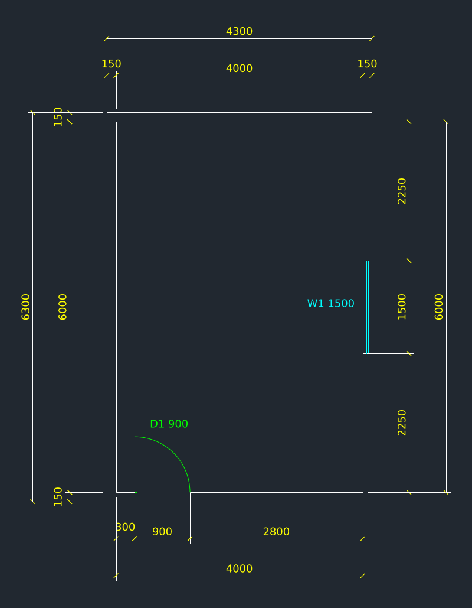

# CAD-001 技術驗證報告 V1.0

| 項目 | 內容 |
|---|---|
| 任務 | Claude Code × AutoCAD 技術可行性驗證 |
| 日期 | 2026-11-16 |
| 執行 | Claude Code（雲端 Linux 容器） |
| 結論 | **部分完成**：LSP 程式已完成，並通過離線執行與幾何驗證；AutoCAD 實機測試**尚未執行** |

---

## 0. 先講清楚：哪些做了，哪些沒做

這次 Claude Code 是在**雲端 Linux 容器**執行，不是使用者的 Windows 電腦。這台機器上**沒有 Windows，沒有 AutoCAD**，也無法連到使用者的電腦。依作戰令的規定：

| 作戰令要求 | 狀態 | 說明 |
|---|---|---|
| 1-1 Windows／AutoCAD 版本與路徑 | ❌ 未偵查 | 已提供唯讀偵查腳本 `tools/CAD001_recon.ps1`，以及 AutoCAD 內的 `CAD001_ENV` 指令 |
| 1-2 存取本機測試資料夾 | ❌ 未驗證 | 偵查腳本第 [4] 項會實際做寫入測試 |
| 1-3 AutoLISP／APPLOAD 支援 | ⚠️ 依官方文件 | 完整版 AutoCAD 支援；實機結果待紀錄表 B2 |
| 1-4 COM／ActiveX 可行性 | ⚠️ 依官方文件 | 見 §4 路線 B |
| 1-5 限制／權限／風險 | ✅ | 見 §1 |
| 2 CAD001_ROOM.lsp | ✅ 已交付 | 見 §2 |
| 3 實機測試、DWG、PDF、截圖 | ❌ **未執行** | 提供操作步驟（README）和紀錄表；目前只有**離線**測試證據，見 §3 |
| 4 三路線比較 | ✅ | 見 §4 |

> **本報告沒有宣稱任何 AutoCAD 實機測試結果。** `evidence/reference/` 的 DXF 和 PNG 是用開源函式庫 ezdxf 依模擬結果畫出的**參考圖**，**不是 AutoCAD 的輸出**。

## 1. 環境偵查與技術限制

### 1.1 由文件得到的事實（尚待實機確認）

| 項目 | 內容 |
|---|---|
| AutoLISP／APPLOAD | AutoCAD 完整版（Windows）內建。APPLOAD 只會把程式載入**目前開啟的圖面**，開新圖需要重新載入 |
| ActiveX（`vla-*`） | 完整版 Windows 支援。AutoCAD LT 2024 起支援 AutoLISP，也支援大部分 `vla-*`；官方列出的不支援項目是 `vlax-create-object`、`vlax-get-object`、`vlax-import-type-library` 等。LT 未列入這次驗證範圍 |
| Mac 版 | 不支援 ActiveX，本 LSP **不適用** |
| 編碼 | AutoCAD 2021 起有 `LISPSYS` 系統變數（預設 1，Unicode）。為避免中文亂碼，LSP 的指令列訊息全部使用 ASCII |
| 安全載入 | `SECURELOAD` 預設會對不在信任路徑內的檔案跳出警告。本流程選「載入一次」，**不修改** SECURELOAD／TRUSTEDPATHS |
| COM | ProgID 是 `AutoCAD.Application`（另有版本專屬的 `.25`、`.25.1` 等）。必須在使用者已登入的 Windows 桌面環境執行 |

版本對照：R24.0 = 2021、R24.1 = 2022、R24.2 = 2023、R24.3 = 2024、R25.0 = 2025、R25.1 = 2026。

### 1.2 權限需求
- 一般使用者權限即可，**不需要系統管理員**。
- 每次載入都需要人工按「載入一次」；如果要免警告，就得改信任路徑或使用數位簽章，這兩種都屬於需要另外核准的設定變更。
- 路線 B 需要 Claude Code 在**同一台 Windows 電腦**上執行（Claude Code 有 Windows 原生版），而且 AutoCAD 必須正在執行。

### 1.3 風險
| 風險 | 本次對策 |
|---|---|
| 程式改到既有圖面 | LSP 只新增物件，不選取、不修改、不刪除既有物件；已用模擬情境 S2 驗證 |
| 中途出錯留下半成品 | 程式會自動回滾，只刪除本次建立的物件（S5）；整批動作包成一個 UNDO 群組 |
| 同名圖層被鎖定／凍結 | 先檢查，有問題就停止，一個物件都不畫（S3） |
| 非世界座標系統（UCS）造成座標錯位 | 偵測到就停止（S4） |
| 圖面單位不是 mm | 只提出警告，不修改 INSUNITS |
| 不小心打開正式圖面 | 操作步驟規定必須用 NEW 開新的空白圖 |

## 2. CAD001_ROOM.lsp 設計基準（明確設定，不是推測）

座標原點 (0,0) = **西南角的室內牆面**，也就是執行時指定的基準點。

| 元素 | 設定 |
|---|---|
| 房間 | **室內淨尺寸** 4000（X，東西向）× 6000（Y，南北向），以牆面到牆面計算 |
| 牆 | 厚 150，**往外**加厚；外輪廓 4300 × 6300，範圍 (-150,-150)–(4150,6150) |
| 牆物件 | 門窗開口把牆環切成兩段，各自是**閉合的 LWPOLYLINE**，可以直接填充（HATCH）或編輯 |
| 門 D1 | 南牆，**淨開口 900**，位置 X = 300–1200（從西牆室內牆面起算）。單扇門，**鉸鏈在西側門框**，**往室內開**；門扇以開啟 90° 表示（40 × 900 閉合複線），另畫半徑 900 的開門弧線 |
| 門的符號 | 門扇寬度＝開口寬度，沒有扣除門框（這是符號簡化，不是門扇的製造尺寸） |
| 窗 W1 | 東牆，**開口 1500，置中**，位置 Y = 2250–3750。平面符號為兩側牆面框線＋兩條玻璃線（間距 20）|
| 窗的開啟方式 | **未定義**。窗台高、窗高、開啟方式在平面圖上不表示，**不在這次驗收範圍** |
| 尺寸 | 16 個旋轉型尺寸（DIMROTATED，AutoCAD 原生物件），以牆面為量測基準。南側：300｜900｜2800、4000。東側：2250｜1500｜2250、6000。北側：150｜4000｜150、4300。西側：150｜6000｜150、6300 |
| 尺寸外觀 | 以物件個別覆寫：字高 125（1:50 出圖時為 2.5 mm）、建築斜線端點、小數位 0。**不修改**圖面的標註型式 |
| 圖層 | A-WALL（顏色 7，線寬 0.50）、A-DOOR（3，0.25）、A-GLAZ（4，0.25）、A-ANNO-DIMS（2，0.18）。如果圖層已存在就直接沿用，**不改它的屬性** |
| 系統變數 | 不修改 CLAYER、OSMODE、DIMSTYLE 等任何變數 |

所有參數都集中在檔案開頭（`*cad001-room-x*` 等變數），修改後重新載入即可套用。

## 3. 測試與驗收（離線）

### 3.1 方法
因為沒有 AutoCAD，這次寫了一個 **AutoLISP 子集直譯器**，搭配依 AutoCAD ActiveX 官方參考建立的**物件模型模擬**（`tools/alisp_sim.py`），在 Linux 上**真的執行** LSP 原始碼，記錄每一個建立的物件，再用獨立腳本（`verify_and_render.py`）驗證幾何。

### 3.2 結果（`evidence/offline_test_run.log`）

| 情境 | 結果 |
|---|---|
| S1 空白圖面執行 → 26 個物件，1 個 UNDO 群組 | PASS |
| S2 圖面已有 5 個物件和紅色 A-WALL 圖層 → 既有物件完全不變，圖層顏色保留 | PASS |
| S3 A-DOOR 圖層被鎖定 → 停止，0 個物件，沒有新增任何圖層 | PASS |
| S4 UCS 不是世界座標 → 停止，0 個物件 | PASS |
| S5 第 8 個物件建立時人為注入錯誤 → 回滾 7 個新物件，既有 3 個保留 | PASS |
| S6 CAD001_ENV → 唯讀，0 個物件 | PASS |
| 幾何檢查 13 項（牆淨面積 2,730,000 mm²、外輪廓範圍、門鉸鏈與弧線、窗線位置、16 個尺寸值、覆寫設定、圖層） | 13／13 PASS |
| 突變測試 5 項（少一個括號、拼錯方法、牆厚改成 120、門寬改成 800、拼錯屬性） | 5／5 都有被抓到 |

模擬執行時的指令列輸出：
```
[CAD001] layer A-WALL: created ... A-ANNO-DIMS: created
[CAD001] done: 26 objects added (2 wall plines, 1 door leaf, 1 arc, 4 window lines, 2 texts, 16 dims).
values: 300 900 2800 4000 2250 1500 2250 6000 150 4000 150 4300 150 6000 150 6300
```

參考預覽（**ezdxf 繪製，不是 AutoCAD 畫面**）：



### 3.3 離線測試**無法**證明的部分
- AutoCAD 是否接受每個呼叫的參數型別和列舉常數，例如 `acArrowArchTick`、`acDimPrecisionZero` 這兩個型別庫常數。
- APPLOAD 的安全警告實際長什麼樣子、使用者需要按幾下。
- 實際出圖的字高、尺寸文字的擺放位置（150 的尺寸文字可能會被推到尺寸界線外）。
- DWG／PDF 檔案本身。

這幾項請照 README 的步驟操作，並填寫 `docs/CAD001_實機測試紀錄表.md`。

## 4. 進階技術評估：三條路線

| 面向 | A. 產生 LSP，由人工 APPLOAD | B. Windows COM／ActiveX | C. MCP／外掛 |
|---|---|---|---|
| 運作方式 | Claude Code 產生 .lsp，使用者載入並執行 | Claude Code（Windows 版）用 PowerShell 或 Python 的 COM 介面控制正在執行的 AutoCAD，可以呼叫 `SendCommand` 載入 LSP，也可以直接 `AddLine` 等 | AI 透過 MCP 協定呼叫工具，工具背後通常還是 COM、LISP 或 .NET 外掛 |
| 安裝難度 | **最低**：不需要安裝任何東西 | 中：Claude Code 和 AutoCAD 要在同一台電腦；Python 路線需要 pywin32 或 comtypes（必須先核准） | 高：要安裝 MCP 伺服器，可能還要 .NET 外掛（NETLOAD） |
| 穩定性 | **高**：在 AutoCAD 內部執行，速度快 | 中：跨行程呼叫較慢；AutoCAD 忙碌時會出現「Call was rejected by callee」，需要重試；版本 ProgID 不同；有對話框時會卡住 | 依實作而定；社群版品質參差 |
| 成本 | 0（使用既有授權） | 0（使用既有授權） | 社群版免費但需要審查；自行開發要投入工時 |
| 安全性 | **最好控管**：人看得到程式碼，每次載入都要人工確認，影響範圍只限於目前圖面 | AI 可以直接操作開啟中的所有圖面，需要嚴格的白名單和只能開測試圖的規範 | 第三方 MCP 屬於「未經核准外掛」，**依作戰令禁止安裝**；若自行開發，可以把工具限縮成白名單 |
| 授權 | 符合一般 AutoCAD 授權使用範圍 | 自動化自己的桌面版通常沒問題；**不可**做成伺服器批次處理服務（需要另外確認 Autodesk 授權條款） | 同 B；如果改走 Autodesk Platform Services 的 Design Automation（雲端），需要付費點數，而且**圖面要上傳雲端**，和「不上傳客戶機密圖面」的規定衝突 |
| 產品化 | 中：可以做成 LSP 工具包加簽章，人機協作 | 中高：可以做成「說一句話就出圖」的本機助理 | **最高**，但前提是有經過安全審查、可以控管的工具介面 |
| 現況 | 已可使用 | 需要 Windows 實機驗證 | Autodesk 目前確認的官方 MCP 是「Product Help」，只能查**文件**，唯讀；能控制 AutoCAD 圖面的 MCP 大多是社群專案，與 Autodesk 無關，**未經審查** |

**建議**：短期以 **A 為主**；中期在測試機上用 **B 做小規模實驗**；**C 等到有自行開發或官方工具、並完成安全審查後**再評估，不安裝社群版 MCP。

## 5. 下一階段建議（CAD-002）

1. **實機驗收**（最優先，約 30 分鐘）：在測試機上照 README 跑一遍，填寫紀錄表，產生 DWG、PDF、截圖。這是把本報告從「離線驗證」升級為「實機驗證」的唯一方式。
2. **參數化**：把房間尺寸、門窗位置、開啟方向改成指令內對話式輸入，或讀取 CSV／JSON，讓同一支程式能畫不同房間。
3. **路線 B 小實驗**：在測試機安裝 Windows 版 Claude Code，用 PowerShell COM 只做三件事：開新圖、`SendCommand` 載入 LSP 並執行、PlotToFile 輸出 PDF。目標是不需要人工按鍵，一次產出 DWG＋PDF。
4. **無頭批次可行性**：評估 `accoreconsole.exe`（AutoCAD 內建、不開介面的核心主控台）。它不支援 `vla-*`，需要改寫成 entmake 版本，但可以本機批次產生，不必上傳雲端。
5. **品質標準**：建立公司圖層與標註型式的標準檔（DWT），讓 LSP 套用標準，而不是逐物件覆寫。
6. **治理**：決定是否要對 LSP 做數位簽章，或指定專用的信任資料夾。這是安全設定變更，**必須先經核准**。

## 附錄：參考資料
- Autodesk, *What's New or Changed with AutoLISP*（LT 2024／2025 對 ActiveX 的支援範圍）
  https://help.autodesk.com/cloudhelp/2025/ENU/AutoCAD-LT-AutoLISP/files/GUID-037BF4D4-755E-4A5C-8136-80E85CCEDF3E.htm
- Autodesk Product Help MCP Server（官方，文件查詢用，唯讀）
  https://help.autodesk.com/cloudhelp/ENU/ADSKMCP-ProductHelpMcp/files/ADSKMCP_ProductHelpMcp_autodesk_product_help_mcp_server_html.html
- 社群 AutoCAD MCP 範例（說明為非官方）：https://glama.ai/mcp/servers/C48H74/autocad-mcp
