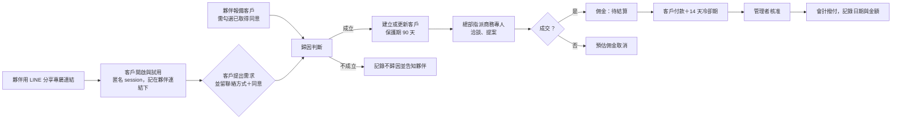

# MIN-003｜百業 AI 員工體驗式獲客引擎：G1 技術設計書 V1.2

涵蓋指令：C-001-ORDER-MIN003-001（體驗追蹤）＋ MIN003-002（CRM 與通知）＋ MIN003-003（推薦夥伴模組）
版本紀錄：V1.1 體驗追蹤＋CRM＋通知；**V1.2 新增第 15 節推薦夥伴模組**，角色「業務」改稱「商務專人」，權限、資料表、工時、驗收同步更新。
狀態：**設計與原型，待總指揮審查**。未部署、未追蹤任何真實客戶、未發送任何通知、未產生付費資源；既有水電、營造示範版本未修改。
互動原型：claude.ai Artifact「MIN-003 獲客戰情室」（全部為模擬客戶）。

> 本文的雲端與訊息服務費率依撰寫時的認知整理，標「需查證」者，正式採購前須到官方頁面核對。個資法相關做法為工程建議，正式上線前建議由法務確認告知與同意文字。

---

## 0. 先回答：Claude Artifact 現有連結能不能直接追蹤？

**不能，必須部署到自有網域（或至少自有的 Cloudflare Workers 網址）。** 原因：

| 限制 | 影響 |
|---|---|
| Artifact 只把網址的 `#名稱` 傳給頁面，**不傳查詢字串**（`?ref=...`） | 頁面讀不到客戶識別碼 |
| Artifact 頁面受 CSP 限制，**不能對外部網址送出請求** | 事件送不到我們自己的伺服器 |
| Artifact 內建資料庫（db）只允許有編輯權的人寫入，**公開連結的訪客不能寫** | 客戶的操作無法寫回 |
| 縮圖與 LINE 預覽卡由平台與 LINE 控制，且會快取 | 無法控制品牌呈現，也會被預覽爬蟲干擾 |

結論：Artifact 繼續當**內部展示與設計稿**；對外獲客版本改由 Cloudflare 部署，模板內容可從現有 HTML 複製後掛上追蹤程式（既有 Artifact 版本不動）。

---

## 1. 系統架構

```mermaid
flowchart LR
  subgraph 客戶端
    L[LINE 收到專屬連結] --> P[體驗頁 demo.自有網域]
  end
  subgraph Cloudflare
    P -- HTML／JS --> PG[Pages 或 Workers 靜態資源]
    P -- 事件 beacon --> API[Worker：POST /e]
    API --> F{機器人過濾・同意檢查・去重・限流}
    F --> D1[(D1)]
    API --> RULE[規則引擎：階段推進・高意向判定]
    RULE --> OUTBOX[(通知外送匣)]
    CRON[Cron：每 5 分鐘、每天 08:00] --> OUTBOX
    CRON --> D1
    OUTBOX --> SEND[寄送 Worker：重試・抑制]
    ADM[後台 admin.自有網域] --> D1
    ACC[Cloudflare Access：Email 一次性密碼] --> ADM
  end
  SEND --> LINEAPI[LINE Messaging API：推播給已綁定同仁]
  SEND --> MAIL[Email 寄送服務]
  T[產業模板：水電／營造／餐飲／美髮…] -. 只引用 track.js 與任務設定 .-> P
```

元件分工：

| 元件 | 做什麼 | 不做什麼 |
|---|---|---|
| 產業模板（HTML） | 呈現體驗內容；在主要按鈕加 `data-track`，完成任務時呼叫 `MIN.task()` | 不碰資料庫、不知道客戶是誰 |
| `track.js`（共用追蹤程式） | 顯示告知與同意、讀取連結碼、送事件 | 不存個資、不設第三方 Cookie |
| 事件 Worker `/e` | 驗證連結碼、過濾機器人、去重、限流、寫入事件、觸發規則 | 不回傳任何客戶資料 |
| 後台 Worker `/admin` | CRM、看板、待辦、通知設定、戰情室 | 不對外公開，一律經 Cloudflare Access |
| 寄送 Worker（Cron） | 從外送匣取通知，發 LINE／Email、重試、抑制 | 不主動抓客戶資料以外的東西 |
| D1 | 單一共用資料庫，所有產業同一套表 | — |

技術底座沿用既有「FB 內容工作室 V5」（Cloudflare Workers＋D1、測試與部署交接紀律已在真實環境跑過）。

---

## 2. 連結與識別碼規則（T01）

| 項目 | 規則 | 範例 |
|---|---|---|
| 客戶代碼 | 產業字首＋3 位流水號，**只在後台使用** | `W001` 水電、`C001` 營造、`R001` 餐飲、`H001` 美髮、`N001` 美甲、`K001` 咖啡廳 |
| 連結碼 | 10 碼隨機，Crockford Base32（去除 I L O U），約 50 位元；以 `crypto.getRandomValues` 產生 | `K7M2Q9XF3H` |
| 網址 | `https://demo.自有網域/d/{模板}?t={連結碼}` | `/d/water?t=K7M2Q9XF3H` |
| 對照 | `demo_links` 表：連結碼 → 客戶、模板、狀態（有效／停用）、建立時間 | — |

**為什麼不用指令範例的 `?ref=W001`：** 流水號可被猜中，別人能冒用他人代碼灌數據，也能從號碼推估客戶量。代碼保留為內部編號，網址只放隨機連結碼。

防猜測與冒用：
1. 50 位元隨機空間，猜中機率可忽略；事件 API 對同一 IP 限流（每分鐘 30 次），連續 20 次無效連結碼即封鎖該 IP 1 小時。
2. 無效、停用或過期的連結碼：**照常顯示體驗頁**，事件記為匿名訪客（`customer_id = NULL`），不提示「代碼錯誤」，避免被用來試碼。
3. 可「重發連結碼」：舊碼立即停用，用於連結外流或客戶轉傳時。
4. 連結碼**不是登入憑證**：拿到連結碼只能看示範頁、送事件，看不到任何客戶資料、也進不了後台。
5. 連結碼與客戶代碼都**不含姓名、電話**等個資。

---

## 3. 事件追蹤（T02）

### 3.1 事件定義

| 事件 | 何時送出 | 是否需同意 | 代表的意義 |
|---|---|---|---|
| `page_open` | 頁面**可見滿 2 秒**後由瀏覽器送出（伺服器端被讀取不算） | 不需（頁面有明確告知） | 連結被打開過。**不代表已閱讀、不代表有興趣** |
| `feature_click` | 點選模板標記的主要功能 | **需同意** | 有實際操作 |
| `task_complete` | 完成模板指定任務（例：水電完成一次 LINE 回報；營造核准一筆估驗） | **需同意** | 有實際試用到核心流程 |
| `consult_click` | 點「我想了解專屬版本」 | 不需（客戶主動提出） | 客戶主動請求 |
| `feedback_submit` | 送出回饋表單 | 不需（客戶主動提交）；留聯絡方式另需勾選同意聯繫 | 客戶主動回饋 |
| `booking_submit` | 送出預約洽談 | 同上 | 客戶主動預約 |
| `consent` | 客戶做出隱私選擇 | — | 同意紀錄 |

### 3.2 告知與同意

- 第一次開啟時顯示告知卡：「這是為您準備的體驗頁。為了在後續聯繫時更了解您的需求，我們想記錄您試用了哪些功能。紀錄只用於安排說明、不提供第三方、保存 12 個月。不同意也可以完整試用。」按鈕：**同意記錄操作**／**只看不記錄**。
- 選「只看不記錄」或未選：只送 `page_open` 與客戶主動送出的表單；其他互動不送出。
- 同意紀錄寫入 `consents`（時間、告知文字版本、選擇）；客戶可隨時從頁面角落「隱私選擇」撤回，撤回後停止記錄，既有操作事件依刪除政策處理。
- 只用第一方 `sessionStorage` 存 session id 與選擇，不用第三方 Cookie、不用廣告追蹤。

### 3.3 去重與機器流量

| 規則 | 做法 |
|---|---|
| LINE、Facebook 等預覽爬蟲 | `page_open` 只由瀏覽器端 JS 在可見 2 秒後送出，爬蟲不執行 JS；伺服器再排除已知爬蟲 User-Agent（如 `facebookexternalhit`、含 `Line/` 的預覽爬蟲、`bot`／`crawler` 字樣） |
| 重複開啟 | `dedup_key = 連結碼＋事件＋功能＋30 分鐘時間桶`，唯一索引，重複寫入直接忽略 |
| 暴量 | 單一 IP 每分鐘超過 30 次丟棄；單一連結碼每天超過 300 筆事件標記異常 |
| IP 保存 | 不存原始 IP，只存「當日鹽值雜湊」用於限流與異常分析，30 天後清除 |
| 業務自己點開 | 後台「預覽」按鈕帶內部參數，事件標記 `internal`，不計入統計 |

---

## 4. 資料表設計（T02、T05、T06、T07、T08）

共用一個 D1 資料庫，不為各產業建 CRM。所有表含 `created_at`、`updated_at`。

```sql
-- 產業與模板（T05：模板與追蹤分離）
industries(id TEXT PK, code_prefix TEXT UNIQUE, name TEXT)                      -- W 水電、C 營造、R 餐飲…
templates(id TEXT PK, industry_id, name, status, version,
          features_json, task_json)                                              -- 主要功能清單與指定任務

-- 客戶名冊（T06）
customers(id TEXT PK, code TEXT UNIQUE, company, industry_id, contact_name,
          phone, email, line_id, source, owner_user_id, stage, need,
          next_action, next_action_due, hot_flag, deal_type, lost_reason,
          dedupe_key, deleted_at)                                                 -- dedupe_key = 正規化公司名＋電話
demo_links(token TEXT PK, customer_id, template_id, status, sent_at, revoked_at)

-- 體驗事件（T02）
sessions(id TEXT PK, token, customer_id NULL, template_id, consent_level,
         ua_class, ip_hash_day, first_seen, last_seen)
events(id INTEGER PK, session_id, token, customer_id NULL, template_id,
       type, feature, consent_level, internal INTEGER, ts, dedup_key UNIQUE)
consents(id, session_id, customer_id NULL, notice_version, choice, ts, withdrawn_at)
feedback(id, customer_id NULL, template_id, best_feature, top_pain, want_custom,
         contact_value NULL, contact_consent INTEGER, ts)
bookings(id, customer_id NULL, preferred_time, contact_value, contact_consent, ts)

-- 商機與任務（T07）
stage_history(id, customer_id, from_stage, to_stage, by_user_id NULL, reason, ts)  -- 系統推進時 by_user_id 為 NULL
tasks(id, customer_id, owner_user_id, title, due_date, status, result, done_at)

-- 通知（T08）
notification_rules(id, name, trigger, recipients_json, channels_json, enabled,
                   suppress_hours)
notifications(id, rule_id, customer_id NULL, recipient_user_id, channel,
              payload_json, status, attempts, next_try_at, last_error, sent_at,
              suppress_key UNIQUE)                                                 -- 外送匣＋發送紀錄

-- 人員、權限與稽核（T06、T09）
users(id, email UNIQUE, name, role, partner_id NULL, line_user_id NULL, line_bound_at, active)  -- role：admin／sales／partner
line_bind_codes(code, user_id, expires_at)
audit_log(id, user_id, action, target_type, target_id, before_json, after_json, ts)
imports(id, user_id, filename, rows_total, rows_added, rows_skipped, ts)
```

重點：
- **分表**：客戶資料、體驗事件、商機紀錄、通知、任務各自獨立，符合 MIN003-002 要求。
- **去重**：匯入時以正規化公司名（去空白、全半形、「有限公司」等字尾）＋電話比對；疑似重複列入「待合併」清單由管理者決定，不自動合併。
- **刪除**：`customers.deleted_at` 先軟刪除，30 天後排程硬刪除該客戶的個資欄位、事件、回饋與通知內容，只保留去識別化的每日統計（`daily_stats`，選配）。

---

## 5. 商機階段與判定條件（T07）

| 階段 | 進入條件 | 誰推進 |
|---|---|---|
| 待發送 | 已建檔並產生連結碼 | 系統 |
| 已發送 | 業務按「已發送」（LINE 傳送無法自動偵測） | 業務 |
| 已體驗 | 至少 1 筆 `feature_click` 或 `task_complete`。**只有 `page_open` 不算** | 系統自動；手動需寫原因（例：電話中確認已試用） |
| 有需求 | 回饋選「想了解專屬版本」、或 `consult_click`、或業務記錄通話中確認的需求 | 系統自動／業務 |
| 預約洽談 | `booking_submit` 或業務排定洽談日期 | 系統自動／業務 |
| 提案報價 | 業務記錄已送提案或報價 | 業務 |
| 成交 | 業務記錄，須填類型（正式合約／付費試辦） | 業務 |
| 未成交 | 業務記錄，須填原因 | 業務 |

- 「已開啟／只開啟沒操作／完成任務」屬於**體驗狀態**，與商機階段分開顯示。
- 系統只會往前推、不會往回推；手動調整一律寫入 `stage_history` 與 `audit_log`。
- **高意向**：7 天內 `task_complete` ＋（`consult_click` 或回饋選「想了解專屬版本」）。客戶選「只看不記錄」時看不到操作，以客戶主動送出的表單為準。

---

## 6. 需求回饋（T03）

體驗頁底部與完成任務後顯示「30 秒回饋」：
1. 哪個功能最有幫助？（模板功能清單，單選）
2. 目前最大的管理困擾？（產業困擾清單，單選，另有「其他」）
3. 是否希望了解專屬版本？（想了解／先看看就好）
4. 聯絡方式（選填）＋「我同意你們用這個聯絡方式和我聯繫，討論專屬版本」勾選框；未勾選不能送出聯絡方式。

困擾清單放在 `templates.task_json` 旁的產業設定中，新產業只要改設定。

---

## 7. 通知（T08）

### 7.1 規則（預設）

| 規則 | 觸發 | 收件人 | 管道 |
|---|---|---|---|
| 客戶主動提出需求 | 回饋選「想了解專屬版本」或 `consult_click` | 負責業務＋Shen | LINE |
| 客戶預約洽談 | `booking_submit` | 負責業務＋Shen | LINE＋Email |
| 高意向商機 | 第 5 節高意向條件成立 | Shen | LINE |
| 業務逾期未跟進 | 待辦過期 1 天；過期 3 天升級 | 負責業務；升級時加 Shen | LINE |
| 每日商機摘要 | 每天 08:00（Cron） | Shen | LINE＋Email |

### 7.2 可靠度

- **外送匣模式**：事件處理時只寫入 `notifications`，由 Cron 每 5 分鐘的寄送 Worker 送出，避免第三方服務慢或掛掉時拖垮事件 API。
- **重試**：1、5、30 分鐘各一次；三次失敗標記「失敗」並在戰情室顯示紅標，LINE 失敗改寄 Email。
- **抑制**：`suppress_key = 規則＋客戶＋收件人＋日期`，唯一索引，同一事由 24 小時內只發一次。
- **收件人未綁定 LINE**：自動改寄 Email。
- **內容最小化**：通知只放客戶代碼、公司名、產業、回饋重點與後台連結，**不放電話、Email**；要看聯絡方式需登入後台。

### 7.3 LINE 綁定與費用

- 使用 LINE 官方帳號＋**Messaging API** 推播給內部同仁。（LINE Notify 已於 2025-03-31 停止服務，不可採用。）
- 綁定流程：同仁加官方帳號好友 → 在後台個人頁產生 6 位數綁定碼（10 分鐘有效）→ 傳給官方帳號 → Webhook 取得 `userId` 寫入 `users.line_user_id`。
- 費用：台灣官方帳號免費方案每月有固定則數的免費推播額度（撰寫時認知為 200 則，需查證）。內部通知量估算：每日摘要 30 則＋需求／預約／逾期約 50–100 則，**免費額度可能足夠，超過再升級方案**。
- 客戶端不推播：G1 不對潛在客戶發 LINE 訊息（避免變成行銷推播與費用暴增）。

### 7.4 Email

| 選項 | 適合 | 備註 |
|---|---|---|
| Cloudflare Email Workers（`send_email`） | 只寄給**已驗證的內部信箱** | 免費，與 Workers 同平台；不能寄給未驗證地址 |
| Resend／Postmark 等寄信服務 | 之後要寄給客戶（例：預約確認信） | Resend 免費方案每月數千封（需查證）；需設定 SPF／DKIM |

G1 建議：內部通知用 Cloudflare Email Workers；要寄給客戶時再接寄信服務。

### 7.5 訊息範例

LINE（客戶主動提出需求）：
```
【客戶主動提出需求】W003
模擬水電行 03（水電）
最有幫助：九宮格
最大困擾：工地狀況要一直打電話問
選擇：想了解專屬版本
負責：商務 A・請於 24 小時內聯繫
[開啟客戶頁]
```

LINE（每日商機摘要）：
```
【每日商機摘要】10/28
昨日新開啟 2・新操作 1・新回饋 1
高意向 1 家・待預約 2 家
逾期待辦 3 件
累計：發送 11／操作 7／回饋 5／試辦 1
[開啟戰情室]
```

Email：
```
主旨：【有需求】W003 模擬水電行 03 想了解專屬版本
最有幫助：九宮格／最大困擾：工地狀況要一直打電話問
負責：商務 A，請於 24 小時內聯繫
客戶頁面：https://admin.自有網域/c/W003（需登入才看得到聯絡方式）
```

---

## 8. 後台身分驗證與權限（T06、T09）

- **Cloudflare Access** 保護 `admin.自有網域`：Email 一次性密碼登入（或 Google 登入），免費方案涵蓋 50 位使用者（需查證）。未通過 Access 的請求到不了後台 Worker。
- 後台 Worker 再依 Access 傳入的 Email 對照 `users.role` 做權限：

V1.2 依 MIN003-003 收斂為三種角色（推薦夥伴細節見第 15.5 節）：

| 動作 | 總部管理者 | 商務專人 | 推薦夥伴 |
|---|---|---|---|
| 看客戶名冊與聯絡方式 | 全部 | 自己負責的 | ❌（只看自己推薦的公司名稱與粗略進度） |
| 編輯客戶、階段、待辦 | 全部 | 自己負責的 | ❌ |
| 分派商務專人 | ✅ | ❌ | ❌ |
| 匯入、匯出名冊 | ✅（匯出不含電話） | ❌ | ❌ |
| 通知規則設定 | ✅ | ❌ | ❌ |
| 刪除客戶個資 | ✅ | ❌ | ❌ |

- 所有寫入動作進 `audit_log`（誰、何時、改了什麼、舊值）。

---

## 9. 個資：告知、同意、保存與刪除

| 資料 | 取得方式 | 保存期限（建議） | 刪除方式 |
|---|---|---|---|
| 客戶名冊（公司、窗口、電話） | 業務建檔或匯入；客戶自願提供 | 成交客戶依合約；未成交最後聯繫後 24 個月 | 管理者刪除 → 30 天後硬刪 |
| 體驗事件 | 告知後記錄；操作類需同意 | 12 個月，之後彙總為統計並刪除明細 | 排程自動 |
| 同意紀錄 | 客戶選擇時 | 與對應資料同期，作為合規證明 | 隨客戶資料刪除 |
| 回饋與聯絡方式 | 客戶主動提交，聯絡方式需勾選同意 | 同客戶名冊 | 同客戶名冊 |
| IP 雜湊 | 自動 | 30 天 | 排程自動 |
| 通知發送紀錄 | 自動 | 12 個月 | 排程自動 |

- 客戶要求查詢或刪除：管理者在客戶頁一鍵處理，動作寫入稽核紀錄。
- 名冊匯入前須確認來源合法（例如客戶主動留下、既有往來），不匯入來源不明的名單。

---

## 10. 共用架構與百業擴展（T05）

新增一個產業（例如美甲）只需要：
1. `industries` 新增一列（字首 `N`）。
2. 做一個模板 HTML，主要按鈕加 `data-track="feature:預約"`，完成任務處呼叫 `MIN.task('完成一次預約提醒')`，頁尾引用 `<script src="/track.js">`。
3. `templates` 新增一列：功能清單、指定任務、困擾選項。
4. 後台、事件 API、CRM、通知、戰情室**完全不用改程式**；戰情室的「各產業與模板轉換」表自動多一列。

模板要遵守的契約：
- 不自行送任何網路請求，只呼叫 `track.js` 提供的 `MIN.track()`、`MIN.task()`、`MIN.consult()`。
- 不收集個資；回饋表單由 `track.js` 統一提供。
- 模板改版時更新 `templates.version`，事件會記錄版本，方便比較不同版本的轉換率。

---

## 11. 現成工具比較（MIN003-002 第三點）

| 方案 | 優點 | 缺點 | 月費量級（需查證） |
|---|---|---|---|
| **A. 全部 Workers＋D1 自建**（建議） | 追蹤、CRM、通知同一個資料庫，規則好寫；費用近乎 0；可沿用 FB 工作室 V5 底座 | 後台介面要自己做；需要有人維護程式 | 約 NT$0–200（網域另計） |
| B. 追蹤自建＋Airtable 當 CRM | 名冊編輯像試算表，非工程人員好上手；有現成檢視與權限 | 事件要同步到 Airtable（API 每秒 5 次限制）；兩邊資料要對齊；依人數計費 | 每位使用者約 US$20 起 |
| C. 追蹤自建＋HubSpot 免費 CRM | 現成 CRM、Email 整合 | LINE 通知要另接；自訂階段與欄位受限；資料在國外平台 | 免費方案起，進階功能費用高 |

**判斷**：追蹤一定得自建（Artifact 與現成 CRM 都做不到客製的「開啟 vs 操作」與同意控制），既然事件已經在 D1，CRM 放同一個庫最省事。業務人數 ≤ 5 人時建議方案 A；若之後業務團隊擴大、需要大量自訂報表，再評估 B。

---

## 12. 技術限制、開發成本與維護成本

### 12.1 技術限制
- LINE 傳送是否成功、客戶是否在 LINE 裡看到訊息：**偵測不到**，「已發送」只能由業務標記。
- 客戶選「只看不記錄」時看不到操作，漏斗的「實際操作」是下限。
- LINE 內建瀏覽器可能清除 `sessionStorage`，同一人隔天再開會被算成新 session（去重仍以連結碼為主，影響有限）。
- 客戶轉傳連結給同事：事件會記在同一個客戶下（可接受；必要時重發連結碼）。
- 預覽卡標題、縮圖由 LINE 快取，改名後不會立刻更新。

### 12.2 開發工時（MVP，含 001＋002）

| 模組 | 人日 |
|---|---|
| D1 結構、遷移、種子設定 | 0.5 |
| `track.js`＋告知同意卡＋事件 API（去重、限流、機器人過濾） | 2 |
| 兩個模板複製掛追蹤（水電、營造） | 1 |
| Cloudflare Access＋角色權限＋稽核紀錄 | 1 |
| CRM 名冊（搜尋、篩選、編輯、匯入去重、匯出） | 2.5 |
| 商機看板、階段規則、階段紀錄 | 1.5 |
| 待辦與跟進 | 1 |
| 通知：規則、外送匣、重試、抑制、LINE 綁定、Email | 2.5 |
| 戰情室（漏斗、產業轉換、困擾排行、業務待辦） | 1.5 |
| 個資：撤回、刪除排程、保存期限排程 | 1 |
| 測試（單元＋模擬資料端到端）與部署交接文件 | 1.5 |
| 小計（V1.1 範圍） | 約 16 |
| 推薦夥伴模組（第 15.7 節） | 約 7 |
| **合計** | **約 23 人日（估算區間 18–28）** |

### 12.3 營運費用（月，估算，需查證）

| 項目 | 費用 |
|---|---|
| Cloudflare Workers／D1 | 免費方案（每日 10 萬請求、5 GB）大概率足夠；超過改付費方案約 US$5 |
| Cloudflare Access | 50 人內免費 |
| 網域 | 每年約 NT$400–1,000 |
| LINE 官方帳號 | 免費方案額度內 0；超過需升級方案 |
| Email | 內部通知用 Cloudflare Email Workers：0 |
| **合計** | **約 NT$0–200／月＋網域年費** |

### 12.4 維護
- 每月：檢查通知失敗率、事件異常（暴量連結碼）、LINE 額度用量。
- 每季：檢查 LINE、Cloudflare 方案與費率變動；輪替後台存取名單。
- 每次新增模板：跑一次端到端測試（開啟、操作、回饋、通知）。
- 最大風險是**單一開發者**：交接文件、測試、部署步驟寫進 repo（沿用 V5 HANDOFF 格式）。

---

## 13. G1 驗收標準（模擬資料，不碰真實客戶）

| # | 驗收項 | 通過條件 | 原型狀態 |
|---|---|---|---|
| A1 | 連結碼規則 | 產生 1,000 組不重複；網址不含客戶代碼與個資 | 原型可展示；批量測試待開發 |
| A2 | 開啟 vs 操作 | 只開啟的客戶不會出現在「實際操作」，也不會進入「已體驗」；手動調整要求寫原因 | ✅ 原型可操作驗證 |
| A3 | 同意 | 選「只看不記錄」後，功能點擊不產生事件；客戶主動送出的表單照常收 | ✅ 原型可操作驗證 |
| A4 | 機器人與去重 | LINE 預覽爬蟲不算開啟；30 分鐘內重複開啟只算 1 次 | 原型以模擬按鈕展示；真實 User-Agent 測試待開發 |
| A5 | 階段推進 | 操作 → 已體驗；想了解專屬版本或諮詢 → 有需求；預約 → 預約洽談；全程寫入階段紀錄 | ✅ 原型可操作驗證 |
| A6 | 高意向與通知 | 完成任務＋諮詢 → 高意向並產生通知；同日重複觸發被抑制 | ✅ 原型模擬（不實際發送） |
| A7 | 權限 | 業務只看到自己的客戶；匯入、匯出、刪除、通知規則限管理者 | ✅ 原型可切換身分驗證 |
| A8 | 名冊 | 匯入時同名或同電話不重複建檔；匯出不含電話 | ✅ 原型可操作驗證 |
| A9 | 個資刪除 | 刪除客戶後，名冊、事件、待辦一併消失，動作進稽核紀錄 | ✅ 原型可操作驗證 |
| A10 | 擴展 | 新增產業只改設定，不改程式（以「餐飲、美髮：規劃中」列驗證報表自動出現） | ✅ 原型可展示 |
| A11 | 費用 | 試算月費 ≤ NT$300（不含網域） | 依本文估算；部署後實測 |

推薦夥伴模組的驗收項 B1–B8 見第 15.9 節。

**審查通過後的下一步（需總指揮核准）**：申請網域與 Cloudflare 帳號設定 → 以模擬客戶在正式環境跑 A1–A11 → 通過後再用 3–5 位真實潛在客戶小規模試行。

---

## 14. 待總指揮決定

| # | 決策 | 建議 |
|---|---|---|
| D1 | 採方案 A（Workers＋D1 自建） | 核准 |
| D2 | 自有網域名稱（例：`demo.xxx.tw`、`admin.xxx.tw`） | 請提供或核准申請 |
| D3 | 告知與同意文字、保存期限（第 9 節） | 請確認，建議法務過目 |
| D4 | 通知收件人與是否需要「逾期 3 天升級給 Shen」 | 請確認 |
| D5 | 商務專人名單 | 請提供（原型用「商務 A／B」） |
| D6 | 是否進入正式開發（約 23 人日，含推薦夥伴模組） | 審查原型後決定 |
| D7 | 佣金比例、歸因保護期（建議 90 天）、冷卻期（建議 14 天） | 請確認 |
| D8 | 續約是否給佣金、佣金是否有上限 | 請決定（G1 只算首次成交） |
| D9 | 佣金的所得類別與扣繳方式 | 請會計師確認 |
| D10 | 推薦夥伴合作協議範本（保密、不得自行報價、個資處理） | 請法務起草 |

---

## 15. 推薦夥伴模組（MIN003-003，V1.2 新增）

設計基準：每個產業模板配置 **3–5 位**推薦夥伴（同業師傅、材料行、會計師、講師等）。原型「推薦夥伴」畫面顯示每個模板的配置是否達標。

### 15.1 推薦夥伴名冊與專屬連結

| 項目 | 規則 |
|---|---|
| 夥伴代碼 | `P` ＋ 3 位流水號（例：`P001`），內部使用 |
| 專屬連結 | 每位夥伴 × 每個可推薦模板一組 10 碼隨機連結碼，格式與客戶連結相同：`/d/water?t=HXEZ2JM5KR`。伺服器端記錄這組碼屬於「夥伴連結」 |
| 產生條件 | 夥伴狀態「合作中」且已簽合作協議才產生 |
| 停權與重發 | 停權後連結立即失效；連結外流可重發，舊碼改記為匿名訪客 |
| 不存的資料 | 身分證字號、銀行帳戶等撥款資料**不進系統**，由會計另外保管；系統只記撥款日期與金額 |

### 15.2 完整流程



重點：
- **夥伴分享**系統看不到；**客戶只開啟或只試用**不成立推薦，只記在夥伴連結下的匿名 session。
- **歸因成立**只有兩種：客戶透過夥伴連結主動提出需求（含聯絡方式與同意），或夥伴報備並經總部受理。
- 歸因成立後，同一個 session 先前的匿名事件補歸到該客戶，所以總部看得到客戶試用了什麼。
- 夥伴收到的通知只有進度（已提出需求、已成交、佣金狀態），**不含客戶聯絡方式與洽談細節**。

### 15.3 重複客戶歸因規則

1. 比對鍵：正規化公司名（去空白、去「有限公司／工程行」等字尾）或電話（8 碼以上），任一相同視為同一家。
2. **先成立者優先**，保護期 90 天；保護期內有進行中的洽談，延長到結案。
3. 保護期內其他夥伴再推薦：寫入歸因紀錄但不歸因，告知該夥伴「已有其他夥伴推薦，在保護期內」，**不透露是誰**。
4. 總部 90 天內已主動接觸（已發送且未結案）的客戶，夥伴報備不成立。
5. 已成交客戶不接受新的推薦歸因。
6. 保護期已過且沒有進行中的洽談，可重新歸因。
7. 禁止推薦自己或自己的公司；同一夥伴或同一 IP 短時間大量報備，標記人工審查。

### 15.4 爭議處理

| 步驟 | 內容 |
|---|---|
| 提出 | 夥伴在入口填客戶名稱、主張、證據（例：LINE 對話截圖、簽到表） |
| 暫停 | 相關佣金自動暫停核准 |
| 審查 | 總部管理者 7 天內決定：**維持原歸屬／改判給申訴人／雙方各半** |
| 執行 | 改判時更新歸因與未撥付佣金；各半時撥付拆兩筆 |
| 紀錄 | 決定、理由、決定人寫入爭議紀錄與稽核紀錄，並通知雙方 |

### 15.5 佣金與狀態

| 狀態 | 進入條件 | 是否計入應付 |
|---|---|---|
| 預估 | 推薦客戶進入「提案報價」且有金額 | 否 |
| 待結算 | 商務專人把推薦客戶改為「成交」並填金額（未填金額系統擋下） | 是，尚未核准 |
| 已核准 | 客戶已付款＋14 天冷卻期，且沒有進行中的爭議 | 是 |
| 已撥付 | 會計撥款後由管理者標記 | 已付 |
| 已取消 | 未成交、冷卻期內退款、歸因被改判；需寫原因 | 否 |

計算：成交金額（未稅）× 夥伴比例（預設 10%，依合作協議）。G1 只算首次成交，續約是否給佣金待總指揮決定（D8）。撥款前的所得類別、扣繳與補充保費由會計師確認（D9）。

三種角色在夥伴模組的權限：

| 動作 | 總部管理者 | 商務專人 | 推薦夥伴 |
|---|---|---|---|
| 夥伴名冊與績效 | 全部 | 檢視（不含佣金金額） | 只看自己 |
| 佣金金額 | 全部 | ❌ | 只看自己 |
| 核准、撥付、取消佣金 | ✅ | ❌ | ❌ |
| 歸因爭議 | 決定 | 提供資料 | 提出申訴 |
| 報備客戶 | 受理 | 受理 | 提出 |
| 停權、重發夥伴連結 | ✅ | ❌ | ❌ |

推薦夥伴從獨立的夥伴入口登入（同樣經 Cloudflare Access，以夥伴 Email 一次性密碼登入），程式層再依 `users.role = partner` 與 `partner_id` 過濾。夥伴連結碼不是登入憑證。以每模板 5 位、4 個模板計約 20 位夥伴，加上總部人員，仍在 Access 免費 50 人額度內（需查證）。

### 15.6 資料表（新增）

```sql
partners(id TEXT PK, name, type, status, agreement_signed_at, commission_rate,
         contact_email, notes)                                   -- 不存身分證、銀行帳戶
partner_templates(partner_id, template_id, PRIMARY KEY(partner_id, template_id))
partner_links(token TEXT PK, partner_id, template_id, status, created_at, revoked_at)
referral_reports(id, partner_id, company, phone_norm, consent_confirmed, status,
                 reviewed_by, reviewed_at, ts)                   -- 夥伴報備
attributions(id, customer_id, partner_id, source, result, reason,
             protect_until, ts)                                  -- source：link／report；result：成立／不歸因
commissions(id, customer_id, partner_id, deal_type, amount, rate, status,
            deal_at, customer_paid_at, approved_by, approved_at, paid_at, cancel_reason)
commission_events(id, commission_id, from_status, to_status, by_user_id, note, ts)
disputes(id, partner_id, customer_id, claim, evidence_url, status, due_at,
         decision, decided_by, decided_at, ts)
```

既有表調整：`customers` 增加 `source`（總部直發／推薦夥伴）、`partner_id`、`attributed_at`、`protect_until`；`sessions` 增加 `partner_link_token`；`notification_rules` 增加「推薦進度通知夥伴」。

### 15.7 開發工時（新增部分）

| 模組 | 人日 |
|---|---|
| 夥伴名冊、連結產生／停權／重發 | 1 |
| 歸因引擎（比對、保護期、報備受理、匿名事件補歸） | 1.5 |
| 爭議流程 | 1 |
| 佣金狀態機、核准撥付、取消 | 1.5 |
| 夥伴入口（連結、報備、進度、佣金、申訴、通知） | 1.5 |
| 測試（含歸因邊界案例） | 0.5 |
| **小計** | **約 7 人日** |

### 15.8 營運費用與安全風險

營運費用：不增加雲端費用（同一組 Workers＋D1）；夥伴 LINE 通知每月約數十則，併入官方帳號額度計算；主要新增成本是**佣金本身**與**會計處理時間**。

| 風險 | 說明 | 對策 |
|---|---|---|
| 假推薦灌佣金 | 夥伴報備大量名單、自己扮客戶 | 只有成交才有佣金；禁止自我推薦；大量報備人工審查；佣金要等客戶付款＋冷卻期 |
| 搶客戶 | 夥伴之間、夥伴與總部之間爭同一家 | 先成立者優先＋保護期＋爭議流程；不透露其他夥伴身分 |
| 夥伴連結外流 | 被轉貼到公開社群 | 每組連結碼可停用、重發；異常流量告警 |
| 個資外洩 | 夥伴看到客戶聯絡方式 | 夥伴入口不顯示聯絡方式與洽談細節；通知內容最小化 |
| 報備未經同意 | 夥伴把別人的電話報給總部 | 報備需勾選「已取得對方同意」；總部首次聯繫時再確認來源 |
| 撥款資料 | 銀行帳戶、身分證字號 | 不進系統，由會計保管 |
| 稅務 | 佣金所得未依法扣繳 | 撥款前由會計師確認（D9） |
| 佣金規則變動 | 改比例後舊單怎麼算 | 佣金建立當下寫入比例，之後改規則不影響已建立的紀錄 |

### 15.9 驗收標準（新增）

| # | 驗收項 | 通過條件 | 原型狀態 |
|---|---|---|---|
| B1 | 配置 | 每個模板顯示合作中夥伴數，未滿 3 位標示差額 | ✅ |
| B2 | 只開啟不算推薦 | 客戶只開啟或只試用時不建客戶、不成立歸因 | ✅（模擬案例第 2 步） |
| B3 | 歸因成立 | 客戶提出需求後建立客戶、歸給夥伴、保護期 90 天、匿名事件補歸 | ✅（第 3 步） |
| B4 | 重複客戶 | 保護期內另一位夥伴報備同一家：不歸因，且不透露原夥伴 | ✅（夥伴入口報備「模擬水電行 03」） |
| B5 | 佣金 | 提案記預估、成交產生待結算、付款後核准、撥付；未填金額不能成交 | ✅ |
| B6 | 爭議 | 申訴 → 暫停核准 → 維持／改判／各半，紀錄完整 | ✅ |
| B7 | 權限 | 推薦夥伴只看到自己的入口；商務專人看不到佣金；只有管理者能核准撥付 | ✅（右上角切換身分） |
| B8 | 夥伴通知不含聯絡方式 | 夥伴收到的通知只有進度與佣金狀態 | ✅ |

### 15.10 完整模擬案例（原型「模擬案例」畫面可逐步執行）

| 步驟 | 發生什麼 | 系統結果 |
|---|---|---|
| 1 | 夥伴阿明（P001，水電材料行）在 LINE 分享水電模板專屬連結給「模擬水電行 21」 | 沒有紀錄（傳送無法偵測） |
| 2 | 客戶開啟、同意記錄、點九宮格、完成一次 LINE 回報 | 匿名事件 3 筆，記在 P001 連結下；不建客戶 |
| 3 | 客戶回饋「想了解專屬版本」，留 LINE 並同意聯繫 | 比對無重複 → 建立 W009，歸因 P001，保護期到 2027-01-26；匿名事件補歸；階段「有需求」、高意向；通知商務 A、Shen、阿明（阿明的通知不含聯絡方式） |
| 4 | Shen 指派商務 A；商務 A 通話後約 11/03 現場展示 | 負責人商務 A；階段「預約洽談」；待辦 2 筆 |
| 5 | 現場展示後提出付費試辦 3 個月 NT$15,000 | 階段「提案報價」；佣金 NT$1,500「預估」 |
| 6 | 客戶簽下付費試辦 | 階段「成交」；佣金 NT$1,500「待結算」；通知阿明 |
| 之後 | 客戶付款＋14 天冷卻期 → 管理者核准 → 會計撥付 | 在「佣金結算」畫面操作 |
