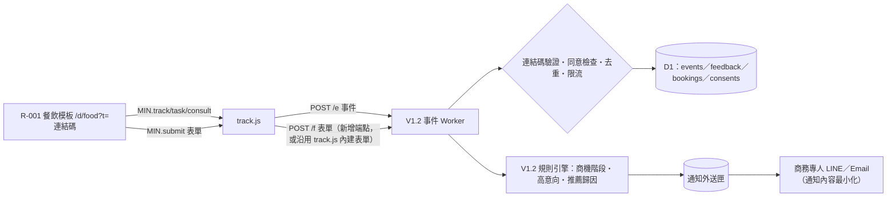

# R-001 × MIN-003 V1.2 商機中心串接方案（提案，未啟用）

依 C-001-ORDER-R001-G2.1-009 T03。本文件只提方案；G2.1-009 驗收版的表單固定為 `SUBMIT_MODE = 'local'`，沒有任何送出程式，不開啟正式商機收集。

## 1. 現況（G2.1-009）

| 項目 | 現況 |
|---|---|
| 表單 | 「領取經營體檢摘要」「預約專人診斷」兩種，保留為模擬表單 |
| 送出前 | 表單頂端提示「這是模擬表單：資料只存在這台手機，不會送到 MIN-003 商機中心」；按鈕寫「（模擬，不會送出）」 |
| 送出後 | 狀態卡「狀態：未送出（模擬）」、顯示正式串接後才會送出的資料、可「刪除這筆模擬資料」 |
| 資料去向 | 瀏覽器本機儲存（`r001-proto-g21-009`）。payload 帶 `delivery: {mode:'local', sent:false}` |
| 網路 | 無。自動測試確認提交過程沒有對外請求 |

## 2. 目標架構（沿用 V1.2 技術設計書，不另建後台）

重點：**模板仍然不直接打任何 API**（V1.2 第 10 節模板契約），只把 `MIN.submit()` 改由正式版 `track.js` 實作。R-001 不需要知道後台網址或客戶身分。

## 3. 欄位對照（R-001 payload → V1.2 資料表）

| R-001 欄位 | V1.2 資料表.欄位 | 說明 |
|---|---|---|
| `cta = report` | `feedback`（`want_custom = 領取體檢摘要`） | V1.2 回饋表；`top_pain` 取 `top_issues[0]` 對應困擾 |
| `cta = booking` | `bookings`（`preferred_time = booking.time`） | `booking.way`、`booking.need` 放入備註欄（V1.2 需新增 `notes`，或併入 `need`） |
| `contact.value`、`contact.consent` | `feedback.contact_value`／`contact_consent`；`bookings.contact_value`／`contact_consent` | 未勾同意不得送出聯絡方式（前端已擋，後端再驗一次） |
| `token` | `events.token`、`sessions.token` | 後端判斷客戶連結或夥伴連結；歸因依 V1.2 第 15.3 節 |
| `session_id` | `sessions.id` | 歸因成立時補歸匿名事件 |
| `store_profile`、`top_issues`、`journey` | `feedback` 新增 `profile_json`（建議） | 讓商務專人知道客戶看了哪種店型、卡在哪些問題 |
| 店名 | **不送** | 只顯示在客戶手機上 |

## 4. 啟用條件（全部滿足才開發 `v12` 模式）

1. 總指揮核准 R-001 正式串接（本方案）。
2. 《G1 V1.2 封版報告》部署清單與《G2 市場驗證計畫》第 1 節前提完成：自有網域、Cloudflare Workers＋D1、Access、法務確認告知文字。
3. V1.2 `templates` 表新增或更新 `food` 列（見 G2-006 MIN003 整合規格第 3 節，待決 D3）。
4. 通知規則確認：哪些 CTA 算「有需求」（G2-006 待決 D2）。

## 5. 開發步驟（核准後）

| 步驟 | 內容 | 驗收 |
|---|---|---|
| 1 | `track.js` 正式版提供 `MIN.submit()`；R-001 移除本機 `MIN` 模擬，改引用 `/track.js` | 模板原始碼中沒有任何 `fetch` 或後台網址 |
| 2 | 事件 Worker 新增表單處理（或沿用 V1.2 回饋表單端點），驗證連結碼、同意、聯絡同意 | 未勾同意的聯絡方式被拒；只看不記錄時操作事件不入庫 |
| 3 | 預設以 `internal` 旗標測試：商務專人自己的預覽連結送出的資料標記內部，不進統計、不發通知 | 戰情室不計入 |
| 4 | 先只通知內部 3 天（V1.2 清單 N7） | 無誤發 |
| 5 | 選 1–2 位餐飲推薦夥伴小規模試行 | 依 G2 市場驗證計畫指標 |

保護措施：`SUBMIT_MODE` 由部署設定決定，不由網址參數或使用者操作切換；`v12` 模式未部署前，前端仍維持「模擬表單」提示。

## 6. 風險與對策

| 風險 | 對策 |
|---|---|
| 客戶以為已送出、等不到聯絡 | 驗收版明示「未送出」；正式版送出成功才顯示「已送出，商務專人 1 個工作天內聯繫」，失敗保留草稿並提示重送 |
| 模擬資料混入正式商機 | 驗收版與正式版不同網域、不同儲存 key；正式版不讀取本機舊表單 |
| 聯絡方式外洩給夥伴 | 依 V1.2 第 15 節：夥伴通知不含聯絡方式 |
| LINE 內建瀏覽器清除本機資料 | 表單一送出即上傳，不依賴本機保存 |
