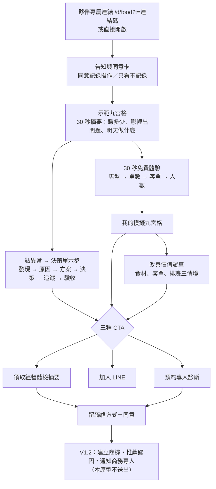

# R-001 商業轉換流程（G2-006・T05–T08）

原則：先證明好用，再證明有人願意買。客戶不需要提供營業數字就能走完體驗；留下聯絡方式一律需要勾選同意；本原型不送出任何資料或通知。

## 1. 客戶體驗路徑

## 2. T05 30 秒免費體驗

| 步驟 | 畫面 | 輸入方式 |
|---|---|---|
| 1 | 你的店是哪一種？ | 四張店型卡（附一句經營特性） |
| 2 | 一天大約幾張單？ | 5 個店型常見選項，或自己輸入 |
| 3 | 平均客單價？ | 以店型預設客單為中心的 5 個選項，或自己輸入（輸入框已帶入店型預設值） |
| 4 | 幾個人上班？有沒有外送？ | 2–10 人選項（已預選店型預設）、外送勾選 |
| 完成 | 我的模擬九宮格 | 頂部標示「依你輸入產生・你用了 N 秒・不代表你的店」，附「領取體檢摘要」 |

- 最少 8 次點擊完成，四種店型自動測試全部通過，並在 390px 手機寬度下確認版面。
- 完成時送出 `task_complete:產生我的九宮格`（附耗時秒數），可作為「實際試用」的判斷。
- 換店型會清空上一家店的決策單與待辦，避免把示範店的問題帶到客戶的店。

## 3. T06 改善價值試算

| 情境 | 公式 | 假設 |
|---|---|---|
| 食材成本降低 x 點 | 月營收 × x% | 營收不變；靠議價、減少報廢、份量標準化 |
| 營收與客單提升 | 增加的月營收 × 邊際貢獻率（1 − 食材率 − 外送占比 × 抽成 − 金流） | 現有人力與店面可承接，人事、租金不增加 |
| 排班效率 | 每日減少工時 × 196 × 1.11 × 營業日 | 減少的是離峰重疊工時，不影響出餐 |

頁面明寫「這是情境試算，不是獲利承諾」「不代表保證獲利」；三項獨立相加，未考慮彼此影響。

## 4. T07 三種 CTA 與事件

沿用 V1.2 既有事件類型，不新增 `type`，以 `feature` 區分 CTA，V1.2 的階段規則與通知規則不用改程式。

| CTA | 點擊時 | 送出表單時 | V1.2 商機階段 | 是否需要聯絡方式 |
|---|---|---|---|---|
| 領取經營體檢摘要 | `consult_click` / `cta_report` | `feedback_submit` / `report`（want_custom＝領取體檢摘要） | 有需求 | 必填 LINE ID 或 Email＋同意 |
| 加入 LINE 了解 AI 經營特助 | `consult_click` / `cta_line`；複製 ID 為 `feature_click` / `line:copy` | —（原型只顯示示範 ID，不開啟 LINE） | 有需求 | 不需要 |
| 預約專人診斷 | `consult_click` / `cta_booking` | `booking_submit` / `booking`（方式、時段、想先看的問題） | 預約洽談 | 必填＋同意 |

其他事件：

| 事件 | 觸發 | 需同意 |
|---|---|---|
| `page_open` | 頁面可見 2 秒後 | 否 |
| `consent` | 選擇「同意記錄操作／只看不記錄」 | — |
| `feature_click` | 開啟卡片、決策單每一步、試算滑桿、精靈每一步 | 是 |
| `task_complete` | 產生我的九宮格、完成一張決策單到驗收、查看 AI 建議依據 | 是 |

V1.2 高意向（7 天內 `task_complete` ＋ `consult_click`）在本模板的意思是：客戶真的走完一張決策單或免費體驗，又點了 CTA。

## 5. 推薦夥伴歸因（依 V1.2 第 15 節）

| 開啟方式 | 模板看到的 | 伺服器判斷（原型模擬） |
|---|---|---|
| 夥伴連結 `?t=HXEZ2JM5KR` | 只有連結碼 | 屬於 P001。客戶只開啟或試用 → 不成立；留聯絡方式＋同意 → 歸因成立、保護期 90 天、匿名事件補歸 |
| 客戶連結 `?t=K7M2Q9XF3H` | 只有連結碼 | 屬於 R001，事件記在客戶名下 |
| 無效或停用連結碼 | 只有連結碼 | 照常顯示，記為匿名，不提示錯誤 |
| 直接開啟 | 無 | 匿名，不歸因 |

- Artifact 只傳 `#hash`，所以原型另外接受 `#t-連結碼`，讀取後從網址移除。正式版用 `?t=`。
- 原型「整合測試」頁（`#devlog`）可切換以上五種開啟方式，看事件、階段預覽與歸因結果。

## 6. T08 付費服務展示（不定價）

| | 免費體驗 | 初階導入 | 正式經營特助 |
|---|---|---|---|
| 對老闆的價值 | 看懂自己的店該先管什麼 | 用自己的資料每週看一次 | 每天打烊自動告訴你哪裡出問題 |
| 資料來源 | 模擬資料 | 每週匯入 POS 報表、配方表、排班表 | 串接 POS、進貨、打卡，每日自動 |
| 九宮格與燈號 | 示範 | 你的店 | 你的店，打烊自動更新 |
| 異常規則 | 店型預設 | 依你的目標調整門檻 | 可新增規則 |
| 決策單閉環 | 模擬 7 天驗收 | 手動輸入追蹤數據 | 自動抓資料驗收 |
| AI 分析 | 未啟用 | 未啟用 | 串接 AI 模型，標示來源與信心 |
| LINE 經營摘要 | — | 每週一份 | 每日打烊推播 |
| 多店管理 | — | — | 可加購 |
| 導入協助 | — | 商務專人 1 次設定 | 專人導入與每月檢討 |
| 價格 | 免費 | 待總指揮定案 | 待總指揮定案 |

## 7. 建議的試辦觀察指標（假設值，待核准）

| 指標 | 定義 | 參考門檻 |
|---|---|---|
| 免費體驗完成率 | `task_complete:產生我的九宮格` ÷ 同意記錄的 session | ≥ 50% |
| 免費體驗耗時 | 完成事件的秒數中位數 | ≤ 60 秒 |
| 決策單完成 | 走到數據驗收的 session ÷ 開啟決策單的 session | 只記錄 |
| CTA 點擊率 | 任一 `consult_click` ÷ 有效開啟 | ≥ 15% |
| 留資率 | `feedback_submit`＋`booking_submit`（含同意）÷ 有效開啟 | ≥ 5% |
| 預約率 | `booking_submit` ÷ 有效開啟 | 只記錄 |
