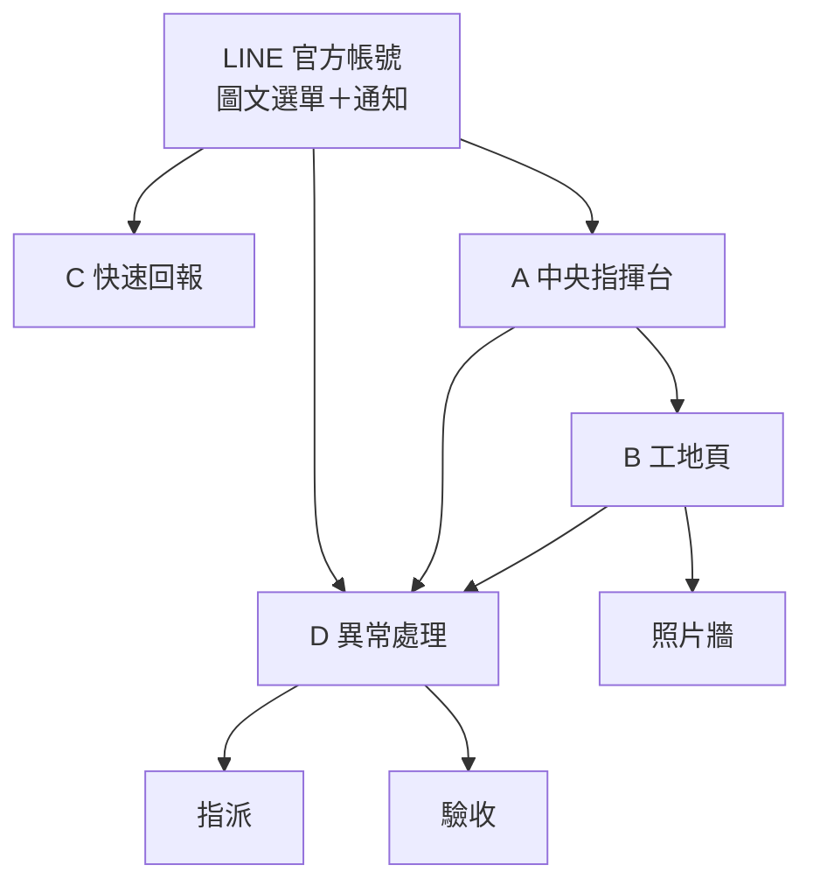
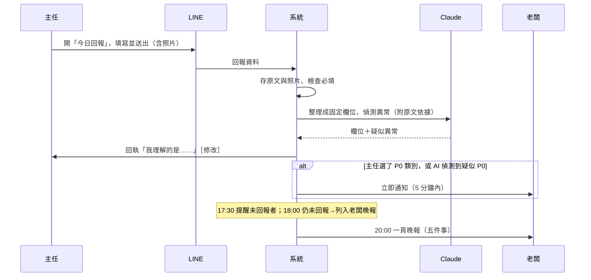
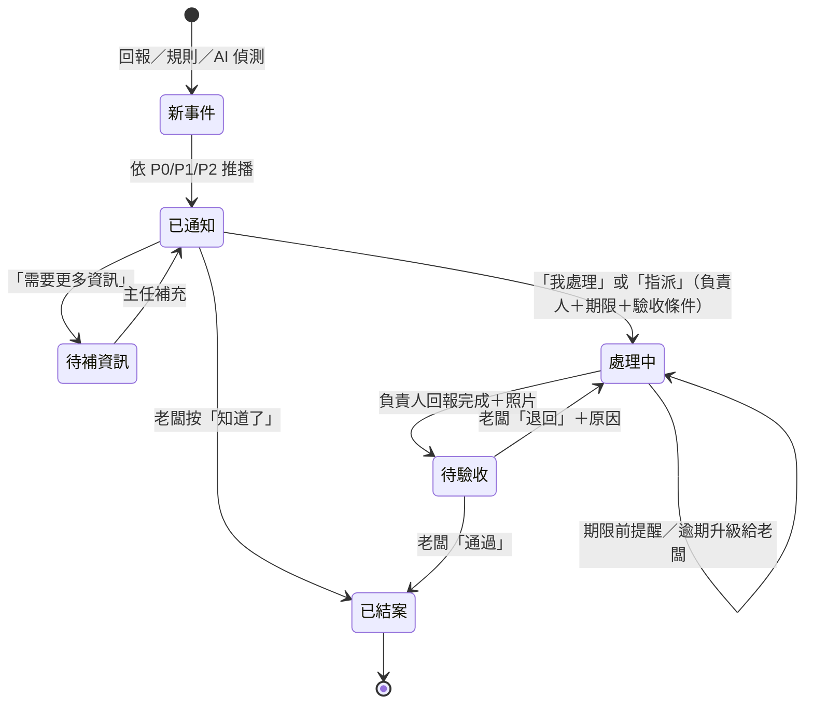

# C-001-02｜架構校正與 MVP 收斂：一個工地的手機體驗設計

- 依據：C-001-ORDER-002　執行：C　日期：2026-10-22
- 本輪只做設計與分析，不開發、不部署、不採購。
- 標記：✅ 已證實　🟡 待驗證（假設、推論，或需要現場確認）　❗ 必須由老闆或主任確認

上一輪是從技術往需求推；這一輪反過來：**老闆要知道什麼 → 現場最少回報什麼 → 手機上怎麼操作 → 才決定要用什麼技術**。

---

## 一、資源盤點補正

上一輪把三種情況混在一起寫成「找不到」，現在分開：

| 分類 | 定義 | 判斷方式 |
|---|---|---|
| **確實不存在** | 我能完整看到的範圍內，確認沒有 | 讀過全部內容 |
| **未找到** | 在我能搜尋的範圍內沒有，但可能存在於我看不到的地方 | 已搜尋，範圍有限 |
| **無權限存取** | 已知（或可能）存在，但這個工作階段沒有讀取管道 | 沒有 Connector 或帳號權限 |

| 項目 | 分類 | 說明 |
|---|---|---|
| Airtable「AI 戰隊｜商機交接中心 V1.0」（「商機案件」資料表，11 個欄位） | **無權限存取** | Shen 已確認存在；這個工作階段的 Connector 只有 Google 雲端硬碟，沒有 Airtable。11 個欄位的名稱與類型我還不知道 |
| Y-001、Y-002 職責卡與提示詞 | **未找到** | 4 個 GitHub repo、雲端硬碟（名稱與全文搜尋）都沒有。可能放在 Airtable 或 claude.ai Projects，這兩處我都讀不到 |
| claude.ai 的 Projects、記憶、Skills | **無權限存取** | 雲端開發工作階段讀不到帳號內的 Projects |
| Cloudflare V5 的線上實際狀態 | **無權限存取** | 只讀了程式碼與 `HANDOFF.md`，沒有登入後台確認；狀態以交接文件為準 |
| F04 | **未找到** | F01、F02、F03（營造、水電）、F05、T01 都有 |
| 中央指揮台設計文件或程式 | **未找到** | |
| LINE 官方帳號 | **未找到** | 沒有任何文件或程式提到 |
| repo `-01`、`-02` 的內容 | **確實不存在** | 兩個都是空 repo（0 commit） |
| V5 的排程（Cron） | **確實不存在** | `wrangler.toml` 沒有 `[triggers]`，`worker.js` 只有 `fetch` handler |
| V5 的 LINE 串接、照片儲存（R2）、多使用者帳號 | **確實不存在** | 已讀過全部原始碼 |
| 海豹小隊 M001 實戰紀錄、戰果庫資料 | **確實不存在** | M001 只有空資料夾；戰果庫 0 筆 |

**下一步需要 Shen 提供**（任選一種）：

1. 在 claude.ai 連接 Airtable Connector，讓 C 用唯讀方式讀 schema；或
2. 匯出「商機案件」的 11 個欄位名稱與類型（截圖也可以，不用提供資料）。

> Y-001／Y-002 的升級設計等拿到欄位後再做；本輪依命令專注在工地 MVP。

---

## 二、從老闆需求反推

以下是**假設**，要用 F03 的 C1、C11（營造）與 W10（水電：「每天晚上只看一頁，最想看到什麼？排前 3 項」）訪談確認。❗

### 2-1 老闆每天最想知道的五件事

| # | 老闆想知道 | 一句話回答的樣子 | 資料從哪來 | 能否自動 |
|---|---|---|---|---|
| 1 | **今天每個工地有沒有開工、來了多少人** | 「A 工地 12 人（預計 14）」 | 主任回報的出工人數；跟預計人數比較 | 半自動：人數要回報，比較由系統算 |
| 2 | **哪個工地落後、落後多少** | 「A 工地 3F 灌漿比預定晚 2 天」 | 主任回報的工項完成度 ＋ 預定進度表（開工時輸入一次） | 半自動 |
| 3 | **今天有沒有出事**（工安、品質、業主或監造意見） | 「B 工地：監造要求補強 2F 樑筋，附照片」 | 主任回報的異常欄 ＋ AI 從文字或照片偵測 | 要回報；AI 只補漏 |
| 4 | **明天會不會卡住**（缺料、缺工、需要我決定的事） | 「A 工地明天缺 #4 鋼筋 30 支，要我批准叫料」 | 主任回報的「明日需求」 | 要回報 |
| 5 | **我交辦的事辦了沒** | 「3 件交辦，1 件逾期（B 工地補強照片）」 | 系統的交辦紀錄 | **全自動** |

刻意**不放進每日**的項目：估驗、請款、成本。這些是週或月的節奏，放進每日摘要會變成噪音，放在第二階段的週報。🟡

### 2-2 工地主任每天最少要回報什麼（目標 2 分鐘內）

| 類別 | 欄位 | 輸入方式 | 對應老闆的第幾件事 |
|---|---|---|---|
| 必填 | ① 今日出工人數 | 數字加減鍵（預設帶昨天的數字） | 1 |
| 必填 | ② 今日完成什麼 | 點選工項（從預定進度表帶出）＋完成度（25%、50%、75%、完成）；或錄一段 30 秒內的語音 | 2 |
| 必填 | ③ 現場照片 2–3 張 | 直接拍照；畫面提示「全景 1 張 ＋ 今日重點 1–2 張」 | 2、3 |
| 二選一 | ④ 明天缺什麼 | 先選「沒有／有」；選「有」才展開：材料、人力、機具、需要老闆決定 ＋ 一句話 | 4 |
| 二選一 | ⑤ 今天有沒有異常 | 先選「沒有／有」；選「有」才選類別：工安、品質、業主或監造、天候、其他 ＋ 一句話 ＋ 照片 | 3 |

設計原則：

- **沒事的日子只要點 5 下＋拍 2 張照**（大約 60–90 秒）；有事才展開。
- 可以打字，也可以用語音，**不強迫打字**（T01 會記錄「回報方式」，用來驗證這個假設）。
- 送出後由系統回覆「我理解的是：……」，有錯直接點選修正。AI 抽出的內容一定讓主任看得到。

### 2-3 哪些資訊可以自動取得

| 資訊 | 來源 | 狀態 |
|---|---|---|
| 有沒有回報、幾點回報、缺交 | 系統紀錄 | ✅ 一定可以 |
| 交辦是否逾期 | 系統紀錄 | ✅ |
| 進度落後天數 | 預定進度表（開工時建一次）× 回報的完成度 | ✅ 計算；前提是進度表有建 |
| 出工人數趨勢、與預計人數的差距 | 歷史回報 | ✅ |
| 天氣預報與豪雨、颱風警報 | 中央氣象署開放資料（要申請 API 授權碼） | 🟡 待驗證申請流程與用量限制 |
| 照片拍攝時間與地點 | 照片的 EXIF | 🟡 LINE 傳圖可能會壓縮並移除 EXIF；先以上傳時間為準 |
| 實際完成度、材料到貨、業主意見 | — | ❌ 只能靠人回報 |

### 2-4 哪些異常要立即通知

| 等級 | 何時通知老闆 | 包含 | 誰判定 |
|---|---|---|---|
| **P0 立即**（任何時間） | 收到回報後 5 分鐘內 | 工安事故或有人受傷、停工、結構或重大品質問題、業主或監造書面要求停工或改正、對露天作業工地發布豪雨或颱風警報 | **主任選的類別**（主要依據）＋ AI 偵測到疑似狀況（補充）。AI **只能升級、不能降級** |
| **P1 當天** | 18:00 前或回報後 2 小時內 | 明天缺料或缺工會影響施工、需要老闆決定的事、監造口頭意見、18:00 還沒回報 | 規則判斷 |
| **P2 晚報** | 20:00 一頁摘要 | 輕微落後、一般紀錄、照片 | 規則 ＋ AI 摘要 |

- P0、P1 的清單與時間點都要老闆確認 ❗。
- 天氣警報要先知道哪些工項是露天作業 ❗。

### 2-5 老闆收到通知後：指派 → 追蹤 → 驗收

1. **收到通知卡**：顯示等級、工地、主任原文與照片，以及 AI 的整理（標示為「AI 整理」）。
2. **四個按鈕**：「我處理」、「指派給……」、「知道了（不需處理）」、「需要更多資訊」。
3. **指派**：
   - 選負責人，預設是該工地主任。
   - 選期限：預設 P0 是今天，P1 是明天 17:00。
   - 選驗收條件，預設是「完成照片 ＋ 一句話」。
4. **負責人收到 LINE 通知**，可以回「處理中」，或回「完成」並附上照片。
5. **追蹤**：期限前 2 小時提醒負責人；逾期 4 小時後通知老闆；每天的晚報都列出逾期項目。
6. **驗收**：老闆收到驗收卡，按「通過」就結案；按「退回」要填原因，退回後重新回到處理中。
7. 每一步都留下稽核紀錄（誰、何時、做了什麼）。

---

## 三、手機頁面資訊架構

### 3-1 角色與頁面

| 角色 | 主要入口 | 可以看到的頁面 |
|---|---|---|
| 老闆 | LINE 通知 → 點連結開網頁 | A 中央指揮台、B 工地頁（全部工地）、D 異常處理 |
| 工地主任 | LINE 選單 → 快速回報 | C 快速回報；B 工地頁（只限自己的工地）；D 異常處理（只限指派給自己的事） |
| 師傅（可選） | LINE 選單 | 只能用 C 快速回報的簡化版 |



### 3-2 A 中央指揮台：一眼看全部工地

```
┌──────────────────────────────┐
│ 10/22（三）  晴 28°   ⟳ 18:05 │
├──────────────────────────────┤
│ 今日回報 7/9   異常 3   逾期 2  │  ← 點數字直接篩選
├──────────────────────────────┤
│ ▍需要你決定（2）              │
│ 🔴 B 工地｜監造要求補強 2F 樑筋 │ → D
│ 🟠 A 工地｜明天缺 #4 鋼筋 30 支 │ → D
├──────────────────────────────┤
│ ▍工地（依嚴重程度排序）        │
│ 🔴 B 工地  12/14 人  落後 2 天  │
│    [照片縮圖]  17:12 回報      │ → B
│ 🟡 E 工地  未回報（18:00 截止）│
│ 🟢 A 工地  15/15 人  正常      │
│ …                            │
├──────────────────────────────┤
│  指揮台 │ 異常 │ 交辦 │ 我     │  ← 底部導覽
└──────────────────────────────┘
```

- 第一個區塊永遠是「需要你決定」；沒有待決事項時顯示「今天沒有需要你決定的事」。
- 燈號規則：🔴 有未結案的 P0，或落後 3 天以上；🟠 有 P1；🟡 未回報或輕微落後；🟢 正常。門檻要老闆確認 ❗。
- MVP 只有 1 個工地，但版面一開始就照 9 個工地設計，之後擴充不用重做。

### 3-3 B 工地頁：一個工地的全貌

```
┌──────────────────────────────┐
│ ← B 工地  🔴   主任：○○         │
│ 工期 第 86/240 天  落後 2 天    │
├──────────────────────────────┤
│ 今日 │ 進度 │ 人員 │ 材料 │ 照片 │ 異常 │
├──────────────────────────────┤
│ [今日]                        │
│ 主任原文（語音附逐字稿）        │
│ ┊ AI 整理：3F 灌漿完成 100%；   │
│ ┊ 明日缺 #4 鋼筋 30 支          │
│ [照片 1][照片 2][照片 3]        │
│ 天氣：明日降雨 70%（露天工項提醒）│
└──────────────────────────────┘
```

| 分頁 | 內容 | MVP 要不要做 |
|---|---|---|
| 今日 | 回報原文、AI 整理、照片、天氣 | ✅ |
| 進度 | 工項清單：預定與實際對照；落後的工項排在最前面 | ✅（簡化成清單，不做甘特圖） |
| 人員 | 每日出工人數走勢（14 天）、預計人數 | ✅ |
| 材料 | 缺料或叫料請求，以及狀態（待批、已叫、已到） | 🟡 只列回報裡的缺料；不做庫存 |
| 照片 | 依日期分組，可以依工項篩選 | ✅ |
| 異常 | 這個工地未結案與已結案的事件 | ✅ |

### 3-4 C 快速回報：兩分鐘內完成

入口是 LINE 圖文選單的「今日回報」。建議做成在 LINE 裡打開的單頁表單（LIFF）；語音和照片也可以直接傳到聊天室，當作備援。🟡 LIFF 需要另外建 LINE Login channel，開通方式與費用待驗證。

```
┌──────────────────────────────┐
│ 今日回報｜B 工地（10/22）       │  ← 工地預設帶上次選的
├──────────────────────────────┤
│ ① 出工人數    [ − ]  12  [ + ] │  ← 預設帶昨天的數字
│ ② 今日完成                     │
│   [3F 灌漿 ✓完成] [3F 拆模 50%]│  ← 工項晶片，可多選
│   🎤 按住說話（可選）           │
│ ③ 照片  [📷全景][📷重點][＋]    │
│ ④ 明天缺東西？  (沒有) (有)     │
│ ⑤ 今天有異常？  (沒有) (有)     │
│        [ 送出 ]               │
└──────────────────────────────┘
送出後（在 LINE 聊天室）：
「收到 B 工地 10/22 回報：12 人；3F 灌漿完成；照片 2 張。
  明天缺：#4 鋼筋 30 支 → 已通知老闆。有錯請點［修改］」
```

- 操作次數：沒事的日子約 5 下點擊＋2 張照片。
- 時間預算：60–90 秒（沒事）；有事時 2 分鐘以內。
- 收訊差：表單內容先存在手機上，有訊號時自動送出。🟡 工地收訊狀況要用 F03 的現場觀察確認。

### 3-5 D 異常處理

列表頁有四個分頁：**待我決定**／處理中／待驗收／已結案。

```
┌──────────────────────────────┐
│ 🔴 P0｜B 工地｜品質             │
│ 10/22 16:40 主任回報            │
├──────────────────────────────┤
│ 原文：「監造說 2F 樑筋間距不足，│
│ 要補強，明天複驗」 [照片][照片] │
│ ┊ AI 整理：品質／監造要求／      │
│ ┊ 期限：明天複驗                │
├──────────────────────────────┤
│ 時間軸                         │
│ 16:40 回報 → 16:41 通知老闆     │
├──────────────────────────────┤
│ [我處理] [指派▾] [知道了] [要更多資訊] │
└──────────────────────────────┘
指派面板：負責人 [B 主任▾]  期限 [明天 12:00▾]
          驗收條件 [✓完成照片 ✓一句話說明]
驗收卡：完成照片＋說明 → [通過] [退回（原因）]
```

---

## 四、現場回報流程



**例外處理**：

| 情況 | 系統怎麼做 |
|---|---|
| 主任忘了回報 | 17:30 提醒一次；18:00 仍未回報就列入晚報，不再追 |
| 必填欄位缺 | 回執裡直接追問一次，不重複追 |
| AI 抽取失敗或沒把握 | 保留原文，標示「未整理」，晚報照樣列出原文；不阻擋送出 |
| 主任修改了 AI 的整理 | 存下修正版，並留下「AI 版 → 人工版」紀錄，當作改進提示詞的樣本 |
| 收訊不良 | 手機上先存草稿，恢復訊號後再送（🟡 技術待驗證） |

---

## 五、異常處理流程



規則：

- 每次狀態改變都寫入稽核紀錄（誰、何時、從哪個狀態到哪個狀態、附註）。
- AI 不能改變狀態，只能整理內容與建議等級。
- 「知道了」結案的事件也保留，週報統計「誤報率」用。
- 系統不會自動對外送出任何東西（叫料、聯絡業主）。MVP 只有「通知人」，沒有「代替人執行」。

---

## 六、技術底座重新檢驗：V5 哪些能用

已逐檔讀過 V5 原始碼（`src/`、`web/`、`test/`、`schema.sql`、`wrangler.toml`、`build.mjs`）。

**先講結論：建議另開一個新的 Worker 與 D1，從 V5 複製可重用的模組，不要把工地功能加進 FB 內容工作室。**原因有三：

1. 客戶的工地資料不應該和自己的行銷名單放在同一個資料庫。
2. V5 是單一管理者密碼登入，工地系統需要多角色帳號。
3. V5 正在使用中，改動會影響現有的粉專排程。

### 6-1 可直接重用

| 模組 | 內容 | 用途 |
|---|---|---|
| `src/util.js` | `json`、`fail`、`newId`、`nowIso`、`escapeHtml`、`readJson`（有大小上限）、`str`、`safeEqual`、`ipHash` | 全部照用 |
| Worker 入口的錯誤處理 | `fetch` 外層 try/catch，錯誤訊息翻成中文 | 照用 |
| 安全標頭 | CSP、`nosniff`、`frame-ancestors 'none'`、同源檢查（擋跨站寫入） | 照用 |
| `build.mjs` | 前端打包成單一 HTML 字串，Worker 打包成單一檔案 | 照用 |
| `test/helpers.js` | 用 `node:sqlite` 模擬 D1、攔截對外的 `fetch` | 照用；換掉 schema 路徑即可 |
| `web/cost.js` | 依實際 `usage` 計算 Claude 費用 | 照用，記錄每筆 AI 呼叫的成本 |
| `wrangler.toml` 做法 | `keep_vars`、Secret 不寫進檔案 | 照用 |
| 部署交接文件格式 | `HANDOFF.md`：一次一步、「真實通過／模擬通過／未測試」分類 | 照用 |
| 外觀 | CSS 色彩變數、深色模式、手機版排版 | 照用 |

### 6-2 需要修改

| 模組 | 現況 | 要怎麼改 |
|---|---|---|
| `src/auth.js` | 單一管理者密碼、HMAC 簽章 cookie、登入失敗鎖定 | 保留 cookie 簽章與鎖定機制；改成多使用者：以 LINE 帳號綁定身分，分成老闆、主任、師傅三種角色 |
| `util.hmac` | 輸出 base64url | LINE Webhook 簽章驗證要用**標準 base64**：加一個參數或另寫一個函式 |
| `schema.sql` | 貼文、表單、名單、登入紀錄 | 只保留 `auth_attempts`，其他資料表重新設計（見 6-3） |
| `worker.js` 路由 | 只有 `fetch` | 改成新路由；新增 `scheduled()` handler 處理 Cron |
| `proxyClaude` | 瀏覽器送請求，伺服器代為加上 API Key | 改成**伺服器主動呼叫**（收到回報、排程時）；保留「API Key 只在伺服器」與「模型白名單」 |
| `meta.js` | Graph API 呼叫、把錯誤碼翻成中文、檢查權杖類型 | 照這個模式寫 `line.js`（推播、回覆、錯誤翻譯、權杖檢查） |
| `forms.js` | 公開表單、防機器人、限流、CSV 防公式注入 | 限流與 CSV 安全匯出照用；表單本身改成快速回報（需要登入身分，不是公開表單） |
| `status()` 健康檢查 | 檢查 Claude 與 Meta 是否設定 | 改成檢查 Claude、LINE、R2、Cron 最後執行時間 |
| `web/app.js`（922 行） | FB 內容工作室的介面 | 外殼、`localStorage` 小工具、API 呼叫方式可以參考；畫面要全部重做 |

### 6-3 需要新建

| 元件 | 說明 |
|---|---|
| LINE Webhook ＋ 簽章驗證 | 接收文字、照片、語音、按鈕回應 |
| LINE 推播與回覆模組 | 通知卡、按鈕、回執 |
| 快速回報頁（LIFF） | 頁面 C；以 LINE 身分登入 🟡 |
| 照片儲存（R2） | 上傳、縮圖、依工地與日期存放 |
| 語音轉文字 | 🟡 Claude API 目前不直接收音訊檔（待查證）；MVP 可以先請主任用 LINE 內建的語音輸入打字，或另外評估語音轉文字服務 |
| 資料表 | 工地、人員與角色、預定工項、每日回報、照片、事件、交辦、稽核紀錄 |
| Cron 排程 | 17:30 缺交提醒、18:00 缺交彙整、20:00 晚報、逾期檢查（每小時） |
| 規則引擎 | P0／P1／P2 判定、燈號、落後天數；門檻寫在設定裡，不寫死 |
| AI 抽取與偵測 | 固定欄位的 JSON 輸出（使用結構化輸出）、一定附原文依據、記錄成本 |
| 事件狀態機與稽核紀錄 | 見第五節 |
| 頁面 A、B、D | 手機優先 |
| 天氣資料 | 中央氣象署開放資料 🟡 |
| 驗收樣本與回歸測試 | T01 的資料加上主任修改紀錄，整理成 20–30 筆標準答案；每次改提示詞都要重跑 |

---

## 七、MVP 驗收標準

### 前置閘門（不寫程式）

- **G0**（T01 已定義）：3 天試跑，回報率 ≥ 60%，且老闆認為摘要有用 ≥ 2 天。沒過就修改回報設計，不開發。

### 試行：1 個工地、連續 14 個工作日

| 面向 | 指標 | 通過門檻 | 怎麼量 |
|---|---|---|---|
| 現場採用 | 回報率（18:00 前） | ≥ 80% 工作日 | 系統紀錄 |
| 現場負擔 | 回報耗時中位數 | ≤ 2 分鐘（80% 的回報 ≤ 3 分鐘） | 從打開頁面到送出 |
| 資料品質 | 必填欄位完整度 | ≥ 90% | 系統紀錄 |
| AI 正確性 | 欄位抽取正確率 | ≥ 90% | 每週抽 10 筆，由主任或 C 對照原文 |
| 安全底線 | P0 漏報 | **0 件** | 測試樣本＋實際試行 |
| 即時性 | P0 從回報到老闆收到 | ≤ 5 分鐘 | 系統時間戳 |
| 噪音 | 老闆按「知道了（不需處理）」的比例 | ≤ 20% | 系統紀錄 |
| 閉環 | 指派時有負責人、期限、驗收條件 | 100% | 系統強制 |
| 閉環 | 逾期都有提醒；結案都有驗收紀錄 | 100% | 稽核紀錄 |
| 老闆價值 | 晚報被評為「有用」的天數 | ≥ 10/14 天 | 晚報底部一鍵回饋 |
| 老闆價值 | 每天打電話問工地狀況的次數 | 只記錄，與 T01 基準期比較 | 老闆自記（樣本小，不設硬門檻） |
| 成本 | AI＋雲端費用 | ≤ NT$500／月 | 用 `cost.js` 累計 |
| 權限 | 主任只能看自己的工地；AI 沒有自行對外動作 | 0 例外 | 測試＋稽核紀錄 |

**下一步的判定**：

- 全部通過 → 擴到第 2、3 個工地（只改設定，不改程式）。
- 「現場採用」不通過 → 回頭改回報設計，不加功能。
- 「AI 正確性」不通過 → 改提示詞與樣本，或縮小 AI 範圍、改用規則。

---

## 八、需要老闆或主任確認的問題（下一次訪談帶去）

| # | 問題 | 對應 |
|---|---|---|
| 1 | 五件事的排序對嗎？有沒有更想看的？ | F03 C1、C11；W10 |
| 2 | P0 清單與「立即」的定義；半夜也要通知嗎？ | 2-4 |
| 3 | 燈號門檻：落後幾天算紅燈？ | 3-2 |
| 4 | 試行要選哪一個工地？主任配合度如何？ | F03 W11 |
| 5 | 有沒有預定進度表（工項＋預定日期）？格式是什麼？ | 2-3 |
| 6 | 主任與師傅的手機和 LINE 使用習慣、工地收訊狀況 | F01 B7；F03 現場觀察 |
| 7 | 回報截止時間：17:30 或 18:00 合適嗎？ | 2-4 |
| 8 | 哪些資料不能上雲？可以接受用代號嗎？ | F03 C10；F01 J1–J5 |

---

## 九、下一輪建議

1. Shen 補 Airtable 讀取管道（Connector 或欄位截圖）→ C 出 Y-001／Y-002 升級設計。
2. 帶第八節的問題做訪談，同時跑 T01。
3. G0 通過後，C 依本文件出**開發規格**（資料表、路由、提示詞、測試案例），仍要經 Shen 核可才開工。
4. 頁面 A–D 可以先做**可點擊的手機原型**（假資料），讓老闆與主任試用、計時。這是不寫後端、成本最低的驗證方式（要 Shen 授權）。
