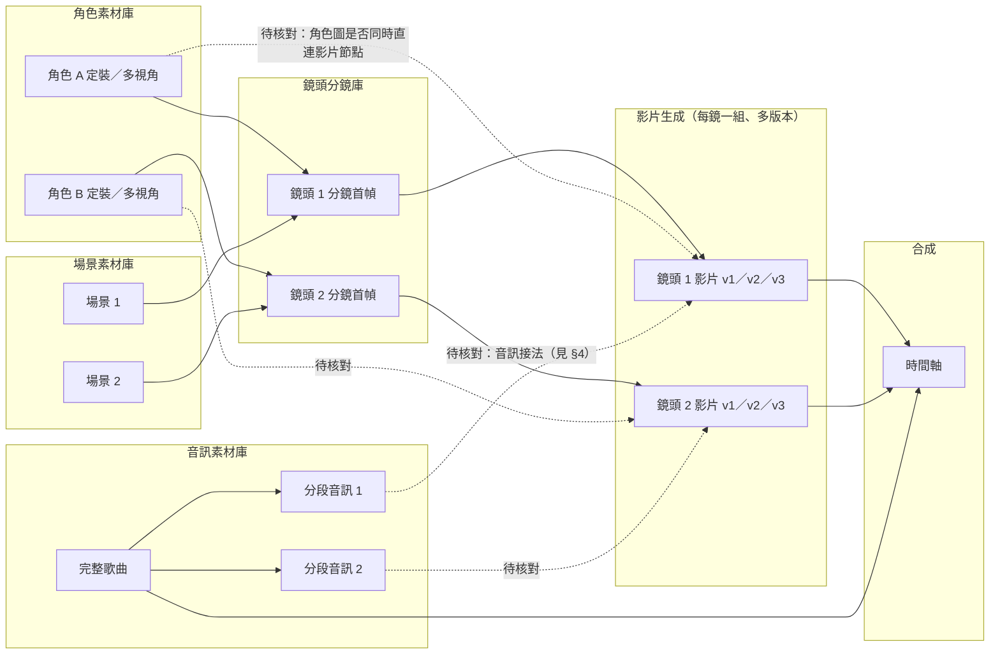
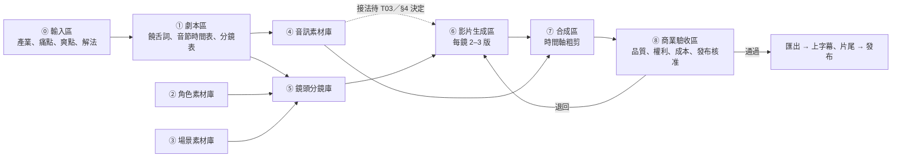

# 《LibTV Battle MV 節點工作流拆解圖 V1.1》

- 回覆令號：C-001-ORDER-010｜LibTV 工作流實證整合令（發令：Shen｜總指揮）
- 執行：C-001｜AI 系統開發官｜日期：2026-10-22
- 前版：[拆解圖 V1.0](../LibTV-BattleMV節點工作流拆解圖-V1.0.md)
- 附件：
  1. [已確認證據表](附件1-已確認證據表.md)
  2. [未驗證技術清單](附件2-未驗證技術清單.md)
  3. [5 秒中文 Rap MVP 操作規格](附件3-5秒中文Rap-MVP操作規格.md)
  4. [跨產業母版重用方案](附件4-跨產業母版重用方案.md)
- 本輪限制：未付費生成、未複製他人素材、未正式部署。

---

## 0. 證據收件狀態（先讀）

| 指定證據 | 狀態 |
|---|---|
| 公開畫布 `https://www.libtv.com/detail/a5bda04ecce444a99a7bfa581243cbeb` | **本環境無法開啟**：`www.libtv.com` 與 `liblib.tv` 系列網域都被環境網路政策擋下 |
| 總指揮的畫布截圖 | **本輪未收到**：命令內文沒有附圖，repo 各分支與總指揮的 Google Drive（以 LibTV、過來人及近一週圖片搜尋）都找不到 |

因此本版的處理方式是：
- **節點架構、素材庫分類、T08 驗證規格、八區母版、成本係數、MVP 操作規格、跨產業方案**：不需要截圖，本版**已完成**。
- **V1.0 假設逐項比對**（§2）：表格已建好，每一列都寫明「截圖上要看哪裡」。目前只能填入總指揮在命令中的**口述觀察**（標為 E0），**沒有任何一列判定為「截圖證實」**。
- 截圖送達後（放進 repo 的 `BattleMV-V1.1/截圖/`、雲端硬碟資料夾，或直接貼在對話裡都可以），我會逐張填表並升版 V1.2，不需要重做其他部分。

**證據等級**（沿用前版並新增 E0）：

| 等級 | 意義 |
|---|---|
| E1 | 我方實測（實際生成並驗收） |
| **E1s** | **截圖直接看得到**（本版新增：只能證明「畫布上有這個節點或連線」，不能證明功能效果） |
| E2 | 官方原始碼 |
| E3 | 官方文件 |
| E4 | 第三方報導或教學 |
| **E0** | **總指揮口述觀察**（本版新增：可信但我未親見，不得單獨作為「已證實」的依據） |

**判定規則**：截圖頂多把「節點存在、連線存在、標籤寫什麼」升到 E1s。**連線存在不等於功能有效**，例如音訊線連到影片節點，不代表嘴型真的由音訊驅動。功能是否有效一律要 E1 實測。

---

## 1. 更新後的節點連線與分組架構

V1.0 是把「角色、舞台、音樂」直接畫成生產線上的步驟。V1.1 依總指揮口述的畫布結構（人物素材、場景分組、音訊節點、影片節點、跨節點連線），改成**「四個素材庫＋一條生產線」**：

- **素材庫**：只放「會被很多鏡頭引用」的來源節點，本身不是成片的一部分。
- **生產線**：每個鏡頭一組，從各素材庫拉線進來。

**V1.0 → V1.1 架構差異**

| 項目 | V1.0 | V1.1 |
|---|---|---|
| 分組概念 | 生產步驟分區（音樂區、角色區、舞台區、影片區） | **素材庫與生產線分開**：四個素材庫被多個鏡頭共用；生產線按鏡頭分組 |
| 分鏡 | 放在舞台／分鏡區，和場景混在一起 | 獨立成**鏡頭分鏡庫**：每個鏡頭一張首幀或分鏡圖，由角色庫＋場景庫組合而成 |
| 音訊 | 音樂區，推定「先整首再切段」 | **音訊素材庫**：完整歌曲、分段、（若有）分軌人聲；接到生產線的方式列為最高優先追查（§4） |
| 跨鏡頭引用 | 只畫了一條「定裝圖 → 鏡頭」 | 獨立成 **T08** 驗證項目（§3） |

### 1.1 四個素材庫的定義

| 素材庫 | 放什麼 | 不放什麼 | 對外連線 | 我方對應 |
|---|---|---|---|---|
| **角色素材庫** | 每位角色的定裝圖、多視角圖、表情或服裝變體 | 帶場景的鏡頭畫面 | 連到鏡頭分鏡庫，以及（待核對）直連影片節點 | 四合一角色板（MVP 素材包已有規格） |
| **場景素材庫** | 空景、不同角度的同一場景 | 有人物的畫面 | 連到鏡頭分鏡庫 | 傳統店／AI 店兩套舞台 |
| **鏡頭分鏡庫** | 每個鏡頭的首幀或分鏡圖（角色＋場景＋構圖） | 影片 | 連到該鏡頭的影片節點 | MVP 分鏡表＋分鏡動態腳本 |
| **音訊素材庫** | 完整歌曲、分段音訊、純人聲、純伴奏 | 影片的原生音軌 | 連到影片節點（待核對）或合成時間軸 | `rap-5s-*.wav`＋音節時間表 |

---

## 2. V1.0 假設逐項比對

「截圖上要看哪裡」是給收到截圖後填表用的。E1s 欄目前全部空白。

| # | V1.0 假設 | 總指揮口述（E0） | 截圖上要看哪裡 | 截圖觀察（E1s） | 本版判定 |
|---|---|---|---|---|---|
| H01 | 每位角色有獨立一組定裝或多視角圖 | 有「人物素材」「角色多視角素材」 | 人物分組內的圖片節點數、每張圖的視角 | 未收到 | 口述支持，**待截圖** |
| H02 | 角色圖連到該角色的多個鏡頭 | 有「跨節點連線」 | 從同一張角色圖出發的連線數量與終點 | 未收到 | **待截圖** |
| H03 | 角色圖除了接分鏡，也直接接影片節點 | — | 影片節點左側輸入口接了哪些節點 | 未收到 | **待截圖** |
| H04 | 有場景分組，且場景先於人物鏡頭建立 | 有「場景分組」 | 場景分組內節點類型；場景圖的下游是誰 | 未收到 | 分組存在：口述支持；順序：**待截圖** |
| H05 | 有「舞台＋角色」分鏡首幀，再圖生影片 | 有「舞台分鏡」 | 影片節點上游是否有一張帶人物的圖片節點 | 未收到 | 口述支持，**待截圖** |
| H06 | 先完成整首歌，再切成每人一段 | 有「音訊波形」「音訊節點」 | 音訊節點數量、長度、是否有一條長音訊連到多條短音訊 | 未收到 | **待截圖** |
| H07 | 音訊線接到影片生成節點（可能是音訊驅動） | — | 音訊節點的輸出線終點是影片節點，還是合成／時間軸 | 未收到 | **待截圖**；即使看到連線，功能仍**未驗證** |
| H08 | 影片節點顯示的模型或模式含「對口型」「音訊驅動」等字樣 | — | 影片節點標題列、參數面板 | 未收到 | **待截圖** |
| H09 | 同一鏡頭有多個版本並排，只有選中的版本連到合成 | — | 同一角色段落的影片節點數、各自是否有下游 | 未收到 | **待截圖** |
| H10 | 有合成／時間軸節點把各鏡頭依歌曲順序排起來 | — | 是否有時間軸或合成類節點；其上游數量 | 未收到 | **待截圖** |
| H11 | 每個影片節點的模型、時長、比例、點數看得到 | — | 節點面板上的欄位 | 未收到 | **待截圖**；點數欄位若顯示，只能當「標價」，不是實扣 |
| H12 | 公開頁有「複製項目」類按鈕 | — | 公開頁頂部或側邊的按鈕文字與提示 | 未收到 | **待截圖**；即使存在，本輪也**不按** |

---

## 3. T08｜素材分組及跨鏡頭引用驗證（新增）

### 3.1 目的

確認「素材庫」這個做法在 LibTV 上真的成立：一份角色或場景素材，能被多個鏡頭穩定引用，換鏡頭不換臉、不換場景，而且素材庫可以跨集重用。

### 3.2 驗證子項

| 編號 | 子項 | 通過標準 | 證據來源 | 判定 |
|---|---|---|---|---|
| T08-1 | 分組存在 | 畫布能建立具名分組，分組內節點可整組移動、收合 | 截圖（E1s）＋我方操作 | 待截圖 |
| T08-2 | 一對多引用 | 同一張角色圖可同時連到 ≥ 3 個下游節點 | 截圖（E1s） | 待截圖 |
| T08-3 | 引用一致性 | 3 個引用同一角色圖的鏡頭，3 位評審盲測認定為同一人 | **只能 E1 實測** | 尚待實測 |
| T08-4 | 來源更新行為 | 替換素材庫裡的角色圖後：已生成的影片**不會**自動改變（應如此）；重新生成時會改用新圖 | E1 實測（只需觀察，不必付費生成即可看節點是否標示「上游已變更」） | 尚待實測 |
| T08-5 | 跨畫布帶線複製 | 複製「角色庫＋一個鏡頭組」到**我方另一張畫布**，連線完整保留 | E1（僅限我方自己的畫布，不涉及他人素材） | 尚待實測 |
| T08-6 | 工具箱沉澱 | 素材庫可存入「我的工具箱」，在新畫布載入後可直接被引用 | E1 | 尚待實測 |
| T08-7 | 命名可追溯 | 每個節點名稱能對應到附件 4 的命名規則，從成片能反查用了哪張角色圖、哪段音訊 | 我方自訂規則＋E1 | 尚待實測 |

T08-1、T08-2 可以靠截圖確認；T08-3 到 T08-7 都要在我方自己的畫布上操作。其中 T08-4 到 T08-7 **不需要付費生成**，可以併入 V1.1 報告的零點數補證一起做。

---

## 4. 最優先追查：音訊如何參與影片生成、中文 Rap 對嘴

### 4.1 四種可能的音訊角色

| 代號 | 音訊角色 | 畫布上的樣子（截圖可見特徵） | 能否靠截圖確認「功能有效」 | 對中文 Rap 的意義 |
|---|---|---|---|---|
| **R1 音訊驅動生成** | 音訊接進影片生成節點當輸入，模型依音訊做嘴型 | 音訊線終點是影片節點的輸入口；節點模式可能寫「音訊參考」「對口型」「數字人」 | **不能**。只能看到「接了」；嘴型是否跟著音訊動，要播放成片並逐幀比對 | 最理想：我方錄好的 Rap 直接驅動嘴型 |
| **R2 模型自生聲音** | 不接音訊；模型依提示詞裡的歌詞自己生成聲音與嘴型，事後再換成正式歌曲 | 影片節點沒有音訊輸入；提示詞文字裡有歌詞 | 不能 | 嘴型與「模型自己唱的版本」同步，換成正式歌曲後可能對不上 |
| **R3 後對嘴** | 先生成表演畫面，再用另一個「影片＋音訊 → 影片」的對嘴節點 | 有一個節點同時吃影片和音訊兩條線，輸出新影片 | 不能 | 多一道工序，但聲音完全可控 |
| **R4 只當配樂** | 音訊只進合成／時間軸，畫面不受影響 | 音訊線終點是時間軸或合成節點 | **可以**：若音訊只接時間軸，就能排除 R1 | 說唱鏡頭必須另想辦法對嘴 |

### 4.2 追查順序

1. **截圖**：看每條音訊線的終點（H07）與影片節點的模式標籤（H08）。結果只能區分「R4」與「R1／R3 其中之一」。
2. **零點數**：在我方帳號打開影片節點的模型清單與參數面板，找有沒有音訊輸入口或對嘴模式（V1.1 零點數補證 Z6、Z8）。
3. **付費實測（需另案核准）**：用 MVP 素材的 `rap-5s-vocal-guide.wav` 跑 R1；若沒有 R1，跑 R2 或 R3。以 `音節時間表.json` 逐幀驗收（附件 3）。

### 4.3 中文 Rap 的特殊難點

| 難點 | 為什麼 | 驗收方式 |
|---|---|---|
| 語速快 | 一拍兩字，每字約 0.3 秒，比一般對白快 | 音節時間表逐字比對，偏移 ≤ 2 幀 |
| 雙唇音 | 「忙（m）」「半（b）」必須先閉唇，最容易看出真假 | 必中項目 |
| 模型偏英文 | 多數對嘴模型以英文訓練，中文嘴型可能較差 | 與 R2（模型自生中文）比較 |
| 節奏與動作同拍 | 說唱手勢要落在拍點上 | 動作命中 ≥ 5/7 拍 |

---

## 5. 八區母版（七區升級，新增商業驗收）

> 編號說明：V1.0 的七區是把 ⓪ 輸入區算在內（⓪–⑥）。V1.1 從原「舞台／分鏡」拆出獨立的鏡頭分鏡庫，再新增商業驗收，畫布上共 9 個分組。依令文「八區」，**以生產區 ①–⑧ 計為八區**；⓪ 輸入區只放每集參數，不計入。

| 區 | 名稱 | 內容 | 跨集重用 |
|---|---|---|---|
| ⓪ | 輸入區 | 產業場景、傳統老闆痛點、AI 老闆爽點、解決方案（4 個文本節點） | 每集替換 |
| ① | 劇本區 | 饒舌詞、音節時間表、分鏡表 | 結構固定，內容每集重寫 |
| ② | 角色素材庫 | 傳統老闆、AI 老闆角色板（基本臉＋產業服裝） | **基本臉全系列固定**，服裝每產業一套 |
| ③ | 場景素材庫 | 傳統店、AI 店兩套 | 每產業一套 |
| ④ | 音訊素材庫 | 完整歌曲、分段、純人聲、純伴奏 | 伴奏可按 BPM 重用，人聲每集重錄 |
| ⑤ | 鏡頭分鏡庫 | 每鏡首幀 | 每集重做 |
| ⑥ | 影片生成區 | 每鏡 2–3 版 | 每集重做 |
| ⑦ | 合成區 | 時間軸粗剪 | 時間軸結構可重用 |
| **⑧** | **商業驗收區（新增）** | 見下表 | 檢查表固定 |

### 5.1 ⑧ 商業驗收區內容

在畫布上用文本節點放下列檢查表，每集逐項打勾；完整版存在 repo 的戰果紀錄。

| 類別 | 檢查項 | 通過標準 |
|---|---|---|
| 品質 | 嘴型、節奏、角色一致性 | 附件 3 驗收表全部通過 |
| 規格 | 9:16、時長、解析度、無浮水印、安全框內字幕 | 全部符合發布平台規格 |
| 權利：角色 | 角色為 AI 生成的虛構人物，無真人臉參考 | 素材來源欄可追溯 |
| 權利：音樂 | 伴奏自製或已授權；人聲為簽約真人錄音或可商用 TTS | 授權書或條款截圖存檔 |
| 權利：平台 | LibTV 條款允許商用；生成時會員或 API 身分有效 | 條款版本日期＋會員有效期截圖 |
| 權利：模型 | 使用模型的商用條款 | 存檔 |
| 權利：他人作品 | 畫布內無任何從他人畫布複製的節點 | 節點命名全部符合我方規則 |
| 內容 | 不點名真實店家、不貶損特定同業、AI 老闆的宣稱不誇大 | 企劃兵＋隊長確認 |
| 成本 | 實際點數 vs 預算 | 記錄差額與原因 |
| 發布 | 總指揮核准 | 簽核紀錄 |

---

## 6. 成本係數：四倍改列暫估

| 項目 | V1.0 | V1.1 |
|---|---|---|
| 係數 | 「預算一律乘 4 倍」 | **暫估 k = 4（合理範圍 3–6），待實測確認** |
| 依據 | 《過來人》創作者自述廢片：成片約 3:1 到 5:1 | 同一依據，等級為 E4（單一創作者口述，作品形式與我方不同、模型與熟練度未知） |
| 公式 | — | 每集預估點數 ＝ 成片秒數 × k × 每秒點數 |
| 確認方式 | — | MVP 及前 3 集逐鏡記錄「生成總秒數 ÷ 採用秒數」，取平均後取代暫估值 |

每秒點數也仍是暫估（第三方約 17 點／秒，720p），兩個暫估相乘，誤差會放大，所以**任何預算都要標註「暫估」並設停損上限**。

---

## 7. 下一步

| # | 事項 | 誰 | 花費 |
|---|---|---|---|
| 1 | 提供截圖（任一方式：放進本資料夾的 `截圖/`、雲端硬碟資料夾並告知名稱、或直接貼在對話裡） | 總指揮 | 0 |
| 2 | 依 §2 填表、升版 V1.2 | 開發官 | 0 |
| 3 | T08-4 到 T08-7 併入零點數補證 | 操作員（授權環境） | 0 點 |
| 4 | 付費 MVP（R1 或 R2／R3 對嘴實測） | 另案核准 | 依附件 3 |
