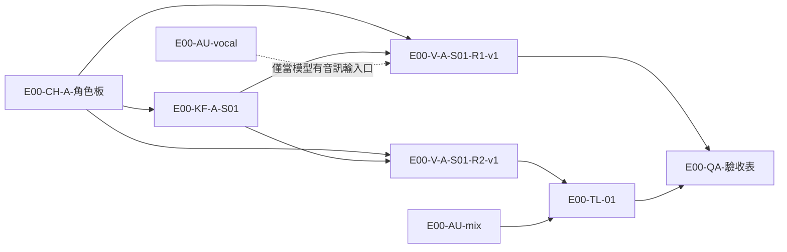

# 附件 3｜5 秒中文 Rap MVP 操作規格

- 隸屬：[《LibTV Battle MV 節點工作流拆解圖 V1.1》](LibTV-BattleMV節點工作流拆解圖-V1.1.md)
- 素材：[`../MVP素材/`](../MVP素材/README.md)（音訊、音節時間表、分鏡動態腳本、驗收表已備妥；角色板待生成）
- 狀態：**規格書**。依本令，**不核准付費生成**；本規格中標 💰 的步驟要等另案核准才能做。

---

## 1. 目標

用**八區母版的最小子集**，做一支 5 秒、9:16、中文 Rap 對嘴的單角色鏡頭，並同時驗證：

| 驗證 | 對應 |
|---|---|
| 音訊怎麼參與影片生成（R1／R2／R3／R4） | U01–U04 |
| 中文 Rap 對嘴精度 | U02 |
| 角色素材庫被多鏡頭引用 | U07、U14 |
| 每 5 秒實際點數 | U10 |

## 2. MVP 畫布佈局（八區子集）

建立一張新畫布，命名 `E00-MVP-麵店老闆-5s`。只建下表節點；**全部節點都由我方素材建立，不從任何他人畫布複製**。

| 區 | 分組名稱 | 節點名稱 | 類型 | 內容 |
|---|---|---|---|---|
| ⓪ | `⓪輸入` | `E00-IN-產業` | 文本 | 傳統麵店 |
| ① | `①劇本` | `E00-SC-詞` | 文本 | 天天忙到半夜，月底錢咧？ |
| ① | `①劇本` | `E00-SC-分鏡` | 文本 | 分鏡表（素材包 README §3） |
| ② | `②角色庫` | `E00-CH-A-角色板` | 圖片 | `ref-麵店老闆.png`（待生成） |
| ③ | `③場景庫` | `E00-ST-A-麵店櫃台` | 圖片 | 空景（可省略，MVP 用提示詞描述場景） |
| ④ | `④音訊庫` | `E00-AU-mix` | 音訊 | `rap-5s-mix.wav` |
| ④ | `④音訊庫` | `E00-AU-vocal` | 音訊 | `rap-5s-vocal-guide.wav`（給 R1） |
| ⑤ | `⑤分鏡庫` | `E00-KF-A-S01` | 圖片 | 鏡頭 1 首幀（由角色板生成，💰 約 1 張圖） |
| ⑥ | `⑥影片` | `E00-V-A-S01-R1-v1` 等 | 影片 | 依 §4 各路徑命名 |
| ⑦ | `⑦合成` | `E00-TL-01` | 時間軸 | 只在 R2／R3／R4 需要換音軌時使用 |
| ⑧ | `⑧驗收` | `E00-QA-驗收表` | 文本 | 驗收表結果摘要（完整版存 repo） |

**命名規則**：`{集}-{區碼}-{角色}-{鏡頭}-{路徑}-v{版}`。區碼：IN 輸入、SC 劇本、CH 角色、ST 場景、AU 音訊、KF 分鏡首幀、V 影片、TL 合成、QA 驗收。

## 3. 連線

## 4. 操作步驟

### 4.1 零點數準備（可在授權環境先做）

| 步 | 動作 | 記錄 |
|---|---|---|
| M0 | 建畫布、建 ⓪–⑧ 分組、建文本節點 | 畫布截圖 |
| M1 | 上傳兩支 WAV 到 ④ | 素材 ID、上傳前後餘額 |
| M2 | 新增影片節點，**逐一打開模型清單**，記錄每個模型：可接哪些輸入（圖、影片、**音訊**）、模式名稱、時長選項、比例、解析度、顯示的點數 | `模型盤點.md`（表格） |
| M3 | 依 M2 結果決定路徑：有音訊輸入口的模型 → R1；有對嘴節點 → R3；都沒有 → R2 | 決策紀錄 |
| M4 | 把影片節點設好（5 秒、9:16、720p、提示詞 v1、連線），讀預估點數；**不按生成** | 參數截圖、標價 |
| M5 | 把 `E00-CH-A-角色板` 同時連到 3 個影片節點（不生成），確認一對多連線成立（T08-2） | 截圖 |

### 4.2 💰 付費實測（另案核准後）

| 步 | 動作 | 對應 | 預估 |
|---|---|---|---|
| P1 | 生成角色板（若不用我方其他工具） | — | 約 14 點 |
| P2 | 生成鏡頭 1 首幀 | — | 約 14 點 |
| P3 | 跑 M3 選定的主路徑 1 次 | U01／U02 | 約 85 點（暫估） |
| P4 | 若主路徑是 R1，再跑 R2 1 次作對照 | U03 | 約 85 點 |
| P5 | 用同一角色板再生 2 個不同景別 | U07 | 約 170 點 |
| P6 | 針對最大缺陷做 1 次局部修正 | U09 | 約 85 點 |
| **合計上限** | | | **500 點（暫估，用完即停）** |

每一步前後都截餘額。輪詢逾時不重送，先看節點狀態。

### 4.3 對嘴換音軌規則（R2、R3、R4 適用）

- 成片音軌一律用 `rap-5s-mix.wav`，從第 0 幀對齊。
- 若模型原生音軌無法完全靜音（官方技能記錄過靜音參數失效），用 −60 dB 增益處理，並在驗收表註明。

## 5. 驗收

使用 [`../MVP素材/驗收表.md`](../MVP素材/驗收表.md)，並加填：

| 項目 | 內容 |
|---|---|
| 使用路徑 | R1／R2／R3／R4 |
| 音訊是否真的影響嘴型 | 同一提示詞、同一角色，「有接音訊」與「沒接音訊」兩版嘴型是否不同（R1 才需比對） |
| 標價 vs 實扣 | 　點 vs 　點 |
| 生成秒數 ÷ 採用秒數 | 用來更新成本係數 k |

**判定規則**：只有實際播放成片、逐幀比對通過，U01／U02 才能改判「已證實」。畫布上有連線、參數面板有欄位，都只算「有條件可行」。

## 6. 停止條件

1. 點數達上限，或單步消耗超過預估 2 倍。
2. 出現非預期的批量生成。
3. 平台要求活體驗證或證件。
4. 角色板觸發風控無法使用（記錄後停，改請總指揮決定角色風格）。
5. 憑證疑似外洩。
