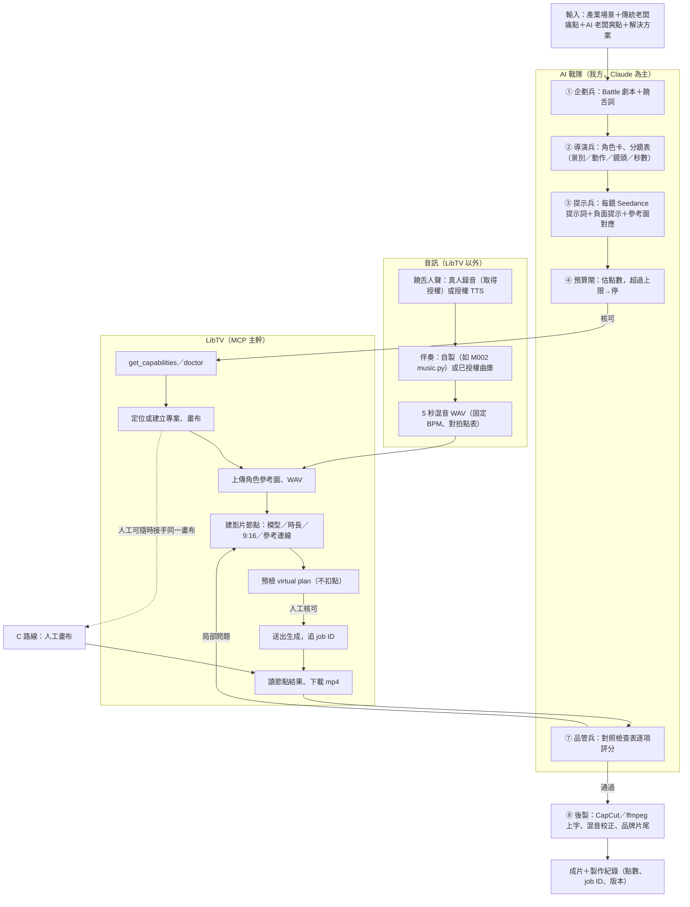

# 《LibTV AI 製片對接與駕馭可行性報告 V1.0》

- 令號：C-001-ORDER-007｜執行：C-001 AI 系統開發官
- 專案：百業商戰 Battle｜AI 影音生產線｜階段：G1 技術可行性研究
- 研究日期：2026-10-22
- 本輪範圍：**僅研究與實驗規劃**。未申請帳號、未使用 Access Key、未呼叫任何 LibTV 介面、未花任何點數。
- 配套文件：[5 秒 MVP 實驗方案（待總指揮核准）](MVP-5秒實驗方案.md)

> **一句話結論**：LibTV 可以當《百業商戰 Battle》的**主要「生成引擎」**，但還不能直接當**整條製片線**。
> 本輪看到的證據都停在「官方文件／原始碼」與「第三方實測」兩層，**沒有一項是我方自己實測過的**。
> 推薦路線：**MCP 為主幹，人工畫布作保底，官方 Skill 只做快速原型**。中文饒舌對嘴（T03）是最大未知數，必須先過 5 秒 MVP 才能決定是否需要外接對嘴工具。

---

## 0. 證據等級說明（本報告所有判定都標注來源等級）

| 等級 | 意義 | 本輪是否有 |
|---|---|---|
| **E1 我方實測** | 我方帳號、我方素材、實際呼叫並留存紀錄 | **無**（本輪不核准付費） |
| **E2 官方原始碼／設定檔** | 官方 GitHub 倉庫中的程式碼、設定檔，能直接看出介面行為 | 有 |
| **E3 官方文件／官方技能說明** | 官方 README、SKILL.md 文字描述（包含宣傳性描述） | 有 |
| **E4 第三方報導／實測** | 媒體、部落格、社群 Skill 作者的說法 | 有，僅供參考 |

驗證狀態只用四種：**已證實／有條件可行／尚待實測／不支援**。
依令文要求：**官方宣傳功能一律不視為實測成功**。在 E1 出現前，任何項目都不標「已證實」，除非是可以直接從官方原始碼讀出的事實（例如「上傳腳本只接受圖片與影片」）。

---

## 1. 官方技術架構與證據來源

### 1.1 LibTV 是什麼

LiblibAI（哩布哩布）推出的節點式 AI 影片創作平台，網頁版是一張「無限畫布」：圖片節點、影片節點、文字節點、連線、分組、時間軸。平台本身不做模型，而是聚合第三方模型（官方 SKILL.md 列出 Seedance 2.0、Kling 3.0/O3、Wan 2.6、NanoBanana、Midjourney、Seedream 5.0；Marketplace 技能另外指定 Seedance 2.5、Seedream 5.0 Pro）。
平台有兩個對外入口給 Agent 使用：**OpenAPI＋Skill（路線 A）** 與 **Remote MCP（路線 B）**。

### 1.2 路線 A：官方 Skill／OpenAPI（`libtv-labs/libtv-skills`）

來源：<https://github.com/libtv-labs/libtv-skills>（最新提交 2026-03-18，MIT 授權）。本輪已逐行讀過 `SKILL.md`、`README.md` 與 `scripts/*.py`。

**架構（E2）**：Skill 只是幾支 Python 標準庫腳本，包了一個「Agent-IM 對話」服務 `https://im.liblib.tv`。我方 Agent 送一句自然語言，LibTV **後端自己的 Agent** 負責拆分鏡、選模型、寫提示詞、在畫布上建節點並生成。

| 需求（令文 A 項） | 官方提供方式 | 證據 | 判定 |
|---|---|---|---|
| 取得與管理 Access Key | 環境變數 `LIBTV_ACCESS_KEY`；HTTP `Authorization: Bearer <key>`。Key 從哪裡拿，官方倉庫**沒寫**；第三方指南說在 liblib.tv「使用者中心 → API／開發者」 | E2（用法）＋E4（取得位置） | 取得流程尚待實測；**輪替、撤銷、權限範圍、多把 Key 皆無官方說明** |
| 建立專案與會話 | `POST /openapi/session`（不帶 `message` 只建立／綁定會話）→ 回傳 `projectUuid`、`sessionId` | E2 | 有條件可行 |
| 換新專案 | `POST /openapi/session/change-project`：把這把 Key 綁到**一個新專案** | E2 | 有條件可行；**沒有「指定綁回某個舊專案」的參數** |
| 上傳角色圖、影片 | `upload_file.py` → 回傳 `https://libtv-res.liblib.art/claw/{projectUuid}/{uuid}.ext` | E2 | 有條件可行；單檔 < 200 MB |
| **上傳音樂／音訊** | 腳本寫死 `ALLOWED_PREFIXES = ("image/", "video/")`，官方文件也寫「其他類型會被拒絕」 | E2 | **不支援**（只能嘗試把音訊包成 mp4 影片上傳，是否被後端當成音訊參考尚待實測） |
| 發送影片生成指令 | 同一個 `POST /openapi/session`，`message` 放自然語言；參考素材以 URL 寫在句子裡 | E2 | 有條件可行；**沒有模型、時長、比例、解析度、種子等結構化參數** |
| 查詢進度 | `GET /openapi/session/:sessionId?afterSeq=N` 增量拉訊息；官方建議每 8 秒輪詢、3 分鐘無結果就停 | E2 | 有條件可行；**沒有任務 ID、沒有狀態欄位、沒有取消指令**，完成與否靠「assistant 訊息中出現結果網址」判斷 |
| 取得結果、下載影片 | `download_results.py` 用正規表示式從訊息內容抓 `libtv-res.liblib.art` 的 png/jpg/webp/mp4/mov/webm 網址 | E2 | 有條件可行；**抓不到音訊檔**；結果網址是否有時效未說明 |
| 從既有專案繼續生成 | 帶 `--session-id` 向舊會話追加訊息 | E2 | 有條件可行（同一會話可續作；跨會話回到舊專案無官方方法） |

**官方文件自身的落差（E2，值得記錄）**：
- README 寫上傳端點是 `POST /openapi/file/upload`，但 `upload_file.py` 實際打的是 `/openapi/upload`。
- 上傳時 Access Key 除了放在 Header，還**再放一份在 multipart 表單欄位 `accessKey`** 裡 → 任何記錄 HTTP 請求本體的 Proxy／日誌都可能留下金鑰（見 §5.6）。
- README 中「OpenClaw 規範」的連結指向一個疑似錯誤的位址。
以上不影響功能判定，但代表**這套 Skill 文件不能當成正式 API 規格**，實作前要以實測為準。

**官方明訂的行為規範（E3，對我方影響最大）**：SKILL.md 有一段「核心原則：使用者側不做創作，只做傳話」，要求呼叫端**不要自己寫分鏡、不要擴寫提示詞、不要把任務拆成多次請求**，一律交給後端 Agent。
→ 這與我方「AI 戰隊負責劇本、角色、分鏡、提示詞」的設計**正面衝突**。我方仍可在訊息裡寫完整分鏡（API 不會擋），但後端 Agent 會不會照做、會不會再改寫，**無法從介面控制，只能實測**。

### 1.3 路線 B：LibTV Remote MCP（`liblib-ai/marketplace`）

來源：<https://github.com/liblib-ai/marketplace>（提交 `4ac581c`，2026-09-17「發布 LibTV 1.0.0」）。本輪已讀 `plugin.json`、`.mcp.json` 與三個隨附技能全文。

**架構（E2）**：
- `.mcp.json`：`type: http`，`url: https://mcp.liblib.tv/mcp`，`tool_timeout_sec: 1200`（單次工具呼叫最長 20 分鐘）。
- 認證：標準 MCP OAuth。插件**不內建 client ID、回呼網址或任何憑據**，用戶端依伺服器的 OAuth metadata 自行註冊並登入；**每位使用者用自己的 LibTV 身分授權**。官方 README 說未授權時 `/mcp` 回 `401` 加 `WWW-Authenticate: Bearer`，兩個 OAuth well-known 端點回 `200`。
- 官方安裝方式只寫了 **Codex**（`codex plugin marketplace add …`、`codex plugin add libtv@libtv`）。

**MCP 實際有哪些工具**：官方倉庫**沒有公開工具清單**，工具 schema 只在連線後才拿得到。下表是從三個官方技能（`libtv-blender-live-action`、`music-driven-product-ad`、`libtv-to-treatment`）**對 MCP 的使用描述**反推的能力，等級為 E3：

| 能力 | 官方技能中的描述 | 對我方的意義 |
|---|---|---|
| 能力探測 | `get_capabilities`、「doctor／runtime check」、連線 instructions 內含工作流摘要 | 可在動手前先確認可用工具與狀態 |
| 專案定位 | 解析確切的 user／space／project／canvas；讀「專案快照 manifest」並記版本 | **可指定回到舊專案續作**（Skill 做不到） |
| 節點級操作 | 建立節點、連線（edges）、分組；「優先使用 typed／deterministic 操作」 | 可精確指定哪張圖接到哪個影片節點 |
| 上傳素材 | 明確上傳並驗證 **WAV 音訊**、圖片 | **音訊可上傳**（Skill 不行） |
| 模型參數 | 「解析 Seedance 2.5 的即時完整模型名並讀取當前 schema；時長、比例、解析度、輸出數量放在參數欄位而非提示詞；若 schema 有 Negative Prompt 欄位就用」 | 景別外的**硬規格可結構化設定** |
| 生成前預檢 | 「Validate one virtual generation plan」「read-only generation preflight」 | 可以先看計畫、確認再付費 |
| 任務追蹤 | 追蹤 job/run ID；「輪詢逾時不代表失敗，先讀節點狀態再決定，**不得重複送出**」 | 防重複扣點的關鍵 |
| 點數不足 | 「credits 不足就停、保留現場並回報」 | 有點數狀態回報（具體欄位尚待實測） |
| 影片編輯模式 | Seedance 2.5 video-editing mode，接白模（Blender 預演）影片＋場景圖＋角色三視圖 | **鏡頭運動可用預演影片控制** |
| 時間軸合成 | typed timeline schema：`sourceNodeId`、`startTime`、`duration`、`sourceOffset`、revision 檢查；`video-clip` 合成產生新影片節點 | 可在 LibTV 內上字前粗剪／混音 |
| 成片檢查 | 內建 `video-review` 路線做一次「非生成性」檢查 | 可做初步 QA，但官方自己說「設定只證明意圖，不證明結果」 |
| 畫布交接 | Browser handoff：把可編輯畫布開給人看 | 人工可隨時接手同一張畫布 |

**官方技能自己揭露的已知問題（E3）**：在某條已測試的路線上，`videoAudioMuted: true` 與 `videoAudioVolume: 0` **會被存檔但渲染時沒有真正靜音**，要改用片段增益（例如 −60 dB）。→ 證明 MCP 參數「設了」不等於「生效」，**每個參數都要看成片驗證**。

**本輪無法連線驗證**：本研究環境的網路政策封鎖 `mcp.liblib.tv`（連 well-known 端點都回 Proxy 403），因此**連「未授權回 401」這件事都沒有親自驗證**。MCP 全部判定維持在 E2/E3。

**Codex 以外的 Agent 能不能用**：MCP 是標準 HTTP＋OAuth，理論上 Claude Code、Claude Desktop 等支援 Remote MCP＋OAuth 動態註冊的用戶端都能接。但官方只寫 Codex，且伺服器是否允許其他用戶端動態註冊、是否限制 redirect URI，都**尚待實測**。

### 1.4 路線 C：人工畫布操作＋AI 輔助

不經任何 API。AI 戰隊產出「劇本 → 角色設定 → 分鏡表 → 每格提示詞 → 品質檢查表」，由人工在 liblib.tv 畫布上建節點、上傳素材、按生成、下載。
控制力最高（網頁上看得到的模型與參數都能手動選），自動化最低。這也是 MCP 出問題時的**保底路線**：MCP 建好的畫布，人可以直接打開接手。

### 1.5 證據來源清單

| # | 來源 | 等級 |
|---|---|---|
| S1 | libtv-labs/libtv-skills：README、`skills/libtv-skill/SKILL.md`、`scripts/_common.py`、`upload_file.py`、`download_results.py`（commit `c609246`） | E2/E3 |
| S2 | liblib-ai/marketplace：README、`.mcp.json`、`.codex-plugin/plugin.json`（commit `4ac581c`） | E2 |
| S3 | 同上：`libtv-blender-live-action/SKILL.md`＋`references/workflow-spec.md` | E3 |
| S4 | 同上：`music-driven-product-ad/SKILL.md`＋`references/libtv-production.md`、`seedance-2.5-prompt.md` | E3 |
| S5 | 同上：`libtv-to-treatment/SKILL.md` | E3 |
| S6 | 第三方 Skill：CDragon123-code/libtv-video-production（README：7 步流程、8 條踩坑、單輪約 1,100 點） <https://github.com/CDragon123-code/libtv-video-production> | E4 |
| S7 | 價格與會員：量子位 <https://www.qbitai.com/2026/03/390320.html>、鈦媒體 <https://www.tmtpost.com/8044585.html>、ai-bio.cn <https://ai-bio.cn/sites/5488.html>、aiproducthub.cn <https://aiproducthub.cn/question/7963.html>、文武科技柜 <https://www.wangdu.site/software/ai/2324.html> | E4（各家數字互相矛盾） |
| S8 | Seedance 2.0 於 LibTV：騰訊新聞 <https://news.qq.com/rain/a/20260402A02VR300>、網易「真人模式解禁、0.35 元/秒」<https://www.163.com/dy/article/KQ8T7E1U05568W0A.html> | E4 |
| S9 | Seedance 2.0 真人人臉限制：新京報 <https://www.bjnews.com.cn/detail/1770694532129745.html>、搜狐 <https://www.sohu.com/a/985891896_122613810> | E4（2026-02 資料，可能已變） |
| S10 | LiblibAI 用戶協議 <https://www.liblib.art/activities/468ad794ccc7408d81757fd91be003ec>、創作圖片商業使用規範 <https://www.liblib.art/activities/e0aa50f25b874722ac60be71adb8c9cb/Commercial_Guidelines> | 官方，但**針對 liblib.art 圖片**，是否適用 LibTV 影片未確認 |
| S11 | 第三方指南（Access Key 位置）：<https://openclawlaunch.com/guides/libtv-skill>、DeepWiki <https://deepwiki.com/libtv-labs/libtv-skills> | E4 |

S7–S9、S11 中部分頁面在本環境無法直接開啟，內容來自搜尋摘要，**只能當線索**。

---

## 2. Skill、MCP、人工輔助三路線比較

| 面向 | A｜官方 Skill／OpenAPI | B｜LibTV MCP | C｜人工畫布＋AI 輔助 |
|---|---|---|---|
| 介面形態 | 4 個 HTTP 端點，自然語言對話 | 節點／連線／參數／時間軸級工具（schema 連線後才知道） | 網頁畫布 |
| **可控性** | **低**：模型、時長、比例、鏡頭全靠一句話；後端 Agent 自行拆解 | **中高**：可指定模型、參數、參考圖連線、預檢後才生成 | **高**：網頁上有的都能手調 |
| 我方能否主導分鏡與提示詞 | 官方明文要求「只傳話」；能寫進去但不保證被採用 | 能，官方技能本身就是由呼叫端寫 Seedance 提示詞 | 能 |
| 音訊上傳（對嘴必要） | **不支援** | 支援（WAV） | 支援（依網頁功能，尚待實測） |
| 續作／局部重做 | 同會話追加；不能精確指定要重做哪個節點 | 可指定專案、節點，新建節點不覆蓋舊結果 | 可 |
| 點數失控風險 | **高**：後端 Agent 可能自動多鏡頭、多版本 | 中：有預檢、單節點生成、job ID 追蹤 | 低：每次都是人按 |
| 效率 | 接入最快（半天） | 接入中等（OAuth＋摸 schema 約 1–2 天） | 每支片人工 30–90 分鐘（估） |
| 維護風險 | 中：介面極簡，但文件與程式碼已不一致；後端 Agent 行為隨平台更新而變 | 中高：工具 schema 會變（官方技能也一再要求「讀即時 schema、不要猜」）；1.0.0 才剛發布 | 低：但依賴人力 |
| 授權方式 | 長效 Access Key（需自行保管） | OAuth 個人授權（Token 由用戶端保管） | 帳號密碼登入 |
| 適合做什麼 | 快速原型、單張圖、「隨便生一段看看」 | **量產主幹**：固定角色、固定規格、可追溯 | 精修、救火、MCP 做不到的操作 |

**結論**：A 路線適合驗證「LibTV 畫面品質是否夠用」，不適合量產，因為它把最重要的控制權交給了 LibTV 的後端 Agent；B 路線是唯一同時具備「音訊上傳＋節點級控制＋預檢＋續作」的自動化入口；C 路線永遠保留作保底。

---

## 3. AI 戰隊與 LibTV 的串接架構圖

設計原則：
1. **創作決策留在我方**（劇本、分鏡、提示詞、品管），LibTV 只負責「照單生成」。這是避開 Skill 路線「後端 Agent 自己決定」的關鍵。
2. **音訊在 LibTV 外做好**再送進去，因為饒舌節奏與聲線必須可控、可重用、權利清楚。
3. **每一次付費生成前都有兩道閘**：我方預算閘＋LibTV 預檢；兩者都過，且有人核可，才送出。
4. **所有結果都回寫製作紀錄**（對接既有 `contracts/02-製作紀錄.md`），記 job ID、點數、模型、提示詞版本，失敗也要記。

---

## 4. 六項核心技術驗證結果

| 編號 | 項目 | 判定 | 依據 | 仍缺什麼（E1 實測項目） |
|---|---|---|---|---|
| **T01** | Agent 對接 | **有條件可行** | Skill：4 個端點與腳本完整，原始碼可讀（E2）。MCP：官方 HTTP MCP＋OAuth 設定檔（E2），工具能力由官方技能描述反推（E3）。 | 實際取得 Key／完成 OAuth；Claude Code 能否完成 MCP 動態註冊；一次「下指令→取回 mp4」全程走通 |
| **T02** | 角色一致性 | **尚待實測** | 平台模型支援參考圖；官方技能用「角色三視圖＋參考連線」鎖臉（E3）；第三方實測建議用單張四合一角色板（E4）。風險：Seedance 2.0 曾**封鎖寫實真人臉參考**（E4，2026-02），後有報導「真人模式解禁」（E4），現況不明。 | 同一角色 3 個不同鏡頭是否變臉；寫實風 AI 生成老闆臉是否被風控擋下 |
| **T03** | 中文饒舌對嘴 | **尚待實測（高風險）** | Skill 路線**不能上傳音訊**（E2，判定為不支援）。MCP 可上傳 WAV（E3），但官方技能都是「影片生成完再把 WAV 疊上去」，**沒有一個官方範例是音訊驅動嘴型**。Seedance 可依提示詞自生對白並音畫同步（E3/E4），但聲線與饒舌節奏不由我方決定。 | ①讓 Seedance 自生中文饒舌（節奏可否接受）；②以我方 WAV 作參考能否驅動嘴型；③都不行時改「LibTV 出畫面＋外部對嘴工具」 |
| **T04** | 分鏡控制 | **有條件可行** | MCP：時長、比例、解析度、負面提示放結構化欄位（E3）；鏡頭運動可用 Blender 白模預演影片＋影片編輯模式控制（E3）。Skill：只能用文字描述，無法保證。 | 5 秒內「中景→手勢→推近」這類指定能否命中；景別描述的命中率 |
| **T05** | 修改與續作 | **有條件可行** | MCP：可定位舊專案、新建節點不覆蓋舊結果、時間軸 revision 檢查（E3）。Skill：同會話追加、宣稱可「局部修改、元素替換」（E3 宣傳）。 | 「只改手勢、臉不變」是否做得到；局部重做的點數是否比重生少 |
| **T06** | 成本與授權 | **尚待實測** | 價格只有 E4 且互相矛盾；API 與網頁是否共用額度**官方未寫**（Key 與 OAuth 都綁個人帳號，推定共用，未證實）；圖片商用規範要求「會員／API 身分存續期間」創作才可商用，影片是否適用未確認；另有報導稱 2026-08 中國電視劇製作產業協會對該平台用戶協議的授權條款發出風險提示（E4，未查證原文）。 | 開通後實際扣點紀錄；取得 LibTV 影片的商用條款原文；台灣帳號能否註冊與付款 |

**本輪沒有任何一項達到「已證實」。** 唯一可從原始碼直接確認的事實是：**官方 Skill 的上傳與下載腳本不處理音訊檔**。

---

## 5. 研究限制與風險（令文第五節逐項回覆）

### 5.1 OpenAPI 是否只提供自然語言入口？
**是（E2）。** 4 個端點裡，唯一能「叫它做事」的只有 `message` 一個字串欄位；沒有模型、時長、比例、種子、負面提示、節點 ID 等參數，也沒有任務 ID、取消、查點數的端點。精細控制只能寫在句子裡，由後端 Agent 決定採不採用。

### 5.2 MCP 是否有更完整的編輯能力？
**從官方技能描述看是（E3），但未實測。** 節點、連線、分組、即時模型 schema、預檢、job 追蹤、時間軸合成、影片審查都有提及。風險：①工具清單不公開，每次版本更新都可能變；②官方自己記錄了「參數存了但不生效」的案例；③目前官方只保證 Codex。

### 5.3 Agent 自動拆分任務是否造成點數失控？
**Skill 路線風險高。** 官方 SKILL.md 鼓勵「一句話生成完整短劇（劇本→分鏡→成片）」，這種請求後端可能一次生出多張分鏡圖＋多段影片。介面上**沒有預算上限參數、沒有預估、沒有取消**。第三方回報：個人 VIP 併發上限約 8，超出的任務失敗但**仍扣點**（E4）；相同參數會回傳快取舊結果（E4）。
**控制方式**：
- 實驗帳號只儲值小額點數，讓「餘額」本身當硬上限（API 沒有其他上限可設）。
- Skill 路線訊息一律寫明「只生成 1 段、5 秒、不要分鏡圖、不要多版本」，並在實驗紀錄比對實際產出數量。
- MCP 路線一律「預檢 → 人工核可 → 單節點送出」，輪詢逾時先讀節點狀態，**禁止重送**。
- 每輪實驗前後截圖點數餘額，以差額為準。

### 5.4 API 與網頁會員是否共用額度？
**官方未說明，尚待實測。** Access Key 與 MCP OAuth 都綁定個人 LibTV 帳號，Skill 產物會出現在同一個網頁畫布（`projectUrl`），推定扣的是同一帳號點數，但**會員贈送的模型額度（例如報導中的可靈贈送條數）能否被 API 使用**沒有任何資料。MVP 實驗中列為必驗項目。

### 5.5 商業使用授權及音樂、角色素材權利
- **生成影片的商用權**：未找到 LibTV 影片的商用條款原文。LiblibAI 圖片商用規範的邏輯是「依模型授權＋會員身分存續期間」，若同樣適用影片，**會員到期後新生成的內容可能不可商用**。正式量產前必須取得條款原文並請法務確認。
- **底層模型條款**：Seedance、Kling 等各自有使用政策，LibTV 轉售不代表我方直接取得模型方授權。
- **角色**：一律使用 **AI 生成、非真實人物** 的老闆形象，不以任何真人照片（包括團隊成員、店家老闆）作臉部參考，除非取得書面肖像授權且平台允許；這同時避開 Seedance 真人臉風控。
- **音樂**：不上傳任何未授權的流行歌或伴奏。MVP 伴奏用自製（沿用 M002 的程式生成作法）或已確認可商用的曲庫；Marketplace 隨附曲譜中 `mendelssohn-wedding-march` 為 CC BY-SA 4.0，需署名，其餘為公有領域。
- **人聲**：真人錄音需簽聲音授權；若用 TTS，需確認該 TTS 的商用條款，**不得模仿特定藝人聲線**。

### 5.6 帳號憑證安全保存
- Access Key 只放在：本機環境變數、或 Claude Code／CI 的 secret 設定；**不寫入程式碼、Prompt、`.md`、截圖、製作紀錄、GitHub**。本 repo 若日後加入腳本，同時加 `.gitignore` 排除 `.env`。
- 官方上傳腳本會把 Key **同時放在 Header 與表單本體**，且錯誤時會把伺服器回應整段印到 stderr → 不要在共用終端機或會被記錄的 CI log 上執行上傳；或改寫成只放 Header（需先實測後端是否接受）。
- MCP 走 OAuth，Token 由用戶端保管，不經我方程式碼，**安全性優於長效 Key**，這也是推薦 MCP 的理由之一。
- 實驗用獨立 LibTV 帳號、小額儲值；實驗結束後撤銷 Key（若平台支援撤銷——尚待確認）。
- 平台是中國大陸服務：台灣使用者能否註冊（手機號驗證）、付款方式、上傳素材的資料存放地，均列入實測前確認事項。

### 5.7 合規邊界（本輪遵守情形）
本輪**未**使用瀏覽器自動化操作 LibTV、**未**逆向任何私有 API、**未**嘗試繞過付費或驗證。研究只讀了公開 GitHub 倉庫與公開網頁。官方 MCP 技能中的「Browser handoff」是官方設計的畫布交接功能，日後使用屬授權範圍內；第三方油猴腳本（如「LibTV Canvas Boost」）**不列入採用範圍**。

---

## 6. 點數、費用、時間及失敗重做風險

> 以下全部是**估算**，數字來源是 E4 第三方資料，彼此不一致。正式數字以開通後的實際扣點為準。

### 6.1 價格線索（E4）

| 項目 | 報導數字 | 可信度 |
|---|---|---|
| 會員年費 | 專業版 499、大師版 1,299／1,999、旗艦版 2,999／3,999、尊享版 6,599 人民幣／年；另一說 569–8,499 | 低（各家不同） |
| 專業版每月點數 | 1,800 點＋每日登入領取 | 低 |
| Seedance 2.0 年會員折後 | 約 **0.35 人民幣／秒** | 低 |
| 圖片（角色錨點） | 約 10–14 點／張 | 低（單一實測） |
| 影片（Seedance 2.0 Mini、720p） | 8 鏡 66 秒約 1,100 點 → **約 17 點／秒** | 低（單一實測） |
| 30 秒短劇（Skill 全自動） | 約 5,000 點 | 低（單一使用者回報） |

### 6.2 5 秒 MVP 預算估算

| 步驟 | 單次估點 | 預估次數 | 小計 |
|---|---|---|---|
| 角色參考圖（若由 LibTV 生成） | ~14 | 4 | ~56 |
| 5 秒影片（720p） | ~85 | 每條路線 2–3 次 | ~170–255／路線 |
| 局部修正（T05） | ~85（假設與重生同價） | 2 | ~170 |
| **兩條路線合計（A＋B）** | | | **約 650–750 點** |

建議核准上限：**1,000 點（含 30% 緩衝）**，用完即停，不追加。若改用 1080p 或 Seedance 2.5，單價可能倍增，需重估。

### 6.3 時間估算

| 工作 | 時間 |
|---|---|
| 帳號開通、Key／OAuth、接通 T01 | 0.5–1 天 |
| 音訊製作（錄音／TTS＋伴奏＋混音） | 0.5 天 |
| 每次 5 秒生成等待 | 數分鐘（E4 報導「幾分鐘出結果」；官方 Skill 設 3 分鐘輪詢上限，MCP 單次工具逾時 20 分鐘） |
| 全部實驗＋紀錄＋報告 V1.1 | 3–4 個工作天 |

### 6.4 失敗重做風險

| 風險 | 發生可能 | 影響 | 對策 |
|---|---|---|---|
| 中文饒舌嘴型對不上 | **高** | T03 失敗，核心賣點不成立 | 實驗設計三種對嘴方案並行比較（見 MVP 方案） |
| 寫實臉被風控擋 | 中 | 角色無法生成或扣點後失敗 | 角色參考圖選「寫實但明顯 AI 生成」；先用 1 次低成本測試 |
| 後端 Agent 多生多扣 | 中（Skill 路線） | 點數失控 | 小額儲值、訊息限定數量、前後點數截圖 |
| 輪詢逾時誤判失敗而重送 | 中 | 重複扣點 | 只讀狀態、不重送；以 job ID／節點為準 |
| 相同參數回傳快取 | 中（E4） | 以為重做了其實沒有 | 每次修正都改變提示詞並記錄版本號 |
| 併發超限仍扣點 | 低（我方只跑單線） | 浪費點數 | 序列執行 |
| 平台介面更新 | 中 | 腳本／流程失效 | 每次開工先跑 `get_capabilities`；流程文件記錄版本日期 |

---

## 7. 推薦技術路線及下一階段驗收標準

### 7.1 推薦路線

1. **主幹：B｜MCP**。唯一可上傳音訊、可指定模型參數、可預檢、可回到舊專案的自動化入口。
2. **保底：C｜人工畫布**。MCP 建好的畫布可由人直接接手；任何 MCP 做不到的操作走人工。
3. **輔助：A｜Skill**，只用在 MVP 第一天驗證畫質與「後端 Agent 會不會照我方分鏡做」，不進量產。
4. **音訊與後製留在 LibTV 外**：饒舌人聲、伴奏、字幕、品牌片尾由我方工具完成（既有 CapCut／ffmpeg 流程）。

### 7.2 最終決策問題的回答

**LibTV 能否成為《百業商戰 Battle》的主要 AI 製片引擎？**
**能成為「主要畫面生成引擎」，目前不能成為「完整製片引擎」。** 理由：
- 畫面生成、角色參考、節點化管理、續作，LibTV 的設計方向都對得上，且 MCP 提供了我方可控的入口。
- 但**中文饒舌對嘴**——這個系列的核心賣點——在所有官方材料中都沒有被證明支援「用我方音訊驅動嘴型」。這一項過關前，不能把 LibTV 定為唯一引擎。
- 平台條款（商用、額度、台灣帳號）尚未確認，**這是量產前的硬門檻**。

**工序分工建議（MVP 實測前的暫定版）**：

| 工序 | 誰做 | 說明 |
|---|---|---|
| 產業研究、劇本、饒舌詞 | AI 戰隊（Claude） | 創作決策不外包給 LibTV 後端 Agent |
| 角色設定卡、分鏡表、提示詞 | AI 戰隊 | 輸出成 MCP 可直接使用的結構 |
| 角色參考圖 | LibTV（Seedream／NanoBanana 等）或其他生圖工具 | 一角色一張定稿圖，全系列重用 |
| 饒舌人聲 | **LibTV 以外**：真人錄音或授權 TTS | 聲線、節奏、權利都要可控 |
| 伴奏／音樂 | **LibTV 以外**：自製或授權曲庫 | LibTV 不是音樂生成器（官方技能也這樣定位） |
| 畫面生成（表演、鏡頭） | **LibTV（MCP）** | 主要價值所在 |
| 對嘴 | **待 MVP 決定**：LibTV 原生 → 不行則外部對嘴工具 | 本系列最大技術風險 |
| 局部修正 | LibTV（MCP）＋人工畫布 | |
| 品質檢查 | AI 戰隊（品管表）＋人工最後一眼 | 官方也承認「設定只證明意圖」 |
| 字幕、混音校正、片尾、平台規格輸出 | **LibTV 以外**：CapCut／ffmpeg | 沿用 M002 已驗證流程 |

### 7.3 下一階段（G2）驗收標準

G2 = 5 秒 MVP 實測完成。以下全部達成才進入 G3（多角色 Battle 試產）：

| # | 驗收項 | 通過標準 |
|---|---|---|
| G2-1 | T01 | MCP 從我方 Agent 發起，全程無人工點擊，取得 9:16、5 秒 mp4；留存 job ID 與點數差額 |
| G2-2 | T02 | 同一角色 3 個鏡頭（正面、側 45°、近景），3 位評審盲測皆認定為同一人 |
| G2-3 | T03 | 以我方 WAV 為準，嘴型與音節偏移 ≤ 2 幀（30fps）的音節比例 ≥ 80%；評審主觀「對得上」≥ 2/3 |
| G2-4 | T04 | 指定的景別、手勢、鏡頭運動 3 項中至少 2 項命中 |
| G2-5 | T05 | 能只修一個問題（例如手勢）而角色臉、場景不變；點數 ≤ 重新生成 |
| G2-6 | T06 | 取得：實際每秒點數、API／網頁額度是否共用、商用條款原文、台灣帳號可用性 |
| G2-7 | 預算 | 總花費 ≤ 核准上限；無重複扣點事故 |
| G2-8 | 安全 | repo、紀錄、截圖中零憑證外洩（以 secret scanning 檢查） |

**若 G2-3 未過**：不放棄 LibTV，改為「LibTV 出無對白表演畫面＋外部對嘴工具」的混合方案，並另開研究令評估對嘴工具。

---

## 附錄：本輪研究做了什麼、沒做什麼

| 做了 | 沒做 |
|---|---|
| clone 並逐檔閱讀兩個官方 GitHub 倉庫 | 申請 LibTV 帳號、取得 Access Key |
| 對照 README 與原始碼找出不一致處 | 執行任何會連到 `im.liblib.tv` 或 `mcp.liblib.tv` 的指令 |
| 嘗試讀取 MCP 公開 OAuth metadata（被本環境網路政策擋下，未取得） | 花任何點數 |
| 搜尋價格、授權、Seedance 能力的公開報導 | 瀏覽器自動化、逆向私有 API |
