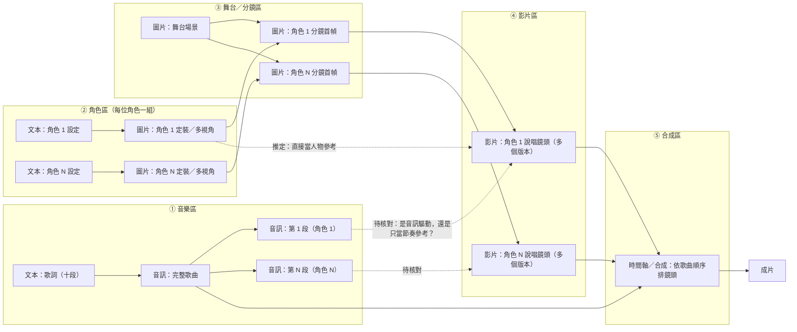
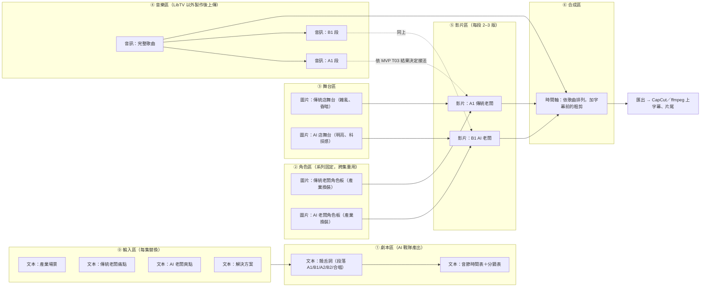

# 《LibTV Battle MV 節點工作流拆解圖 V1.0》

- 回覆令號：C-001-ADD-008A｜LibTV 公開專案逆向拆解補充令
- 研究樣本：LibTV 公開作品《過來人》（The OGs）｜喆FILM（王琨喆）
- 執行：C-001｜AI 系統開發官｜日期：2026-10-22
- 相關：[MVP 執行準備報告 V1.1](LibTV-MVP執行準備報告-V1.1.md)、[5 秒測試素材包](MVP素材/README.md)

> **先說限制**：本研究環境的網路政策封鎖 LibTV 全部網域（見 V1.1 §1），**我沒有看到《過來人》的公開畫布本身**。
> 本文件分三層，每一層都標明證據來源：
> 1. **公開報導能確認的事實**（§1）。
> 2. **依 LibTV 已知節點機制推定的工作流**（§2）。這是**假設**，要由看得到畫布的人照 §3 的唯讀拆解表逐項核對。
> 3. **我方原創的 Battle MV 製片母版**（§5）。它是我們自己的設計，不依賴、也不複製對方的任何素材。
>
> 本輪未複製專案、未付費、未改動任何他人作品。

---

## 0. 六個問題的現況總表

| # | 問題 | 現況 | 證據 | 下一步（唯讀） |
|---|---|---|---|---|
| 1 | 「複製項目」能否完整保留可編輯工作流 | **尚待實測** | E4：第三方攻略稱 LibTV 支援**跨畫布複製貼上，連線一起帶走**；工作流可「打組 → 建立工作流」存進「我的工具箱」；畫布可「分享（他人可看）」或「發布（上社區）」。**沒有任何來源說明公開作品的「複製項目」按鈕會保留什麼** | 在公開畫布頁**只看不按**：記錄按鈕名稱、提示文字、是否顯示扣點、是否要求作者授權（§3 表 A） |
| 2 | 角色定裝圖如何連接不同鏡頭 | **尚待實測（有推定）** | E4：影片節點左側可接圖片、音訊、影片作參考；E3：官方技能用「一張角色三視圖連到每個影片節點」鎖臉 | 數每張定裝圖往外連了幾條線、連到哪些影片節點（§3 表 C） |
| 3 | 音訊節點如何連人物影片、是否音訊驅動對嘴 | **尚待實測** | E4：影片節點左側可接音訊作參考；音訊節點連到合成節點時會依片段長度自動裁切；B 站教學目錄有「AI 對口型」章節（內容未見）。**創作者沒有公開對嘴做法** | 分辨音訊線接到「生成節點」（可能是音訊驅動）還是「合成／時間軸節點」（只是配樂）（§3 表 D） |
| 4 | 每個影片節點的模型、參數、時長、點數 | **尚待實測** | 創作者公開：成本約「幾千元人民幣」、廢片比約 3:1 到 5:1、大量時間花在磨提示詞、提示詞已公開。**單節點參數沒有任何公開資料** | 逐一點開影片節點，抄下面板上看得到的欄位（§3 表 B） |
| 5 | 如何改造成可重複使用的 Battle MV 母版 | **已完成設計（我方原創）** | 見 §5。不需要複製對方專案就能做 | 等 MVP 實測後填入實際模型與參數 |
| 6 | 複製功能的授權、素材再利用、商業使用限制 | **尚待確認（初判：高風險）** | 對方作品的歌詞、編曲、人聲、角色圖都屬於創作者的創作成果；LibTV 用戶協議原文仍未取得 | 見 §4。結論：**只學方法，不搬素材** |

證據等級：E1 我方實測、E2 官方原始碼、E3 官方文件、E4 第三方報導或教學。**本文沒有任何 E1。**

---

## 1. 公開報導能確認的事實（E4）

| 項目 | 內容 |
|---|---|
| 作品 | 《過來人》（英文 The OGs），AI 說唱 MV |
| 發布 | 2026-10-13 晚，抖音首發，之後擴散到微博、視頻號等；LibTV 官網首頁以「100 萬＋讚」展示其畫布 |
| 形式 | **十位歷史或神話人物接力說唱**（報導點名杜甫、蘇軾、劉邦、孫悟空等），以「過來人」口吻談今天的處境 |
| 分工 | 策劃、詞曲、AI 製作均由喆FILM 一人完成；**畫面由 LibTV 生成**（片中標註） |
| 詞曲 | 歌詞底子由創作者自己寫，AI 在編排與押韻上出力；伴奏與十種「古人音色」由 AI 生成。**音樂用了哪個模型，創作者未公開** |
| 成本與良率 | 約「幾千元」人民幣；廢片：成片約 3:1 到 5:1 |
| 方法 | 大量時間花在前期磨提示詞；提示詞已公開 |
| 創作者的話 | 「技術為表，人心為核」；「抄得走工序，抄不走內核」 |

**對我們最有用的三點**：
1. **形式幾乎就是我們的 Battle MV**：多個角色輪流上台說唱，每人一段。Battle MV 是它的雙角色對打版。
2. **3:1 到 5:1 的廢片比**是目前唯一的公開良率數字，可以直接拿來當預算係數：每 1 秒成片要準備 4–6 秒的生成量。
3. 創作者公開說「工序抄得走」，但他沒有把素材授權給別人用（見 §4）。

---

## 2. 推定工作流拆解圖（假設，待 §3 核對）

以下依 LibTV 已知機制推定：五種節點（文本、圖片、影片、音訊、腳本）、影片節點左側可接參考、音訊可接合成節點、官方技能的角色三視圖做法。**圖中每一條連線都要在畫布上核對，才能改判為「已證實」。**

**推定依據與待核對點**

| 推定 | 依據 | 核對方法 |
|---|---|---|
| 每位角色有獨立一組定裝圖，連到該角色所有鏡頭 | 總指揮描述「角色多視角素材」；官方技能用三視圖鎖臉 | 表 C：數連線 |
| 先做「舞台＋角色」分鏡首幀，再圖生影片 | 總指揮描述「舞台分鏡」；第三方實測多用圖生影片鎖構圖 | 看影片節點左側接的是定裝圖、分鏡圖，還是兩者都接 |
| 歌曲先完成，再切成每人一段 | 「接力說唱」形式；畫布上有音訊波形 | 表 D：看音訊節點數量與長度 |
| 音訊是否驅動嘴型 | **無證據**。可能是：(a) 音訊接影片節點當參考，由模型對嘴；(b) 模型依歌詞自己生聲音與嘴型，最後換成正式歌曲；(c) 另用對嘴功能後製 | 表 D：音訊線接到哪一種節點、該節點的模式名稱 |
| 同一鏡頭有多個版本並排 | 3:1 到 5:1 廢片比 | 表 B：數每段有幾個影片節點、哪個連到合成區 |

---

## 3. 唯讀拆解表（請看得到畫布的人填寫）

**規則**：只看、只截圖、只抄欄位。不按「複製項目」、不按生成、不下載對方素材、不改動任何節點。
截圖只存在我方內部研究資料夾，**不公開、不放進 repo**（著作與肖像權屬於對方）。
如果可以用官方 MCP **唯讀**讀取這個公開專案（官方技能有「讀專案快照 manifest」的能力），可以用 MCP 代替人工抄寫。但公開專案是否允許非作者讀取**尚待實測**，被拒就停，不嘗試其他方式。

### 表 A｜專案層級與複製功能

| 欄位 | 填寫 |
|---|---|
| 公開畫布網址 | |
| 頁面上的按鈕（原文照抄）：例如「複製項目」「做同款」「分享」 | |
| 按鈕旁的提示文字（游標停留時顯示的說明、圖示） | |
| 有沒有顯示「需要點數」或「僅會員」 | |
| 有沒有授權聲明、使用條款連結、「禁止商用」等字樣 | |
| 作者是否標示「允許複製／再創作」 | |
| 節點總數（大約）：文本／圖片／影片／音訊／腳本 | ／／／／ |
| 是否分區或分組，各區名稱 | |

### 表 B｜影片節點（每個影片節點一列；先抄 3 位角色、每位 2 個節點即可）

| 節點標題 | 屬於哪位角色／段落 | 模型名稱 | 模式（文生、圖生、首尾幀、參考生成、影片編輯、對口型……） | 時長 | 比例 | 解析度 | 其他可見參數 | 顯示的點數 | 左側接了哪些節點 | 有沒有連到合成區（＝被採用） |
|---|---|---|---|---|---|---|---|---|---|---|
| | | | | | | | | | | |

### 表 C｜角色定裝圖

| 角色 | 定裝圖張數與視角（正、側、背、特寫） | 這組圖往外連了幾條線 | 連到哪些節點（分鏡圖或影片） | 生圖模型（若看得到） |
|---|---|---|---|---|
| | | | | |

### 表 D｜音訊節點

| 音訊節點標題 | 長度 | 來源（上傳、模型生成，模型名稱） | 連到哪一種節點（影片生成、合成／時間軸、其他） | 接收節點的模式名稱 | 判讀：音訊驅動對嘴／節奏參考／純配樂 |
|---|---|---|---|---|---|
| | | | | | |

### 表 E｜提示詞（只抄結構，不抄全文）

創作者已公開提示詞。我們只記錄**結構**（分幾段、各段寫什麼類型的資訊、多長），不把原文搬進我方母版：

| 段落順序 | 這一段在描述什麼（角色、服裝、場景、鏡頭、動作、台詞、聲音、負面） | 大約字數 |
|---|---|---|
| | | |

---

## 4. 複製功能的授權、再利用與商業使用（問題 6）

### 4.1 誰擁有什麼

| 對方畫布裡的東西 | 權利人（初判） | 我們能不能用 |
|---|---|---|
| 歌詞 | 喆FILM（人寫的，有著作權） | **不能**用在我方作品 |
| 編曲、十種古人音色、完整歌曲 | 喆FILM，並受所用 AI 音樂工具的條款約束 | **不能** |
| 角色定裝圖、分鏡圖、影片片段 | 喆FILM，並受 LibTV 條款約束 | **不能** |
| 提示詞（已公開） | 公開不等於授權；照抄作商業用途有風險 | 只能學結構，不照抄 |
| **節點結構、連線方式、分區方法、工序順序** | 方法與流程一般不受著作權保護 | **可以學**，並用我方原創內容重做 |
| 歷史人物形象 | 歷史人物本身不受保護，但對方生成的**具體造型**屬於他的作品 | 我方本來就不用歷史人物 |

### 4.2 「複製項目」的風險

- 就算平台提供按鈕，複製後我方帳號裡會出現對方全部素材的副本。按鈕存在只代表平台允許這個動作，**不代表作者授權我們再利用**。
- 複製後如果在上面生成新內容，結果很可能是對方作品的**衍生作品**。
- LibTV 用戶協議中「公開作品被他人複製」的條款**尚未取得原文**（V1.1 補證第 6 項）。
- 複製可能會扣點或需要會員（未知）。

### 4.3 建議規則

1. **預設不複製**。§3 唯讀拆解已經足夠學到方法。
2. 如果總指揮認為必須複製才能看到隱藏參數，需同時滿足三項：(a) LibTV 條款允許；(b) 取得喆FILM 書面同意（私訊或 email 留存），並說明用途是內部研究；(c) 複製進獨立的研究帳號，研究完刪除，**不在副本上生成任何新內容**。
3. 我方母版（§5）**從空白畫布開始建**，不貼上任何從對方畫布複製的節點。

---

## 5. 百業商戰 Battle MV 製片母版（我方原創）

### 5.1 從《過來人》學到、轉成我方規格的方法

| 學到的方法 | 我方規格 |
|---|---|
| 十人接力：每人一段、輪流上台 | 雙角色對打：**傳統老闆 ↔ AI 老闆**，每段 4–8 小節輪流，最後合唱 |
| 每位角色一組定裝圖，供所有鏡頭共用 | 每位角色一張**四合一角色板**（MVP 素材包已有規格），全系列重用；換產業時只換服裝與道具 |
| 先完成歌曲，再依段落做畫面 | 歌曲與音節時間表先定案，畫面依時間表生成（MVP 已做的 `音節時間表.json` 就是這個母版的第一份樣本） |
| 3:1 到 5:1 廢片比 | 預算一律乘 4 倍；每段平行做 2–3 個版本，選 1 |
| 花大量時間磨提示詞 | 提示詞模板化：固定段落結構，每集只替換「產業、痛點、爽點」三個變數 |

### 5.2 母版畫布結構

### 5.3 母版規則

| 項目 | 規則 |
|---|---|
| 節點命名 | `{集數}-{區}-{角色}-{段落}-v{版本}`，例：`E01-V-A-A1-v2`。一看就知道是哪集、哪區、哪位角色、哪一段、第幾版 |
| 分區 | 固定 7 區（⓪–⑥），每區用 LibTV 分組框起來，區名與上圖相同 |
| 跨集重用 | ② 角色區與 ③ 舞台區存成「我的工具箱」工作流；新一集從工具箱載入，只改 ⓪ 輸入區 |
| 版本 | 每段最多 3 版；選定版才連到 ⑥ 合成區，落選版保留但不連線（這樣畫布上的連線就等於成片的組成） |
| 預算 | 每集生成量上限＝成片秒數 × 4 × 每秒點數，在 ⓪ 區用文本節點寫明，超過就停 |
| 對嘴接法 | **待 MVP T03 實測決定**：音訊直接接影片節點（T03-b）、模型自生聲音（T03-a）或後對嘴（T03-c） |
| 權利 | 母版內每一個素材都要能追溯到我方來源（自生、自錄、已授權）；不得貼入外部畫布的節點 |

### 5.4 母版的建立順序

1. 先跑完 5 秒 MVP（V1.1 流程），得到：可用模型、參數、每秒點數、對嘴接法。
2. 用 MVP 結果在空白畫布建 ⓪–⑥ 分區與一條完整路徑（傳統老闆 A1 段）。
3. 補上 AI 老闆 B1 段，做出第一支 10 秒「對打」樣片。
4. 把 ②③ 存進工具箱，換一個產業重跑一次，驗證「只換輸入區」是否真的可行。
5. 寫成《Battle MV 母版操作手冊》，交給 MCP 自動化與人工畫布兩種執行方式共用。

---

## 6. 請總指揮核准或提供

| # | 事項 | 說明 |
|---|---|---|
| 1 | 提供公開畫布網址與截圖 | 本環境看不到畫布；有網址後，可由操作員在授權環境依 §3 填表，或用 MCP 嘗試唯讀讀取 |
| 2 | 指定 §3 唯讀拆解的執行人 | 建議與 V1.1 零點數補證同一位操作員、同一次作業，約 1 小時 |
| 3 | 確認「預設不複製」規則（§4.3） | 若要複製，需另案核准並取得作者書面同意 |
| 4 | 母版建置排在 MVP 之後 | 母版裡的模型與對嘴接法要以實測為準 |

---

## 7. 來源

- 作品與創作者：楚天都市報 <https://www.ctdsb.net/c1742_202610/2884136.html>；什麼值得買系列報導 <https://post.smzdm.com/p/al38402p/>、<https://post.smzdm.com/p/ak8lo7w8/>、<https://post.smzdm.com/p/a3mxrl3d/>、<https://post.smzdm.com/p/awwom67p/>、<https://post.smzdm.com/p/awwom6ng/>；百度百科「過來人」<https://baike.baidu.com/item/%E8%BF%87%E6%9D%A5%E4%BA%BA/69437605>；微博 <https://weibo.com/2/detail/5355712026510841>；方格子 <https://vocus.cc/article/6ad9c9bbfd89780001177bdd>；YouTube <https://m.youtube.com/watch?ra=m&v=C_SPMqq8uwk>
- LibTV 節點與複製功能（第三方教學）：<https://deepseek.csdn.net/6a3207ef662f9a54cb803c49.html>、<https://gitcode.csdn.net/69e6d3ac54b52172bc6b1fe7.html>、<https://www.aihub.cn/tools/libtv/>、<https://gitcode.csdn.net/69cf507a54b52172bc66a796.html>、<https://x.com/YangGuangAI/article/2034973086769139721>、B 站教學 <https://www.bilibili.com/video/BV1ynNE6uEbw/>、<https://x.com/op7418/status/2034567141819613664>
- 官方：<https://github.com/liblib-ai/marketplace>（官方技能的角色三視圖與專案快照讀取做法）

以上報導頁面多數在本環境無法直接開啟，內容來自搜尋摘要，屬 E4。
