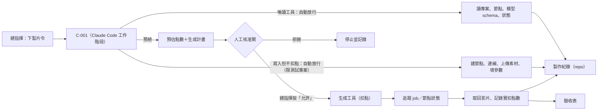

# 《C-001｜LibTV MCP／Skill 實際對接報告 V1.0》

- 回覆令號：C-001-ORDER-012｜LibTV 自動駕馭實測令（發令：Shen｜總指揮，2026/10/23）
- 執行：C-001｜AI 系統開發官
- 執行時間：2026-10-22 19:05–19:07 UTC（＝台北 2026-10-23 03:05–03:07）
- 原始紀錄：[`紀錄/連線嘗試紀錄.md`](紀錄/連線嘗試紀錄.md)

> **驗收結果：未達成。**
> 本輪**沒有完成任何一次對 LibTV 的成功工具呼叫**。MCP 與 Skill 兩條路線的每一個請求，都在本執行環境的出口就被網路政策擋下，**請求沒有到達 LibTV 伺服器**，所以沒有取得任何 LibTV 的回應。
> 這是**執行環境的限制**，不是 LibTV 拒絕，也不能據此推論平台不支援。本報告不把任何模擬結果算成連線成功。
> 解法：由總指揮在 claude.ai 完成一次官方 OAuth 授權（§6）。完成後新開工作階段，第一階段約 15 分鐘可以跑完，全程不扣點。

---

## 1. 實際連線結果及錯誤紀錄

### 1.1 第一階段六項

| # | 指定動作 | 結果 | 原因 |
|---|---|---|---|
| 1 | 檢查 LibTV MCP 是否可連接 | **失敗** | `mcp.liblib.tv:443` 被本環境出口 Proxy 拒絕（CONNECT 回 403，紀錄類型 `connect_rejected`） |
| 2 | 確認 OAuth 授權方式 | **未能實測**；文件層面已確認 | 連 OAuth metadata 端點也被擋。官方文件：標準 MCP OAuth，用戶端依伺服器 metadata 自行註冊，每人用自己的 LibTV 帳號授權（E2） |
| 3 | 列出 MCP 可用工具與權限 | **失敗** | 未連上，拿不到工具清單 |
| 4 | 讀取帳號可存取的專案及節點 | **失敗** | 同上 |
| 5 | 唯讀查詢節點 `v-p4tvutpb69y5` | **失敗** | 同上 |
| 6 | 記錄成功、失敗、權限不足原因 | **完成** | 見 §1.2 |

### 1.2 實際發出的請求與回應（節錄，完整見紀錄檔）

| 時間（UTC） | 請求 | 回應 | 判讀 |
|---|---|---|---|
| 19:06:26 | `GET https://mcp.liblib.tv/mcp`（不帶憑證） | `Tunnel connection failed: 403 Forbidden` | 環境 Proxy 拒絕，未到達 LibTV |
| 19:06:26 | `GET https://mcp.liblib.tv/.well-known/oauth-authorization-server` 等 3 個 OAuth metadata 端點 | 同上 | 同上 |
| 19:06:27 | `https://im.liblib.tv/openapi/...`（Skill／OpenAPI 端點） | `CONNECT tunnel failed, response 403` | 同上 |
| 19:06:27–28 | `www.libtv.com`、`www.liblib.tv`、`libtv-res.liblib.art` | 同上 | 同上 |
| 19:06:28 | 官方 Skill 腳本 `query_session.py` | `错误：请设置 LIBTV_ACCESS_KEY 环境变量` | 腳本在發出網路請求前就結束；依本令不得索取 Token，故未設定 |

**環境 Proxy 自身的拒絕紀錄**（這是「被我方環境擋下」的直接證據）：

```
2026-10-22T19:06:26.658Z connect_rejected mcp.liblib.tv:443
2026-10-22T19:06:27.688Z connect_rejected im.liblib.tv:443
2026-10-22T19:06:27.936Z connect_rejected www.libtv.com:443
2026-10-22T19:06:28.188Z connect_rejected www.liblib.tv:443
2026-10-22T19:06:28.483Z connect_rejected libtv-res.liblib.art:443
```

### 1.3 其他已檢查的連接途徑

| 途徑 | 結果 |
|---|---|
| 本工作階段已載入的連接器 | 只有 Google Drive，**沒有 LibTV** |
| claude.ai 連接器目錄 | 搜尋 libtv、liblib、seedance、影片生成：**目錄中沒有 LibTV**，必須以「自訂連接器」加入 |
| 總指揮其他在線的 Claude 工作階段或電腦 | 無（沒有可轉交執行的本機工作階段） |
| 環境變數中的 LibTV 憑證 | 無（依本令也不索取） |

---

## 2. 可用工具與功能對照表

本輪拿不到實際工具清單，下表**全部是文件宣稱**，「實際操作」欄一律為未測。工具名稱以官方技能文字中出現的為準，實際名稱以連線後的 schema 為準。

| 測試 | 驗證項目 | 文件宣稱（來源） | 實際操作 |
|---|---|---|---|
| T01 | 建立專案或節點 | MCP：建立節點、連線、分組（官方技能，E3）；Skill：`create_session` 會綁定或建立專案，`change_project` 換新專案（E2） | 未測 |
| T02 | 指定影片模型 | MCP：讀取即時模型名稱與 schema 後指定（E3）；Skill：**無模型參數**，只能寫在自然語言裡（E2） | 未測 |
| T03 | 秒數、比例、解析度 | MCP：放在參數欄位（E3）；Skill：無結構化參數（E2） | 未測 |
| T04 | 中文 Rap 提示詞與音訊模式 | MCP：提示詞欄位；可上傳 WAV；原生音訊開關（E3）；Skill：不能上傳音訊（E2） | 未測 |
| T05 | 生成前查詢預估點數 | MCP：「virtual generation plan」「read-only preflight」（E3），是否回傳點數**文件未寫** | 未測 |
| T06 | 追蹤任務狀態與錯誤 | MCP：job／run ID、讀取節點狀態、逾時不重送（E3）；Skill：輪詢訊息，**無任務 ID**（E2） | 未測 |
| T07 | 取得已生成影片 | MCP：讀取節點輸出網址（E3）；Skill：`download_results.py` 從訊息抓網址（E2） | 未測 |
| T08 | 保存及重用原創工作流 | MCP：讀專案快照、節點與時間軸（E3）；網頁「我的工具箱」（第三方，E4） | 未測 |

證據等級：E2 官方原始碼、E3 官方技能文件、E4 第三方。

---

## 3. 現有影片節點讀取結果

| 項目 | 結果 |
|---|---|
| 節點 `v-p4tvutpb69y5` | **未讀取到**（MCP 未連上） |
| 專案 `f91644ef7f604ff79fd47a9272a75ff3`（space `12656113`） | 未讀取到 |

### 3.1 總指揮人工實測（已收錄，標為「總指揮實測」，本方未能獨立核對）

| 項目 | 數值 | 對前版的影響 |
|---|---|---|
| 模型 | Seedance 2.0 Mini | — |
| 規格 | 5 秒、9:16、480P | — |
| 原生音訊 | 開啟 | 屬於 V1.1 定義的 **R2 路徑**（模型自己生聲音與嘴型），**不是**用我方音訊驅動 |
| 結果 | 生成成功 | 證明這組設定可以出片；**嘴型與中文 Rap 品質尚未驗收** |
| 影片點數 | **40 點** | 每秒 **8 點**（480P）。前版暫估約 17 點／秒是 720P 的第三方數字，兩者解析度不同，不能直接比較 |
| Agent 報告總消耗 | 41 點 | 比影片多 **1 點**，推定是 Agent 對話本身的計費，**原因待查** |
| 網址參數 `guideSource=skill` | — | 推定這次是透過 Skill／Agent 入口建立的專案（待連線後核對） |

**由此更新的成本暫估**（仍為暫估）：5 秒 480P 一次 ≈ 40–41 點；以成本係數 k = 4 估，每 5 秒成片約 160 點。

---

## 4. 已通過與未通過的測試項目

| 測試 | 結果 | 說明 |
|---|---|---|
| 第一階段：連線 | **未通過** | 環境網路政策阻擋 |
| 第一階段：OAuth | **未測** | 需總指揮授權（§6） |
| 第一階段：工具清單 | 未測 | 依賴連線 |
| 第一階段：讀節點 | 未測 | 依賴連線 |
| T01–T08 | **全部未執行** | 依令「第一階段成功後」才做 |
| 本方獨立核對總指揮的 40 點 | 未通過 | 讀不到節點 |

---

## 5. 後續最小可行自動化架構



### 5.1 三道安全機制（不依賴平台是否提供報價）

| 層 | 機制 | 作用 |
|---|---|---|
| 1. 工具權限 | 連線取得工具清單後，在 Claude Code 權限設定中：唯讀工具設為允許；**所有可能扣點的工具（生成、重試、購買）設為「每次詢問」**；刪除類工具設為拒絕 | 即使 AI 判斷錯誤，扣點動作也一定停在總指揮面前 |
| 2. 預檢 | 每次生成前先呼叫預檢或讀取節點標價；**若平台不回傳點數**，改用我方價目表（目前：Seedance 2.0 Mini 5 秒 480P＝40 點，總指揮實測）並註明「我方估價」 | 核准時看得到金額 |
| 3. 帳戶硬上限 | 實驗帳號只保留小額點數，不綁自動儲值 | 最壞情況的損失上限 |

另外兩條操作規則：輪詢逾時**不重送**，先讀節點狀態；**正式專案只讀不寫**，所有寫入只在新建的測試專案進行。

權限設定草稿（連線後依實際工具名稱定稿，`<伺服器名>` 為連接器在工作階段中的名稱）：

```json
{
  "permissions": {
    "ask": ["mcp__<伺服器名>"],
    "allow": ["mcp__<伺服器名>__<唯讀工具名>"]
  }
}
```

先把整個伺服器設為「詢問」，再逐一把確認過的唯讀工具改為允許，避免漏掉新增的扣點工具。

---

## 6. 是否需要總指揮進行官方 OAuth 授權

**需要。** MCP 用的是 OAuth，必須由帳號主人在瀏覽器登入 LibTV 並按同意。這一步 AI 不能代做，也不需要總指揮提供任何密碼、Cookie 或 Token。

### 推薦做法 A｜claude.ai 自訂連接器（約 5 分鐘）

1. 打開 <https://claude.ai/customize/connectors>，選「新增自訂連接器」。
2. 名稱填 `LibTV`，網址填 `https://mcp.liblib.tv/mcp`。
3. 按「連接」，在跳出的 LibTV 頁面用**測試用帳號**登入並同意授權。
4. **新開一個 Claude Code 工作階段**（連接器只在工作階段開始時載入），在該工作階段的連接器設定中確認 LibTV 已啟用。
5. 在新工作階段下令：「執行 ORDER-012 第一階段」。

推定：連接器的流量走 Anthropic 的連接器通道，**不受本容器的網路政策限制**；這點在第一次連上時就能確認。
風險：LibTV 官方只保證 Codex 用戶端。若 LibTV 的 OAuth 不接受 claude.ai 註冊，第 3 步會報錯，請截圖錯誤畫面，改用 B。

### 備案 B｜總指揮電腦上的官方路徑

- **Codex（官方唯一保證）**：`codex plugin marketplace add https://github.com/liblib-ai/marketplace.git --ref main` → `codex plugin add libtv@libtv` → 新任務中完成 LibTV 登入。
- **Claude Code 本機**：`claude mcp add --transport http libtv https://mcp.liblib.tv/mcp` → 在 Claude Code 輸入 `/mcp` → 選 libtv 完成登入。

### 備案 C｜Skill／OpenAPI

需要 Access Key，屬於機密。若總指揮決定採用，請**自行**把它設定在雲端環境的 secret（環境變數 `LIBTV_ACCESS_KEY`），並在環境 Network access 放行 `im.liblib.tv`、`libtv-res.liblib.art`；**不要貼在對話或 repo**。依本令，我不主動索取。Skill 路線無法指定模型、秒數、解析度，也不能上傳音訊，只適合當比較組。

---

## 7. 下一步建議及預估成本

| 順序 | 動作 | 執行者 | 點數 | 時間 |
|---|---|---|---|---|
| 1 | 完成 §6-A 授權並新開工作階段 | 總指揮 | 0 | 5 分鐘 |
| 2 | 第一階段：列工具、讀專案、讀節點 `v-p4tvutpb69y5`、核對 40 點 | C-001 | 0 | 15 分鐘 |
| 3 | 依工具清單定稿權限設定（§5.1） | C-001 提案，總指揮確認 | 0 | 15 分鐘 |
| 4 | 第二階段 T01–T08：在**新建測試專案**建節點、設模型與參數、上傳 MVP 音訊、預檢；**不生成** | C-001 | 0（預期；每步前後讀餘額確認） | 1 小時 |
| 5 | （另案核准）第一次自動化付費生成：同設定 5 秒 480P，R2 原生音訊 | 核准後由 C-001 發起、總指揮按允許 | 約 40 點 | 10 分鐘 |
| 6 | （另案核准）R1 音訊驅動對嘴測試（若 schema 支援） | 同上 | 約 40–80 點（暫估） | 30 分鐘 |

第 1–4 步全部不扣點。第 5–6 步合計約 **120 點以內**（暫估），需另案核准。
